## Problem Statement

- As User, I want when i type start type `{{` gui show list of environment variable and available mock seeder (e g: `{{mock.address.full}}`).  So that, i able to select the available mock seeder and environment variable without opening `VariableManage` config at `Header`.

## Acceptance Criteria

- When user start type `{{` show the simple dialog appear on top of the current cursor typing. Design will be explain using `plantuml`.
- every string that has completed pattern, e g: `{{anyword}}`, show design as follow
    - overlay color with 70% opacity, (color if variable not found is red and green if found)
    - make text become bold
- note: we just resolve **environment* *variable for this task, leave the mock in future
- when user select the variable apply the variable key to the input.
- Apply variable to input at
    - [Body JSON and Multipart form data](D:\personal\apitester-desktop\frontend\src\pages\editor\components\RequestConfig\BodyEditor.tsx)
    - [Query Params](D:\personal\apitester-desktop\frontend\src\pages\editor\components\RequestConfig\ParamsContent.tsx)
    - [Path Variable](D:\personal\apitester-desktop\frontend\src\pages\editor\components\RequestConfig\ParamsContent.tsx)
    - [Header](D:\personal\apitester-desktop\frontend\src\pages\editor\components\RequestConfig\HeadersContent.tsx)
    - [Auth](D:\personal\apitester-desktop\frontend\src\pages\editor\components\RequestConfig\AuthContent.tsx)
- When user *hover *the completed pattern, show tooltip showing the real value of its variable.
- Create new endpoint for search variable based on key at [collection/controller](D:\personal\apitester-desktop\internal\adapter\controller\collection\controller.go), response only list of key.

## Flow

### Design

### Test

**Design Variable**

```plantuml
@startsalt
{+
  "Search Variable" | <&magnifying-glass>
  {SI
    * userId
    * username
    * useLanguage
  }
}
@endsalt
```

