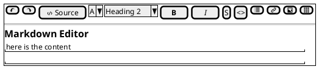

### Problem Statement
- **As User, I want** to have page that can render content of markdown file at the project, there i can also edit the content .  **So that**, i can plan and view the business decision, specific information about project from apitester

## Acceptance Criteria
- content component render syntax markdown directly, follow this rules [[Markdown Basic Syntax]] [[Markdown advance syntax]]
- when user type specific syntax markdown at editor content, immediately render it example. for instance;
	- \*Bold me\* -> **Bold Me**
- User can also click the specific button icon at toolbar for shortcut of manually typing the syntax, see the page Design.
- User can block the specific word or paragraph then apply transformation from toolbar.
- toolbar position is absolute when user scrolling. the toolbar is place at Header so it match the `RequestHeader`, `TestScenarioHeader`, `AutomationHeader`
## Flow

**Editing content**
- User type anything.
- debounce for 500ms then,
- send to new socket `document:content:edit` with payload
```json
{
   "content": "Test",
   "startPos": 12,
   "lenght": 10
}
```

note: do not re-fetch content when new socket event sent from action editing. Only refetch when event `document:refresh` with payload true is triggered.
### Design

**Editor page**




