# File: wiki/index.md

# Wiki Index

This index lists the maintained knowledge pages for the API Tester codebase. Repository-backed usecases receive `*bbolt.DB` and create typed repositories locally with `db.NewRepository`; `shared/api/default.go` does not centralize repository construction.

## Patterns

### Backend

- [[patterns/backend/index]] - Backend composition and registration pattern pages.
- [[patterns/backend/example-of-api-and-socket-registration]] - Shared dependency initialization and HTTP/socket module registration.

### Controller

- [[patterns/controller/index]] - Controller pattern pages.
- [[patterns/controller/example-of-module-controller]] - Source summary and workflow for creating an HTTP controller module.
- [[patterns/controller/controller-base-structure]] - Shared controller embedding and narrow usecase interfaces.
- [[patterns/controller/controller-request-handling]] - Request binding, validation, context propagation, and responses.
- [[patterns/controller/controller-routing-and-middleware]] - Route grouping, authentication, authorization, and idempotency.

### Socket

- [[patterns/socket/index]] - Socket pattern pages.
- [[patterns/socket/example-of-module-socket]] - Source summary and workflow for creating a socket module.
- [[patterns/socket/socket-base-composition]] - Embedding shared socket dependencies in a feature module.
- [[patterns/socket/socket-room-lifecycle]] - Joining, leaving, caching, and notifying room members.
- [[patterns/socket/socket-event-broadcasting]] - Broadcasting messages and tracking acknowledgements.
- [[patterns/socket/socket-error-handling]] - Validating socket input and mapping errors to clients.

### Usecase

- [[patterns/usecase/index]] - Usecase pattern pages.
- [[patterns/usecase/new-usecase-workflow]] - Workflow and checklist for creating a new Go usecase, based on the collection service.
- [[patterns/usecase/usecase-rules-of-engagement]] - (Must-follow rule for usecase logic) Coding constraints for error wrapping (with localerror exceptions), context spacing, 4-line helper extraction (except simple branching), parameter bounds, struct encapsulation (setters/getters), and context propagation.

### Frontend

- [[patterns/frontend/index]] - Frontend pattern pages.
- [[patterns/frontend/api-service-and-query-hook-wiring]] - Typed Axios services and TanStack Query hooks for feature API wiring.
- [[patterns/frontend/socket-io-service-and-hook-wiring]] - Socket.IO connection, event, response, cleanup, and cache wiring.
- [[patterns/frontend/create-new-tabs-kind]] - Workflow for adding a new editor tab kind and its Redux slice.

## Decisions

- [[decisions/index]] - Technical decisions recorded for the codebase.
- [[decisions/desktop-production-build]] - Production packaging pipeline for Windows service backend, portable Electron frontend, and Inno Setup installer.
- [[decisions/file-backed-restrequest-editing]] - Filesystem-backed request editing with serialized direct writes and no current version check.
- [[decisions/collection-history-for-restrequest-mutations]] - `collection_history` audit records preserving old and new content hashes for successful mutations.
- [[decisions/debounced-request-config-mutations]] - Frontend debounce, optimistic cache, version coordination, and serialized request configuration mutations.
- [[decisions/usecase-rules-of-engagement]] - Standardized usecase method complexity, error reporting, struct encapsulation, and execution context limits.
- [[decisions/google-drive-service-account-sync]] - Architecture, security permissions, and step-by-step setup for syncing Playwright test reports to Google Drive.
- [[decisions/playwright-cumulative-test-caching]] - Cumulative test scenario caching pipeline to prevent RAM exhaustion during testing and retain comprehensive reports.

## Concepts


- [[concepts/index]] - Reusable domain and codebase concepts.
- [[concepts/base-url-lifecycle]] - End-to-end lifecycle, variable categorization, template resolution, and dispatch mechanism of baseUrl.
- [[concepts/path-variable-lifecycle]] - How `:word` endpoint segments become path variables, are synced, edited, and resolved at send time.
- [[concepts/backend/file-backed-editor-sync]] - Target design for filesystem-backed editor coordination, versioning, hashing, and conflict handling.
- [[concepts/backend/postman-prerequest-script-dto]] - Postman pre-request script data transfer object specification across collection schema and sandbox runtime.
- [[concepts/backend/usecase-design-rules]] - Reusable structural standards for usecase orchestration, error boundaries, parameter encapsulation, and execution lifecycles.
- [[concepts/frontend/redux-toolkit]] - Modern Redux Toolkit structure, state boundaries, and data flow.
- [[concepts/frontend/playwright-component-coverage]] - Black-box E2E limitations, static test-to-component mapping, and automated resolution alternatives.

## Tasks

- [[tasks/backlog]] - Living checklist of pending, in-progress, and done tasks for the project.

# File: wiki/log.md

# Wiki Log

- 2026-09-04: Added [[new-usecase-workflow]] based on `internal/service/collection/usecase.go` and `shared/api/default.go`.
- 2026-09-04: Ingested `resource/document/raw/patterns/backend/Example of Module Socket.md`; added [[example-of-module-socket]], [[socket-base-composition]], [[socket-room-lifecycle]], [[socket-event-broadcasting]], and [[socket-error-handling]], and updated the wiki index.
- 2026-09-04: Ingested `resource/document/raw/patterns/backend/Example of Module Controller.md`; added [[example-of-module-controller]], [[controller-base-structure]], [[controller-request-handling]], and [[controller-routing-and-middleware]], and updated the wiki index.
- 2026-09-04: Reorganized wiki pages into `patterns/controller`, `patterns/socket`, and `patterns/usecase`; added category indexes for `patterns`, `decisions`, and `concepts`, qualified wiki-links with paths, and updated `AGENTS.md` and the root index.
- 2026-09-04: Updated [[patterns/usecase/new-usecase-workflow]] to document repository injection after the collection usecase constructor was refactored.
- 2026-09-04: Added the controller placement rule: new controller files belong under `internal/adapter/controller/<module>`.
- 2026-09-07: Added [[patterns/frontend/create-new-tabs-kind]] and [[patterns/frontend/index]] documenting the editor tab-kind workflow and a simple Redux slice example.
- 2026-09-08: Ingested `resource/document/raw/concepts/frontend/Redux Tool Kit.md`; added [[concepts/frontend/redux-toolkit]], updated frontend and concept indexes, and recorded the frontend Redux state reset as historical context.
- 2026-09-08: Updated controller, usecase, and socket patterns to require repository-backed usecase constructors to accept `*bbolt.DB` and create typed repositories with `db.NewRepository` instead of using `shared/api/default.go` `initRepositories`.
- 2026-09-08: Ingested `resource/document/raw/concepts/backend/IDE Like File Editor Design.md`; added the file-backed editor synchronization concept and the `restrequest` request-editing decision, and updated wiki indexes.
- 2026-09-08: Added [[decisions/collection-history-for-restrequest-mutations]] proposing the `collection_history` entity for old/new values, hashes, and affected JSON lines on successful backend `restrequest` mutations; no application code changed.
- 2026-09-08: Implemented `collection_history` recording in the backend `restrequest` URL and header mutation endpoints, including structured old/new values, hashes, and committed JSON line numbers.
- 2026-09-08: Extended the backend `restrequest` API with optimistic, history-backed mutations for method, query parameters, JSON and multipart form-data bodies, and post-request scripts; updated the file-backed editing decision.
- 2026-09-08: Added version-checked request deletion with nested collection removal and history recording.
- 2026-09-08: Extended the REST request response with query, body, and post-request script data for the local frontend editor.
- 2026-09-09: Ingested `resource/document/raw/patterns/frontend/Pattern of wiring.md`; added [[patterns/frontend/api-service-and-query-hook-wiring]] and updated the frontend indexes.
- 2026-09-09: Applied [[patterns/frontend/api-service-and-query-hook-wiring]] to request configuration; added feature-local Axios services and TanStack Query hooks, configured the application QueryClientProvider, and preserved debounced optimistic editor updates.
- 2026-09-09: Added the collection pre-request script retrieval endpoint, reading the collection-level `prerequest` event and joining its script lines.
- 2026-09-09: Added optimistic collection pre-request script updates with create-if-missing behavior, plus frontend service, hook, and collection-manager save wiring.
- 2026-09-09: Extracted collection pre-request script editing and execution into the standalone `ScriptManage` component.
- 2026-09-10: Refactored request configuration to wire feature-local Axios services through a hook directly into request header/config components; removed the request endpoint proxy context and preserved shared optimistic, debounced, versioned cache updates.
- 2026-09-10: Added [[decisions/debounced-request-config-mutations]] documenting per-field debouncing, serialized request mutation coordination, optimistic cache updates, version handling, and deletion ordering.
- 2026-09-10: Expanded [[decisions/debounced-request-config-mutations]] with an annotated TypeScript example explaining the coordinator, debounce timer, optimistic cache update, queued API call, and version token.
- 2026-09-10: Ingested `resource/document/raw/patterns/backend/Example of API and Socket Registration.md`; added [[patterns/backend/example-of-api-and-socket-registration]] and [[patterns/backend/index]], and updated the wiki index.
- 2026-09-11: Added [[patterns/frontend/socket-io-service-and-hook-wiring]] documenting frontend Socket.IO connection, event, response, cleanup, and cache wiring; marked the removed debounce coordinator decision as superseded and updated wiki indexes.
- 2026-09-12: Temporarily removed backend `baseVersion` checks and atomic collection-file replacement in favor of serialized direct writes; retained response content hashes and `CollectionHistory.old_hash`/`new_hash`, and updated affected decisions and patterns.
- 2026-09-14: Added the `SaveResponse` usecase and `request:save:response` socket event for appending responses to `DocsContent.Item.Response` with collection history tracking.
- 2026-09-14: Wired `request:save:response` socket event to the editor ResponseView Save button, adding `saveResponse` to `RequestConfigServices` and `useRequestConfig` hook, and displaying saved example responses in tabs.
- 2026-09-14: Added `SavePostRequestScript` usecase and `request:save:script` socket event for saving post request scripts to `DocsContent.Item.Event` with `listen="test"` and `script.type="text/javascript"`.
- 2026-09-14: Wired `request:save:script` socket event to `ScriptEditor.tsx` with a 400ms debounce via `useDebouncedCallback`, adding `savePostRequestScript` to `RequestConfigServices` and `saveScript` to `useRequestConfig`.
- 2026-09-14: Implemented global dark mode support across frontend: reordered :root and .dark in index.css to fix cascade override, wired ThemeProvider with dynamic toggle, and updated all layout and page components with semantic tokens and Sandpack dark theme integration.
- 2026-09-14: Preserved HTTP method badge colors (GET/POST/PUT/PATCH/DELETE) and white text/icons on SelectTrigger in RequestHeader for both light and dark modes.
- 2026-09-14: Configured dark theme default on SandpackScriptEditor and added CodeMirror dark theme extensions and global styles for autocomplete popups and tooltips.
- 2026-09-15: Ingested `resource/document/raw/patterns/backend/Usecase Rule of engagement.md`; added [[patterns/usecase/usecase-rules-of-engagement]], [[decisions/usecase-rules-of-engagement]], and [[concepts/backend/usecase-design-rules]], updated [[patterns/usecase/new-usecase-workflow]], and recorded mandatory usecase logic rules in wiki indexes.
- 2026-09-16: Updated [[patterns/usecase/usecase-rules-of-engagement]] to include exceptions for localerror in Rule 1 and simple branching in Rule 3 based on raw source changes.
- 2026-09-21: Added UpdateTree usecase and PUT /restrequest/tree/:collectionId endpoint for reordering and pruning collection items while preserving item metadata and recording collection history; updated [[decisions/file-backed-restrequest-editing]].
- 2026-09-21: Added [[concepts/backend/postman-prerequest-script-dto]] documenting Postman pre-request script data transfer objects across the collection schema specification (v2.1.0 JSON) and sandbox execution runtime (`pm.*` context), along with local Go DTO mappings.
- 2026-09-21: Added [[decisions/desktop-production-build]] documenting the complete production build and packaging pipeline for Apitester Desktop (Windows service backend compilation, portable Electron frontend packaging, and Inno Setup installer generation).
- 2026-09-23: Added [[concepts/base-url-lifecycle]] documenting the end-to-end lifecycle, regex categorization, header UI selection, variable template substitution, pre-request script mutation, and CORS proxy routing of baseUrl; updated wiki indexes.
- 2026-09-23: Enforced rule that frontend baseUrl resolution occurs strictly for variables with category = 'BASE_URL'; updated backend PrepareCreate and PrepareVariables to automatically assign category = 'BASE_URL' to matching variables via regex upon collection creation; updated [[concepts/base-url-lifecycle]].
- 2026-09-30: Set up task management in the wiki; created [[tasks/backlog]] as the single living task checklist; added a `## Task Management` section to `AGENTS.md` with rules and format for tracking tasks; added `resource/document/wiki/tasks/` to the folder structure; updated wiki index.
- 2026-09-30: Expanded `## Task Management` in `AGENTS.md`; tasks are now user-authored in `resource/document/raw/tasks/`; documented task source template (acceptance criteria, flow, problem statement, metadata); defined agent behavior for executing tasks, updating status manually, and backlog format.
- 2026-09-30: Added `isSelected` field to `CollectionVar` (Go and TS DTOs); updated `PrepareVariables` to default `isSelected=true` on the first BASE_URL found; updated `useSendRequest` to resolve `baseUrl` from request get with fallback to `isSelected` variable; added `PUT /collection/select-base-url` endpoint to persist selected baseUrl on the fly; disabled header baseUrl dropdown while update is in flight; updated [[concepts/base-url-lifecycle]].
- 2026-10-01: Set up Ponytail in the project: added workspace rule `.agents/rules/ponytail.md`, six agent skills in `.agents/skills/`, OpenCode plugin and command configurations in `.opencode/`, and workflow aliases in `.agents/workflows/`.
- 2026-10-01: Updated PrepareVariables in collection usecase to synchronize the selected BASE_URL key into RequestUrl.host (as {{key}}) and replace old host in RequestUrl.raw across all requests; updated SelectBaseURL to trigger PrepareVariables; updated [[concepts/base-url-lifecycle]].
- 2026-10-01: Added query parameter extraction to UpdateURL in restrequest usecase: resolves all query parameters from Request.URL.Raw into RequestURL.Query and removes old RequestURL.Query.
- 2026-10-01: Refactored UpdateURL and UpdateHeaders in restrequest usecase to use u.update; updated UpdateQuery to synchronize new query parameters back into RequestUrl.raw after '?'.
- 2026-10-01: Refactored SaveResponse, Delete, and UpdateTree in restrequest usecase to match declarative u.update / u.updateTree pattern; moved all private helpers and functions to bottom of usecase.go; added Delete usecase unit tests.
- 2026-10-02: Removed collectionId from frontend editorTabsSlice Redux state, moved findSelectedCollection to shared/base/port.go (FindSelectedCollection and Port.LoadCollection fallback), and updated backend socket requestIDs and restrequest/tree endpoints to automatically resolve the selected active collection when collectionId is omitted.
- 2026-10-02: Moved task `enhance-save-example` (Enhancing current save example feature) to In Progress in backlog.
- 2026-10-02: Completed task `enhance-save-example`: enhanced backend `SaveResponse` usecase and socket adapter to support creating, updating, and deleting example responses; added `(+)` create example and `<X>` remove buttons to `ResponseView`, added HTTP status code selector and editable response body in Sandpack, wired editing of example `originalRequest` across `RequestConfig`, added example mode warning badge with 1-click switch in `RequestConfig`, and disabled sending requests while an example is selected in `RequestHeader`; moved task to Done in `backlog.md`.
- 2026-10-02: Moved task `wiring-endpoint-update-tree` (Wire the endpoint update tree with SidebarLayout Drag and Drop request) to In Progress in backlog.
- 2026-10-02: Completed task `wiring-endpoint-update-tree`: added `updateTree` service method and DTOs in `frontend/src/layout/services/collection.ts`, added `updateTreeMutation` and `isUpdatingTree` in `frontend/src/layout/hooks/useCollection.ts`, implemented recursive tree reordering and DTO mapper in `frontend/src/layout/view/SidebarLayout.tsx` for `handleDragEnd`, wired optimistic TanStack Query cache updates (`queryClient.setQueryData`), wired `PUT /restrequest/tree/:collectionId` endpoint call, added dark background spinning loader overlay over the collection tree while updates are saving, and moved task to Done in `backlog.md`.
- 2026-10-03: Executed ponytail-audit cleanup: pruned 31 unused npm packages and 75 node_modules packages from frontend, deleted 27 dead Shadcn UI components, purged dead common component boilerplate chain and unused configs/types, removed 5 unused Go modules (gorm, mysql, exp, sentry), deleted unused pkg/environment and pkg/logger/logger.go, cleaned pkg/localerror and pkg/mapper, and deduplicated socket room connection handling.
- 2026-10-06: Moved task `integrate-path-variable` to In Progress in backlog.
- 2026-10-06: Completed task `integrate-path-variable`: added `PathVariable` and `RequestURL.Variable` with `ResolvePath`/`SyncVariables` helpers (collection dto); `UpdateURL` now syncs `:word` path segments into `url.variable` (dedupe, keep values, drop orphans); added `EditPathVariable` usecase, `updateReq.Validate` hook and `request:edit:path:variable` socket event; Params tab shows titled Query Params and Path Variables tables (values editable only); `useSendRequest` resolves `:key` from `url.variable`; added usecase test; added [[concepts/path-variable-lifecycle]]; moved task to Done in `backlog.md`.
- 2026-10-06: Added debounce (300ms via useDebouncedCallback) with immediate blur/unmount flush to Path Variable value editing in ParamsContent.
- 2026-10-07: Refactored file watcher to shared base Port (*watcher.FileWatcher singleton), implemented NotifyChanges checksum comparison against latest CollectionHistory with socket broadcast, moved NotifyWatcher to Port and called after all collection-mutating methods in collection and restrequest usecases, and wired NotifyChanges socket listener in frontend CollectionManage to trigger reactive collection refresh.
- 2026-10-07: Standardized socket architecture: removed direct cio.Emit from collection usecase in favor of SetOnRefresh callback port; created dedicated collection socket adapter (internal/adapter/socket/collection) under "collection" namespace; registered collection socket in cmd/api and cmd/windows; updated frontend socket config and mainSocket to route collection and restrequest to their dedicated namespaces (/collection and /restrequest).
- 2026-10-07: Standardized socket event name to "collection:refresh" across backend CollectionSocket and frontend CollectionServices, removing redundant "NotifyChanges" event.
- 2026-10-07: Moved CollectionServices.onNotifyChanges listener useEffect from CollectionManage to RequestHeader so that collection change notifications and query invalidations are always active regardless of whether the collection manager dialog is open.
- 2026-10-07: Added updateEditorTab reducer to editorTabsSlice, wired restrequest refetch and tabs resync (syncEditorTabs) in RequestHeader's onNotifyChanges useEffect, and dispatched updateEditorTab on method selection.
- 2026-10-08: Moved task `enhance-variable-display` (Enhance Variable Display in Editor) to In Progress in backlog.
- 2026-10-08: Completed task `enhance-variable-display` (Enhance Variable Display in Editor): added `SearchVariables` usecase and `GET /collection/variables/search` endpoint (returning list of keys); added `searchVariables` in `CollectionServices`; created `VariableDialog` component implementing the PlantUML design (search input with icon, scrollable variable list, keyboard and click selection, floating on top of typing cursor); created `VariableInput` component with trigger on typing `{{`, 70% opacity overlay (green if found, red if not found), bold text, and hover tooltip displaying real variable values; created CodeMirror variable extensions (`codeMirrorVariableExtensions.ts`) for Body JSON syntax highlighting, hover tooltips, and auto-complete dialog; applied variable inputs across Body JSON, Multipart form data, Query Params, Path Variables, Headers, and Auth; added backend usecase and controller tests; moved task to Done in `backlog.md`.
- 2026-10-08: Mock data mechanism.md - Implemented Mock Data Mechanism to allow generating and resolving mock data (e.g. mock.firstName) in editor dialogs, inputs, and send request pipeline
- 2026-10-10: Started TASK Setup Playwright testing (moved to In Progress)
- 2026-10-10: Completed TASK Setup Playwright testing (moved to Done)
- 2026-10-10: Moved testing folder from resource/testing to frontend/testing per user request
- 2026-10-11: Configured test runner and report pipeline: added test, test:export, and test:report scripts in frontend/package.json, updated playwright.config.ts to export html and json reports to ./testing/result, updated csv-export.cjs to support nested test suites, and configured all Playwright scenarios to maximize window before test execution for full component visibility.
- 2026-10-11: Added component test coverage reporting: mapped tested components across scenarios, dynamically scanned all 56 project components in frontend/testing/csv-export.cjs, added coverage percentage metrics and detailed component breakdown to report.csv, injected an interactive Component Coverage dashboard into Playwright's html-report/index.html, and generated a standalone coverage.html report.
- 2026-10-11: Added formatted Excel (XLSX) test and coverage report generation to frontend/testing/csv-export.cjs via SheetJS, with structured Summary/KPIs, Test Results, and Component Coverage sheets including column widths, merges, and auto-filters.
- 2026-10-11: Added [[decisions/google-drive-service-account-sync]] documenting Google Drive synchronization for Playwright test reports (report.xlsx), least-privilege security permissions (blank GCP IAM roles, folder-scoped Editor permissions), step-by-step service account setup, and frontend/testing/sync-gdrive.cjs utility wiring; updated wiki indexes.
- 2026-10-11: Verified end-to-end Google Drive synchronization with service account update workflow: configured frontend/testing/gdrive-config.json with target file ID and verified successful live update of report.xlsx in destination folder.
- 2026-10-11: Created Playwright test scenario `frontend/testing/scenario/params_tab.spec.ts` for testing RequestConfig Params tab: verifies adding multiple query parameters, toggling query param active/disabled status, deleting query params, and validates live synchronization with the RequestHeader endpoint path. Added component coverage mappings to `frontend/testing/csv-export.cjs`.
- 2026-10-11: Implemented Playwright cumulative test caching (`test-cache-manager.cjs`, `cache-reporter.cjs`, `csv-export.cjs`): caches test scenarios incrementally in `test-cache.json` across separate test runs to prevent computer RAM exhaustion, dynamically discovers scenario files, generates cumulative merged `report.json`, `report.xlsx`, `report.csv`, and `coverage.html`, updates injected dashboard in `html-report/index.html`, and added `test:cache:clear` script in `frontend/package.json`; added [[decisions/playwright-cumulative-test-caching]].
- 2026-10-11: Added [[concepts/frontend/playwright-component-coverage]] documenting why Playwright E2E tests cannot natively resolve React components, detailing the dual-tier annotation/static baseline mapping in `frontend/testing/csv-export.cjs`, and analyzing automated alternatives (V8/Istanbul code coverage, Playwright Component Testing, DOM data attributes) for future team review; updated wiki indexes.
- 2026-10-12: Created Playwright test scenario `frontend/testing/scenario/headers_tab.spec.ts` for testing variable inputs in Headers tab: validates triggering VariableDialog dropdown via `{{`, selecting desired variables from the list, verifying found variables (green badge & value tooltip), not found variables (red badge & 'Variable not found' tooltip), mock variables (green badge & 'calculate during send request' tooltip), and header table row persistence. Updated scenario baseline mapping in `frontend/testing/csv-export.cjs`.
- 2026-10-12: Created Playwright test scenario `frontend/testing/scenario/header_content.spec.ts` for "testing in header content": verifies adding a new header item, toggling header enabled/disabled state, fast typing value at header item, and deleting header item. Confirmed and fixed the fast typing race condition bug in `HeadersContent.tsx` by wrapping rows in `HeaderItemRow` with local state and debounced updates (`useDebouncedCallback`). Updated baseline mapping in `csv-export.cjs`.
- 2026-10-12: Created Playwright test scenario `frontend/testing/scenario/collection_variable.spec.ts` for Collection Manager Manage Variables (`VariableManage.tsx`): verifies switching to Variables tab, adding new variable items via Add button and Enter key, empty key validation prevention, editing variable keys and values with blur-save persistence, and deleting variable items with table row removal. Registered `collection_variable.spec.ts` baseline component mappings in `frontend/testing/csv-export.cjs`.
- 2026-10-12: Added `requestCompletionSource` in `frontend/src/lib/pmCompletions.ts` based on `RestRequestResponse` DTO (`id`, `name`, `method`, `url`, `headers`, `query`, `body`, `auth`, `script`, `responses`, `version`); replaced `resCompletionSource` with `requestCompletionSource` in `frontend/src/layout/components/collectionManager/ScriptManage.tsx`; updated `frontend/src/lib/jsCompletions.ts` to ignore `request` member dot-access chains.
- 2026-10-12: Configured pyragify documentation flattener: installed pyragify globally, added root config.yaml targeting resource/document with output to resource/flatten_result, generated flattened single markdown file at resource/flatten_result/document.md, and documented manual update workflow in README.md.

# File: wiki/concepts/base-url-lifecycle.md

# Base URL Lifecycle

**Summary**: Explains the end-to-end lifecycle and mechanism of `baseUrl` in API Tester, from regex-based backend collection variable categorization to frontend header selection, template resolution, pre-request script mutation, and CORS proxy routing.
**Sources**: `internal/service/collection/usecase.go`, `frontend/src/layout/components/header/RequestHeader.tsx`, `frontend/src/layout/hooks/useSendRequest.ts`
**Last updated**: 2026-09-23

---

The `baseUrl` represents the root endpoint for API requests within a collection. Rather than being a static string, its lifecycle spans backend collection categorization, UI selection and dynamic generation, template variable interpolation, pre-request script sandboxing, and runtime transport resolution.

## 1. Backend Detection & Categorization

In the backend collection service, collection variables are evaluated to detect if they represent a base URL.

- **Pattern Matching**: The collection usecase defines a case-insensitive regular expression:
  ```go
  var baseURLRegex = regexp.MustCompile(`(?i)(base.*url|url.*base)`)
  ```
- **Lifecycle Evaluation**:
  - `PrepareCreate()`: When a collection is created or imported, any variable key matching `baseURLRegex` is assigned `Category = "BASE_URL"` and persisted directly to the collection JSON on disk.
  - `PrepareVariables()`: When a collection is loaded, any variable key matching `baseURLRegex` without an existing category is tagged with `Category = "BASE_URL"`. If no variable has `IsSelected == true`, the first `BASE_URL` found is automatically marked `IsSelected = true`. It also updates `RequestUrl.host` of every request to `` and replaces the old host inside `RequestUrl.raw` with the new host (e.g. `{{oldDev}}/auth/login` => `{{dev}}/auth/login`).
  - `SelectBaseURL()`: Endpoint (`PUT /collection/select-base-url`) to select a base URL by ID, key, or value, updating `isSelected` and persisting the change.
  - `AddVariable()` and `UpdateVariable()`: When a variable is inserted or updated via collection usecases, if `isBaseURLVar(key)` evaluates to `true`, the variable's category is set to `"BASE_URL"`.

## 2. Frontend Header Selection & Provisioning

The frontend editor header manages available base URLs for the active collection:

- **Option Extraction**: `RequestHeader.tsx` reads collection variables and filters for those with `category === "BASE_URL"`, deduplicating unique values into `baseUrlOptions`.
- **Active Selection**: When a request is loaded (or tab changed), `getBaseUrlFromRequest` resolves the base URL directly from the request (e.g. `raw` url with `{{variable}}` or origin). If not specified on the request, it resolves from the collection variable with `isSelected === true`, falling back to `baseUrlOptions[0]`.
- **On-the-fly Selection**: Selecting a base URL in the header dropdown calls the `selectBaseUrl` endpoint in the background, temporarily disabling the dropdown while the change persists.
- **Dynamic Creation**: Users can add a new base URL directly via the dropdown interface. `getNextBaseUrlKey()` sequentially generates keys (`base_url`, `base_url_1`, `base_url_2`, etc.) and invokes `createVariableMutation` followed by `selectBaseUrlMutation` to persist and select the new variable.

## 3. Template Resolution & Enforcement

During request preparation in `RequestHeader.tsx`, variable interpolation replaces Mustache-style tags (`{{...}}`):

- **Category-Enforced Resolution**: In `resolveVariableValue()`, a variable reference is resolved to `selectedBaseUrl` **only if** the matched collection variable has `category === "BASE_URL"`. Variables without this category are treated as standard collection variables.
- **Runtime Variables Synchronization**: All variables with `category === "BASE_URL"` in `effectiveRuntimeVariables` and `useSendRequest.ts` `varsObj` are dynamically bound to the current `selectedBaseUrl`.
- **Endpoint Prefix Extraction**: `formatEndpoint()` only strips leading variable tags from the endpoint URL if the variable belongs to `category === "BASE_URL"`, preserving URL path variables (e.g. `/users/{{userId}}`).

## 4. Pre-Request Script Sandboxing & Mutation

Before an HTTP request is dispatched, pre-request scripts have the ability to inspect and mutate the base URL:

- **Sandbox Injection**: In `useSendRequest.ts`, `varsObj["BASE_URL"] = config.baseUrl` exposes the base URL to the execution sandbox.
- **Script Mutation**: If a pre-request script mutates `BASE_URL` (e.g. `pm.environment.set("BASE_URL", "https://api.staging.example.com")`), the request runner overrides `config.baseUrl` with `String(preOutput.mutations["BASE_URL"])`.
- **Origin Re-parsing**: If the script rewrites `request.url` to an absolute URL (`https://...`), `applyMutatedRequestToSendConfig()` parses the URL using `new URL(rawUrl)` to split and update `baseUrl = parsed.origin` and `endpoint = parsed.pathname + ...`.

## 5. Network Dispatch & CORS Proxying

The final HTTP transmission in `sendApiRequest()` adapts depending on the runtime target:

- **Electron Runtime**: When running inside desktop Electron (`window.electronAPI`), requests bypass browser security models and are dispatched directly through Axios with `baseURL` and `url`.
- **Browser Dev Mode**: Outside Electron during local development, cross-origin requests are routed via a Vite proxy path:
  ```ts
  baseURL = ""
  url = `/__cors_proxy__?target=${encodeURIComponent(fullTarget)}`
  ```
- **Raw Request Protocol Preview**: `generateRawRequest()` parses `new URL(request.baseUrl).host` to construct the canonical HTTP/1.1 wire lines for debugging (`METHOD baseUrl/endpoint HTTP/1.1\nHost: ...`).

## Related pages

- [[concepts/backend/postman-prerequest-script-dto]]
- [[patterns/frontend/api-service-and-query-hook-wiring]]
- [[decisions/debounced-request-config-mutations]]
- [[patterns/usecase/new-usecase-workflow]]

# File: wiki/concepts/index.md

# Concepts

**Summary**: Index of reusable domain and codebase concepts.
**Sources**: `resource/document/raw/concepts/frontend/Redux Tool Kit.md`, `resource/document/raw/concepts/backend/IDE Like File Editor Design.md`, `resource/document/raw/patterns/backend/Usecase Rule of engagement.md`
**Last updated**: 2026-09-23

---

### Frontend

- [[concepts/frontend/redux-toolkit]] - Modern Redux Toolkit structure, state boundaries, and data flow.
- [[concepts/frontend/playwright-component-coverage]] - Black-box E2E limitations, static test-to-component mapping, and automated resolution alternatives.

### Backend

- [[concepts/backend/file-backed-editor-sync]] - Filesystem-backed editor coordination, versioning, hashing, and conflict handling.
- [[concepts/backend/postman-prerequest-script-dto]] - Postman pre-request script data transfer object specification across collection schema and sandbox runtime.
- [[concepts/backend/usecase-design-rules]] - Reusable structural standards for usecase orchestration, error boundaries, parameter encapsulation, and execution lifecycles.

### Runtime & Architecture

- [[concepts/base-url-lifecycle]] - End-to-end lifecycle, variable categorization, template resolution, and dispatch mechanism of baseUrl.
- [[concepts/path-variable-lifecycle]] - How `:word` endpoint segments become path variables, are synced, edited, and resolved at send time.

## Related pages

- [[index]]

# File: wiki/concepts/path-variable-lifecycle.md

# Path Variable Lifecycle

**Summary**: How `:word` segments typed in the endpoint become path variables, are edited in the Params tab, and are resolved when a request is sent.
**Sources**: `resource/document/raw/tasks/Integrate Path Variable.md`
**Last updated**: 2026-10-06

---

## Data model

Path variables live in `Request.URL.Variable` (`url.variable` in JSON, omitted when empty). Each item is a `PathVariable` with `id`, `key` and `value` (`internal/service/collection/dto.go`). `Request.URL.Path` is rebuilt from `Raw` (host, query and fragment ignored).

## Sync on endpoint change

Socket event `request:update:url` (`UpdateURL`) calls `RequestURL.ResolvePath()` then, inside the update step, `RequestURL.SyncVariables(old.Variable)`:

- every unique path segment matching `^:\w+$` becomes a variable (`/user/:userId` gives key `userId`)
- duplicate keys are collapsed, so two variables can never share a key
- keys still present keep their previous value, orphans are removed, new keys are added
- any `variable` array sent by the client is ignored; the server is the source of truth

## Editing a value

Socket event `request:edit:path:variable` (`EditPathVariable`, payload `key` + `value`) updates the matching item. Unknown keys fail with `Path variable not found` before anything is written (via the new `updateReq.Validate` hook). Keys are read-only in the UI.

## UI

`ParamsContent` shows a **Query Params** table always, and a **Path Variables** table only when `request.url.variable` has items. Only the value column is editable.

## Sending

`useRequestSender` calls `resolvePathVariables` (`useSendRequest.ts`): each `:key` segment is replaced by the variable value (`{{env}}` resolved first, then URL-encoded). Blank values leave `:key` unchanged.

## Known limits

- In example mode the value edit is stored in the example's `originalRequest.url.variable`, but endpoint edits there do not go through `UpdateURL`, so variables are not re-synced.

## Related pages

- [[concepts/base-url-lifecycle]]
- [[decisions/debounced-request-config-mutations]]
- [[tasks/backlog]]

# File: wiki/decisions/collection-history-for-restrequest-mutations.md

# Collection History For Restrequest Mutations

**Summary**: The `collection_history` entity records successful REST request mutations, including the old and new change values, collection file hashes, and the source line affected in the collection JSON file.
**Sources**: `shared/base/port.go`, `internal/service/restrequest/usecase.go`, `internal/service/collection/usecase.go`, `internal/domain/collection.go`, `pkg/db/repository.go`, `resource/document/wiki/decisions/file-backed-restrequest-editing.md`
**Last updated**: 2026-09-12

---

## Decision

The backend now uses a domain entity named `CollectionHistory`, persisted in the `collection_history` bbolt bucket, to provide an append-only audit trail for mutations handled by the backend `restrequest` service.

The history record is created only after the collection file has been written and the collection metadata update has succeeded. Failed reads, missing requests, serialization failures, file-write failures, and metadata-write failures must not create history records. Backend `baseVersion` checks and atomic replacement are currently disabled as described in [[decisions/file-backed-restrequest-editing]].

The first mutation sources are:

- `UpdateURL`
- `UpdateHeaders`

The design should be reusable for future REST request mutation endpoints without coupling history storage to a particular field.

## Proposed Record

Each `collection_history` record should contain:

- A unique history ID and creation timestamp.
- `collection_id` and `request_id` identifying the affected data.
- The mutation operation, such as `update_url` or `update_headers`.
- The changed field or path, such as `request.url` or `request.headers`.
- The old value and new value, stored as JSON-compatible snapshots rather than display-only strings. This preserves structured URL and header changes and supports later inspection.
- `old_hash`, the SHA-256 hash of the collection bytes loaded before the mutation.
- `new_hash`, the SHA-256 hash of the serialized bytes passed to the successful collection write.
- `file_path` identifying the collection file at mutation time.
- `line`, the one-based line in the written collection JSON where the affected request or field is located.

The record should also retain enough path context to disambiguate repeated request names, for example a request ID and a JSON path. The request ID is authoritative; names are descriptive only.

## Hash And Line Semantics

`RecordHistory` retains the SHA-256 byte-level definition independently of optimistic concurrency. `old_hash` identifies the exact content loaded before the mutation, and `new_hash` identifies the serialized content returned by the successful write operation. These hashes remain populated even though the backend no longer compares an incoming `baseVersion`.

Line numbers should be calculated against the exact serialized content written to disk, not the pre-mutation input. Because JSON formatting and array positions can change, the line is an observation of the committed file, not a permanent identity for the request. The request ID and JSON path remain the stable references.

If a precise field line cannot be identified reliably, record the containing request's line and make the scope explicit rather than inventing a line number. This should be treated as a design/test concern before implementation.

## Consistency And Ordering

History creation belongs inside the existing serialized mutation flow. The intended order is:

1. Load the collection and retain its bytes for the old hash.
2. Capture the old field value and old file hash.
3. Apply the requested change and directly write the new collection content.
4. Update collection metadata.
5. Append the `collection_history` record with the committed new hash and line.

The file remains the source of truth for collection content. bbolt stores the audit metadata and does not replace the collection file. Since filesystem writes and bbolt writes cannot share one transaction, implementation must define and test recovery behavior if the final history write fails after the file commit. The preferred initial behavior is to return the history persistence error and expose a reconciliation path rather than silently claim that the audit record exists.

History records must not be updated or deleted through the initial REST request API. Retention, filtering, pagination, and rollback are separate decisions.

## Scope Boundaries

This decision does not add history listing routes, migrations, rollback behavior, or history endpoints. It also does not require recording external filesystem edits detected by watchers; the implementation covers mutations initiated by the backend `restrequest` service only.

## Consequences

Successful request edits become traceable without moving request content out of the collection file. The database gains an append-only audit bucket and each mutation incurs an additional persistence operation. Hashes provide content identity, while request IDs and JSON paths provide stable references when line numbers shift after later writes.

## Related Pages

- [[decisions/file-backed-restrequest-editing]]
- [[concepts/backend/file-backed-editor-sync]]
- [[patterns/usecase/new-usecase-workflow]]

# File: wiki/decisions/debounced-request-config-mutations.md

# Debounced Request Configuration Mutations

**Summary**: Historical decision for the removed frontend debounce and mutation coordinator. Request configuration writes now use Socket.IO; the backend serializes writes but currently performs no version conflict check.
**Sources**: `frontend/src/pages/editor/components/RequestConfig/hooks/useRequestConfig.ts`
**Last updated**: 2026-09-12

---

> **Superseded**: The coordinator was removed on 2026-09-11. Its `baseVersion` conflict assumptions also stopped applying when backend checks were removed on 2026-09-12. See [[patterns/frontend/socket-io-service-and-hook-wiring]] for the current wiring pattern.

## Decision

Coordinate request configuration mutations in `useRequestConfig` rather than allowing each editor control to call the API independently. Each request has a coordinator keyed by its React Query key. The coordinator tracks the latest server version, pending field timers, and a promise queue.

Each field update follows this sequence:

1. Update the React Query cache optimistically.
2. Cancel the existing timer for that field.
3. Schedule a mutation after 350 ms of inactivity.
4. Append the mutation to the shared promise queue.
5. Store the returned version and response in the cache after success.

The queue serialized writes across fields, while field-specific timers prevented rapid edits to one field from producing unnecessary requests. Mutations sent the coordinator's latest `baseVersion`, which the backend used at the time to reject stale writes.

The hook owns the wiring for method, URL, headers, query parameters, JSON body, multipart form-data body, and post-request script updates. It also cancels pending timers, waits for queued writes, deletes with the latest version, and removes the query cache when a request is deleted.

## Example

The following simplified example shows what each part of the mechanism is for:

```ts
type Coordinator = {
  version: string
  timers: Map<string, ReturnType<typeof setTimeout>>
  queue: Promise<void>
}

// One coordinator is shared by all request-config controls for this request.
const coordinator: Coordinator = {
  version: currentRequest.version,
  timers: new Map(),
  queue: Promise.resolve(),
}

function enqueue(field: string, mutation: () => Promise<Request>) {
  // Replace the previous timer for this field.
  const previousTimer = coordinator.timers.get(field)
  if (previousTimer) clearTimeout(previousTimer)

  coordinator.timers.set(field, setTimeout(() => {
    coordinator.timers.delete(field)

    // Chain onto the queue so writes run one at a time.
    coordinator.queue = coordinator.queue.then(async () => {
      const savedRequest = await mutation()
      coordinator.version = savedRequest.version
      queryClient.setQueryData(queryKey, savedRequest)
    })
  }, 350))
}

function updateUrl(url: RequestURL) {
  // Make the UI respond immediately.
  queryClient.setQueryData(queryKey, {
    ...currentRequest,
    url,
  })

  // Persist the latest URL after the user stops editing for 350 ms.
  enqueue("url", () => RequestConfigServices.updateUrl(collectionId, requestId, {
    baseVersion: coordinator.version,
    url,
  }))
}
```

In this historical example, `queryClient.setQueryData` provided immediate UI feedback, `enqueue` reduced and ordered writes, and `RequestConfigServices.updateUrl` performed the API call. The shown `baseVersion` no longer has backend conflict semantics.

Deletion follows the opposite order: cancel timers, await `coordinator.queue`, delete with the latest `coordinator.version`, then remove the cached request.

## Consequences

- The editor remains responsive because local state is updated before persistence completes.
- Typing and repeated field edits are reduced to the latest debounced mutation for that field.
- Mutations for different fields cannot overwrite one another due to concurrent client-side writes.
- A failed mutation is surfaced through the hook's mutation error state, but the optimistic cache is not automatically rolled back.
- Deletion is ordered after already-enqueued mutations, while not-yet-fired debounced updates are discarded.

## Related Pages

- [[decisions/file-backed-restrequest-editing]]
- [[patterns/frontend/api-service-and-query-hook-wiring]]
- [[concepts/backend/file-backed-editor-sync]]

# File: wiki/decisions/desktop-production-build.md

# Desktop Production Build and Packaging Pipeline

**Summary**: Production build and packaging workflow for Apitester Desktop, compiling the Windows service backend, portable Electron frontend, and generating the Inno Setup Windows installer (`Apitester-Setup.exe`).
**Sources**: `cmd/windows/main.go`, `frontend/package.json`, `deployment/desktop/setup.iss`
**Last updated**: 2026-09-21

---

## Context and Decision

Apitester Desktop consists of two primary runtime binaries and an installer:
1. **Backend Service (`apitester-backend.exe`)**: A Go HTTP/Socket server implemented with Windows Service bindings (`golang.org/x/sys/windows/svc`) in `cmd/windows/main.go`. It runs as a background Windows service (`Apitester-backend`) initialized with `--env <path-to-.env.prod>`.
2. **Frontend UI (`apitester.exe`)**: An Electron application wrapping the React + Vite single-page application, packaged as a portable Win32 executable.
3. **Inno Setup Installer (`Apitester-Setup.exe`)**: A Windows installer script (`deployment/desktop/setup.iss`) that copies the application binaries and configuration to `C:\Program Files\Apitester`, configures and starts the backend Windows service via `sc.exe`, registers shortcuts, and launches the UI.

The packaging pipeline compiles both targets into `deployment/desktop/build/` and executes the Inno Setup compiler (`ISCC.exe`) to produce the standalone distribution installer in `deployment/desktop/installer/`.

---

## Build Steps

### 1. Build Backend (`apitester-backend.exe`)

Compile the Windows-specific entry point (`cmd/windows`) with stripped debug symbols:

```powershell
go build -ldflags="-s -w" -o deployment/desktop/build/apitester-backend.exe ./cmd/windows
```

- **Entry point**: `cmd/windows/main.go` implements the `WinService` lifecycle hooks (`Execute`, `logEvent`) and command-line flags (`--env` to supply the environment configuration file path).
- **Target path**: `deployment/desktop/build/apitester-backend.exe`.

### 2. Build Frontend (`apitester.exe`)

Compile the React frontend, compile Electron TypeScript sources, and run `electron-builder` to package the executable:

```powershell
cd frontend
pnpm build:electron:dist
cd ..
```

- **Underlying scripts** (from `frontend/package.json`):
  - `pnpm build`: Runs `vite build` to output `frontend/dist/`.
  - `tsc -p electron/tsconfig.json`: Compiles Electron main and worker processes.
  - `copy-preload`: Copies preload scripts into the dist directory.
  - `electron-builder --win`: Packages the application with `target: "portable"` and runs `afterPack.cjs` to apply version and icon metadata.
- **Output artifact**: `frontend/release/Apitester 0.0.1.exe`.

Copy the generated executable to the deployment staging directory:

```powershell
Copy-Item "frontend/release/Apitester 0.0.1.exe" -Destination "deployment/desktop/build/apitester.exe" -Force
```

### 3. Build Installer (`Apitester-Setup.exe`)

Run the Inno Setup 6 compiler against `deployment/desktop/setup.iss`:

```powershell
& "C:\Program Files (x86)\Inno Setup 6\ISCC.exe" deployment/desktop/setup.iss
```

- **Output artifact**: `deployment/desktop/installer/Apitester-Setup.exe`.
- **Installer Actions**:
  - Installs files from `deployment/desktop/build/*` into `{app}` (`C:\Program Files\Apitester`).
  - Installs `.env.prod` into `{app}\.env.prod`.
  - Creates the database directory: `{app}\resource\db`.
  - Registers the backend service via `sc.exe`:
    ```cmd
    sc.exe create Apitester-backend binPath= "{app}\apitester-backend.exe --env \"{app}\.env.prod\"" start= auto
    ```
  - Starts the backend service: `sc.exe start Apitester-backend`.
  - Creates desktop and start menu shortcuts for `{app}\apitester.exe`.
  - Launches `{app}\apitester.exe` upon setup completion.
  - On uninstall: stops and deletes `Apitester-backend` via `sc.exe`, and prompts to purge `{commonappdata}\Apitester`.

---

## Unified Build Automation Script

To execute the entire build and packaging workflow end-to-end in PowerShell:

```powershell

# 1. Build Backend
Write-Host "Building Backend..." -ForegroundColor Cyan
go build -ldflags="-s -w" -o deployment/desktop/build/apitester-backend.exe ./cmd/windows
if ($LASTEXITCODE -ne 0) { throw "Backend build failed" }

# 2. Build Frontend & Electron
Write-Host "Building Frontend..." -ForegroundColor Cyan
Push-Location frontend
pnpm build:electron:dist
if ($LASTEXITCODE -ne 0) { Pop-Location; throw "Frontend build failed" }
Pop-Location

# Copy to deployment/desktop/build/apitester.exe
Copy-Item "frontend/release/Apitester 0.0.1.exe" -Destination "deployment/desktop/build/apitester.exe" -Force

# 3. Compile Inno Setup Installer
Write-Host "Compiling Inno Setup Installer..." -ForegroundColor Cyan
& "C:\Program Files (x86)\Inno Setup 6\ISCC.exe" deployment/desktop/setup.iss
if ($LASTEXITCODE -ne 0) { throw "Inno Setup compilation failed" }

Write-Host "Build complete: deployment/desktop/installer/Apitester-Setup.exe" -ForegroundColor Green
```

---

## Related pages

- [[decisions/index]]
- [[index]]

# File: wiki/decisions/file-backed-restrequest-editing.md

# File-Backed Rest Request Editing

**Summary**: Request definitions remain canonical in the collection file on the filesystem. Backend mutations are currently serialized and written directly without optimistic version checks, while SHA-256 hashes remain available for responses and history.
**Sources**: `resource/document/raw/concepts/backend/IDE Like File Editor Design.md`, `shared/base/port.go`, `internal/service/restrequest/usecase.go`, `internal/service/collection/usecase.go`
**Last updated**: 2026-09-21

---

## Decision

Implement request editing as a dedicated `internal/service/restrequest` usecase over the existing collection JSON format. The service exposes request retrieval and updates for method, URL, headers, query parameters, JSON and multipart form-data bodies, and post-request scripts.

The initial endpoints are:

- `GET /restrequest/:collectionId/:requestId`
- `PUT /restrequest/:collectionId/:requestId/url`
- `PUT /restrequest/:collectionId/:requestId/headers`
- `PUT /restrequest/:collectionId/:requestId/method`
- `PUT /restrequest/:collectionId/:requestId/query`
- `PUT /restrequest/:collectionId/:requestId/body/json`
- `PUT /restrequest/:collectionId/:requestId/body/formdata`
- `PUT /restrequest/:collectionId/:requestId/script/post-request`
- `DELETE /restrequest/:collectionId/:requestId`
- `PUT /restrequest/tree/:collectionId`

The initial implementation required `baseVersion` and rejected stale updates. This check was temporarily removed on 2026-09-12: backend mutation DTOs no longer accept a version token, and stale clients are not rejected. SHA-256 versions remain in read and mutation responses and in [[decisions/collection-history-for-restrequest-mutations]].

## Storage And Writes

- The filesystem remains the source of truth for collection and request content.
- bbolt continues to store collection metadata, including `UpdatedAt`, but not request bodies.
- Collection mutations write serialized JSON directly with `os.WriteFile`.
- Service writes are serialized with a usecase mutex during this initial implementation.
- New headers receive stable IDs when the client does not provide one.

## Scope Boundaries

The first implementation deliberately does not add per-file actors, persistent revision history, patch operations, three-way merge, or watcher event journaling. Those remain the next synchronization stages described in [[concepts/backend/file-backed-editor-sync]].

## Consequences

Clients do not need to send a version when updating. The mutex still orders mutations handled by one usecase instance, but without a compare step the latest backend write can overwrite an external edit or a write based on older state. Direct writes also expose the destination file to partial-write risk if persistence is interrupted. Returned versions and history hashes are informational content identities, not concurrency guards.

## Related Pages

- [[concepts/backend/file-backed-editor-sync]]
- [[patterns/usecase/new-usecase-workflow]]

# File: wiki/decisions/google-drive-service-account-sync.md

# Google Drive Service Account Sync for Test Reports

**Summary**: Architecture, security permissions, and step-by-step setup for synchronizing Playwright test reports (`report.xlsx`) to Google Drive using a Google Cloud Service Account.
**Sources**: `frontend/testing/sync-gdrive.cjs`, `frontend/testing/csv-export.cjs`, `frontend/package.json`
**Last updated**: 2026-10-11

---

## Context and Decision

The Playwright test pipeline generates test results and component coverage reports in `frontend/testing/result/report.xlsx`. To enable automated sharing and remote review of test summaries without third-party SaaS subscriptions or manual uploads:

1. **Automation Mechanism**: An automated synchronization utility (`frontend/testing/sync-gdrive.cjs`) uses the official `googleapis` client.
2. **Authentication Choice**: A dedicated **Google Cloud Service Account** was selected over user-interactive OAuth2 or desktop sync clients. Service accounts run headlessly, require no interactive browser logins, and incur zero cost under standard Google Drive API free tiers.
3. **Storage Model**: The service account writes directly into a designated user-owned Google Drive folder. Reports can be preserved as raw Excel (`.xlsx`) files or converted into native interactive Google Sheets via `convertToGoogleSheets: true`.

---

## Security and Permission Strategy (Least Privilege)

To ensure zero risk to Google Cloud infrastructure or personal Google Drive data, permissions are compartmentalized across two distinct layers:

| Layer | Configured Permission | Security Rationale |
| :--- | :--- | :--- |
| **GCP Project IAM** | **None (Empty / Skip)** | Service accounts do not need project-level roles (e.g., Viewer/Editor/Owner). Leaving IAM empty ensures the service account cannot provision, inspect, or manage any billable Google Cloud resources. |
| **Google Drive Folder** | **Editor (Folder-scoped)** | Sharing only the destination folder with the service account email restricts file access strictly to that directory. The service account cannot see, read, or modify any other files in the user's personal Drive. |
| **OAuth API Scope** | `.../auth/drive.file` | Restricts API access exclusively to files and folders created by or explicitly shared with this application, avoiding broad drive-wide scopes. |

---

## Step-by-Step Preparation Guide

### Step 1: Create a Google Cloud Project & Enable Drive API
1. Navigate to the [Google Cloud Console](https://console.cloud.google.com/).
2. Click the project dropdown in the top navigation and select **New Project** (e.g., `Apitester Sync`).
3. Open **APIs & Services** → **Library**.
4. Search for **Google Drive API** and click **Enable**.

### Step 2: Create the Service Account
1. Go to **APIs & Services** → **Credentials**.
2. Click **Create Credentials** → **Service Account**.
3. Set the service account name (e.g., `apitester-reporter`).
4. In step 2 (*Grant this service account access to project*), leave the role **empty** and click **Continue**.
5. Click **Done**. Copy the generated service account email (e.g., `apitester-reporter@<project-id>.iam.gserviceaccount.com`).

### Step 3: Generate and Place the JSON Key
1. Under **Credentials** → **Service Accounts**, click the service account email.
2. Open the **Keys** tab and click **Add Key** → **Create new key**.
3. Select **JSON** and download the key file.
4. Move and rename the key file to:
   ```text
   frontend/testing/gdrive-key.json
   ```
   *(Note: Ignored by Git via `.gitignore` to prevent credential exposure).*

### Step 4: Share Destination Folder in Google Drive
1. Open [Google Drive](https://drive.google.com/) and navigate to or create the target report folder.
2. Click **Share** on the folder.
3. Paste the service account email address, grant it the **Editor** role, and click **Share**.
4. Extract the folder ID from the browser URL:
   - URL: `https://drive.google.com/drive/folders/1aBcDeFgHiJkLmNoPqRsTuVwXyZ`
   - Folder ID: `1aBcDeFgHiJkLmNoPqRsTuVwXyZ`

### Step 5: Configure `gdrive-config.json`
Create `frontend/testing/gdrive-config.json` (template available at `frontend/testing/gdrive-config.example.json`):

```json
{
  "folderId": "YOUR_COPIED_FOLDER_ID",
  "fileName": "report.xlsx",
  "convertToGoogleSheets": false
}
```

- `"convertToGoogleSheets": false`: Stores the raw binary Excel `.xlsx` file.
- `"convertToGoogleSheets": true`: Converts the file on upload to a native interactive Google Spreadsheet for direct browser viewing without downloading.

---

## Execution Workflows

- **Manual Sync**:
  ```powershell
  cd frontend
  pnpm test:sync
  ```
- **Automatic Test Export & Sync**:
  ```powershell
  cd frontend
  pnpm test:export
  ```
  `csv-export.cjs` automatically detects `gdrive-key.json` and syncs the updated `report.xlsx` to Google Drive upon completion.

---

## Troubleshooting: "The user's Drive storage quota has been exceeded"

### Root Cause
For personal `@gmail.com` accounts, Google assigns **0 bytes (zero storage quota)** to Service Accounts. When a Service Account creates a new file, Google assigns file ownership to the service account, which immediately throws `Drive storage quota has been exceeded` regardless of how much space your personal account has.

### Solutions
1. **Quick Fix (Pre-create file)**: Upload or create a file named `report.xlsx` inside the Google Drive folder once manually from the browser. Because the file is owned by your personal account, the service account performs an update (`drive.files.update`) without creating a file.
2. **Permanent Fix (OAuth 2.0 Desktop Client)**: Use an OAuth 2.0 Desktop Client credentials JSON (`frontend/testing/oauth-credentials.json`). `sync-gdrive.cjs` will automatically open the browser once to authenticate your personal account, save `token.json`, and thereafter sync headlessly using your personal 15 GB quota.

---

## Related pages

- [[decisions/index]]
- [[tasks/backlog]]

# File: wiki/decisions/index.md

# Decisions

**Summary**: Index of explicit technical decisions recorded for the API Tester codebase.
**Sources**: `resource/document/raw/concepts/backend/IDE Like File Editor Design.md`, `resource/document/raw/patterns/backend/Usecase Rule of engagement.md`
**Last updated**: 2026-09-21

---

- [[decisions/desktop-production-build]] - Production packaging pipeline for Windows service backend, portable Electron frontend, and Inno Setup installer.
- [[decisions/file-backed-restrequest-editing]] - Filesystem-backed request editing with serialized direct writes and no current version check.
- [[decisions/collection-history-for-restrequest-mutations]] - Append-only audit records with old and new content hashes for successful mutations.
- [[decisions/debounced-request-config-mutations]] - Frontend debounce, optimistic cache, version coordination, and serialized request configuration mutations.
- [[decisions/usecase-rules-of-engagement]] - Standardized usecase method complexity, error reporting, struct encapsulation, and execution context limits.
- [[decisions/google-drive-service-account-sync]] - Architecture, security permissions, and step-by-step setup for syncing Playwright test reports to Google Drive.
- [[decisions/playwright-cumulative-test-caching]] - Incremental test scenario caching pipeline to prevent RAM exhaustion and preserve cumulative reports.

## Related pages

- [[index]]

# File: wiki/decisions/playwright-cumulative-test-caching.md

# Playwright Cumulative Test Scenario Caching

**Summary**: Architecture and mechanism for incrementally caching Playwright test scenario results and component coverage across separate runs to prevent RAM exhaustion and preserve cumulative reports.
**Sources**: `frontend/testing/test-cache-manager.cjs`, `frontend/testing/cache-reporter.cjs`, `frontend/testing/csv-export.cjs`, `frontend/playwright.config.ts`, `frontend/package.json`
**Last updated**: 2026-10-11

---

## Context and Motivation

Running a comprehensive suite of Playwright test scenarios simultaneously spins up multiple Electron application instances (`dist-electron/main.js`). This causes high peak memory utilization that can exceed the RAM capacity of developer workstations.

Previously, running a single test scenario caused Playwright to overwrite `report.json` and `html-report`, leaving only the most recently executed scenario in the exported Excel (`report.xlsx`), CSV (`report.csv`), and HTML coverage dashboards. Any previously executed scenarios were discarded, falsely dropping component coverage rates.

## Architectural Decision

We implemented a persistent, cumulative test result caching pipeline:

1. **Persistent Cache Store (`test-cache.json`)**:
   - Stores executed test scenarios keyed by scenario file name (`scenarios[fileName]`).
   - Retains full Playwright suite trees, annotations, durations, and pass/fail statuses.
   - Automatically prunes deleted test scenario files from the cache.

2. **Custom Playwright Reporter (`cache-reporter.cjs`)**:
   - Integrated directly into `playwright.config.ts`.
   - On completion of any Playwright test execution (`onEnd`), reads the current run output (`.report-current.json`), merges newly run or updated scenarios into `test-cache.json`, and rebuilds a complete cumulative `report.json`.
   - Immediately triggers report generation (`report.xlsx`, `report.csv`, `coverage.html`) with all cached scenarios.

3. **Cumulative Export & Sync (`csv-export.cjs`)**:
   - Reads the cumulative cache and merges all executed scenarios.
   - Dynamically discovers all scenario files on disk in `frontend/testing/scenario/`.
   - Generates executive Excel reports (`report.xlsx`) where:
     - **Sheet 1 (Dashboard & Overview)** displays all scenarios with `PASSED`, `FAILED`, or `PENDING` statuses.
     - **Sheet 2 (Test Execution Results)** details every test spec from all cached scenarios.
     - **Sheet 3 (Component Coverage Matrix)** computes cumulative component coverage across all cached runs without requiring all scenarios to run simultaneously.
   - Injects the cumulative dashboard into `html-report/index.html`.
   - Automatically syncs the complete `report.xlsx` to Google Drive when credentials are present.

4. **Cache Control**:
   - `pnpm test:cache:clear` resets the cache to a clean slate when desired.
   - `pnpm test:export --clear-cache` clears the cache before generating reports.

## Related pages

- [[decisions/index]]
- [[decisions/google-drive-service-account-sync]]
- [[tasks/backlog]]

# File: wiki/decisions/usecase-rules-of-engagement.md

# Usecase Rules of Engagement Standards

**Summary**: Architectural decision establishing strict code formatting, error propagation, parameter bounds, decomposition limits, and timeout controls for all backend usecase methods.
**Sources**: `resource/document/raw/patterns/backend/Usecase Rule of engagement.md`
**Last updated**: 2026-09-15

---

## Context

As the backend codebase grows across collection management, request execution, and history recording, usecase methods risk accumulating mixed responsibilities, unstructured error returns, unbounded method signatures, and uncoordinated timeouts. 

Without consistent conventions:
- Errors returned without wrapping bypass centralized console logging.
- Methods with dozens of lines without spacing become difficult to scan and maintain.
- Long parameter lists create high coupling and fragile signatures.
- Socket operations executing usecases without timeouts can block indefinitely on slow I/O or deadlocks.

## Decision

All backend usecase methods must adhere to the standardized rules of engagement:

1. **Mandatory Error Logging Entrypoint**: All returned errors must pass through `u.errHandler.ErrorReturn(err)`. This ensures consistent console logging without requiring manual log statements before every `return`.
2. **Context Paragraphing**: Code blocks representing distinct operational stages must be visually isolated with blank lines.
3. **4-Line Single Separation of Concern**: Any sub-context or operational block inside a usecase method spanning more than 4 lines must be extracted to a helper method.
4. **Parameter and Return Budgeting**: Input parameters are capped at 3 (excluding `context.Context`); return values are capped at 2 (excluding `error`). Any excess must be encapsulated into dedicated typed request or response structs.
5. **Struct Encapsulation for State and View**: Field mutations (> 2 lines) must be moved into struct setters; field extractions or presentations (> 2 lines) must be moved into struct getters.
6. **Bounded Socket Lifecycles**: All socket-triggered usecase executions must run under a context with a strict 3-second deadline (`context.WithTimeout(..., 3*time.Second)`). HTTP requests must propagate Gin's request context.

## Consequences

- **Maintainability**: Usecase methods remain high-level workflows that are easy to audit and reason about.
- **Observability**: Error logging is guaranteed across all endpoints through the centralized error handler.
- **Stability**: Socket handlers fail fast instead of hanging or accumulating leaked goroutines.
- **Refactoring Requirement**: Existing usecase implementations that violate these rules must be progressively refactored when touched.

## Related pages

- [[patterns/usecase/usecase-rules-of-engagement]]
- [[patterns/usecase/new-usecase-workflow]]
- [[concepts/backend/usecase-design-rules]]
- [[decisions/index]]

# File: wiki/tasks/backlog.md

# Task Backlog

**Summary**: Living checklist of all pending, in-progress, and done tasks for the project. Updated by the agent when the user asks.
**Sources**: User requests and session work.
**Last updated**: 2026-10-08

---

## In Progress

## Todo

## Done

- [x] Setup Playwright testing

- [x] Mock data mechanism

- [x] enhance-variable-display · Enhance Variable Display in Editor
- [x] integrate-path-variable · integrate path variable to tab Params
- [x] wiring-endpoint-update-tree · Wire the endpoint update tree with SidebarLayout Drag and Drop request
- [x] enhance-save-example · Enhancing current save example feature

---

## Related pages

- [[wiki/index]]
- [[wiki/log]]

# File: wiki/patterns/backend/example-of-api-and-socket-registration.md

# API and Socket Registration

**Summary**: The application API composition layer initializes shared infrastructure, injects it into feature modules, registers HTTP routes and Socket.IO namespaces, and starts the server.
**Sources**: `resource/document/raw/patterns/backend/Example of API and Socket Registration.md`
**Last updated**: 2026-09-10

---

## Application composition

The API composition object owns the Gin server, Socket.IO instance, shared infrastructure, and collections of HTTP routers and socket namespaces. Its `Start()` method creates the API root group, registers every router, initializes every socket namespace, and starts Gin on the configured port.

```go
type Router interface {
	Route(handler *gin.RouterGroup)
}

type Namespace interface {
	OnSpace(nsfun cio.NSInitiate)
}

func (a *Api) Start() error {
	root := a.server.Group("/api/v1")
	for _, router := range a.routers {
		router.Route(root)
	}
	for _, namespace := range a.namespaces {
		namespace.OnSpace(a.socket.NewSpace)
	}
	return a.server.Run("0.0.0.0:" + os.Getenv("APP_PORT"))
}
```

The application default constructor is responsible for initializing shared services and connections, such as Gin middleware, Socket.IO, the database, cache, storage, logging, and optional external integrations. Feature modules should receive these dependencies through their constructors rather than creating global connections themselves.

## Module constructors

Each feature entry point is either an HTTP controller or a socket module. Constructors are the dependency-injection boundary: they receive shared connections and base components, then create or configure the feature usecase.

```go
func NewHomepageController(dbConn *gorm.DB, controller base.BaseController, port base.Port) HomepageController {
	return HomepageController{
		BaseController: controller,
		port:           port,
		uc:             homepage.New(dbConn, port),
	}
}

func NewChatSocket(dbConn *gorm.DB, mongoConn *mongodb.Conn, baseSocket base.BaseSocket, prt base.Port) ChatSocket {
	return ChatSocket{
		cachedUc:   caching_chat.NewUsecase(dbConn, mongoConn, prt),
		BaseSocket: baseSocket,
	}
}
```

See [[patterns/controller/example-of-module-controller]] and [[patterns/socket/example-of-module-socket]] for the internal structure of each module type.

## Registration boundary

The registration layer converts application dependencies into module dependencies and stores the resulting modules on the API object. Keep registration separate from server startup so the application entry point can compose all modules in one place.

```go
func (a *Api) RegisterSocket(r func(conns Conns, port base.Port, sct base.BaseSocket) []Namespace) {
	namespaces := r(Conns{Db: a.db, MongoDb: a.mongoConn, KafkaProducer: a.kafkaProducer},
		base.NewPort(a.db, a.cache, a.minioStr, a.reZero),
		base.NewBaseSocket(a.cache, a.db, a.reZero))
	a.namespaces = append(a.namespaces, namespaces...)
}

func (a *Api) Register(r func(conns Conns, port base.Port, controller base.BaseController) []Router) {
	routers := r(Conns{Db: a.db, MongoDb: a.mongoConn, KafkaProducer: a.kafkaProducer},
		base.NewPort(a.db, a.cache, a.minioStr, a.reZero),
		base.NewBaseController(a.db, a.cache))
	a.routers = append(a.routers, routers...)
}
```

`Register` handles HTTP controllers, while `RegisterSocket` handles Socket.IO namespaces. Both functions pass shared dependencies into a callback that returns the concrete modules to register.

## Entry-point wiring

The executable loads configuration, builds the default API, registers controllers and sockets, and starts the server. A module is not active merely because its package exists; it must be returned from the corresponding registration callback.

```go
app := api.Default()

app.Register(func(conn api.Conns, port base.Port, ctrl base.BaseController) []api.Router {
	return []api.Router{
		controller.NewHomepageController(conn.Db, ctrl, port),
	}
})

app.RegisterSocket(func(conns api.Conns, port base.Port, sct base.BaseSocket) []api.Namespace {
	return []api.Namespace{
		socket.NewChatSocket(conns.Db, conns.MongoDb, sct, port),
	}
})

if err := app.Start(); err != nil {
	panic(err)
}
```

## Related pages

- [[patterns/controller/example-of-module-controller]]
- [[patterns/socket/example-of-module-socket]]
- [[patterns/usecase/new-usecase-workflow]]

# File: wiki/patterns/backend/index.md

# Backend Patterns

**Summary**: Patterns for composing, dependency-injecting, and registering backend HTTP and Socket.IO modules.
**Sources**: `resource/document/raw/patterns/backend/Example of API and Socket Registration.md`
**Last updated**: 2026-09-10

---

- [[patterns/backend/example-of-api-and-socket-registration]]

## Related pages

- [[patterns/controller/index]]
- [[patterns/socket/index]]
- [[patterns/usecase/index]]

# File: wiki/patterns/controller/controller-base-structure.md

# Controller Base Structure

**Summary**: Feature controllers embed a shared base controller and expose a narrow usecase interface, keeping transport handlers decoupled from concrete usecase implementations.
**Sources**: `resource/document/raw/patterns/backend/Example of Module Controller.md`
**Last updated**: 2026-09-08

---

## Pattern

New controller files belong in `internal/adapter/controller/<module>`. The controller is an adapter, so it should translate HTTP or socket input into usecase calls rather than contain business logic.

The example uses `base.BaseController` for shared binding, mapping, security, and idempotency facilities. Its `BookingUsecase` interface lists only the operations called by the controller.

This boundary makes handlers easier to test and prevents them from depending on unrelated usecase methods. The constructor is the composition point where database, external storage, ports, and the shared base controller are assembled. For usecases that depend on `db.RepositoryInterface`, the controller should pass `*bbolt.DB`; the usecase creates each typed repository with `db.NewRepository` rather than receiving repositories from a global `initRepositories` function.

## Related pages

- [[patterns/controller/example-of-module-controller]]
- [[patterns/usecase/new-usecase-workflow]]

# File: wiki/patterns/controller/controller-request-handling.md

# Controller Request Handling

**Summary**: HTTP handlers validate incoming data before calling the usecase, pass the request context through, and use shared response helpers for consistent output.
**Sources**: `resource/document/raw/patterns/backend/Example of Module Controller.md`
**Last updated**: 2026-09-04

---

## Handler sequence

1. Declare the feature request type.
2. Call `Enigma.BindAndValidate` with the Gin context.
3. Return `400 Bad Request` with `DefaultInvalidInputFormResponse` when validation fails.
4. Add route parameters using `c.Param` when they are not part of the body.
5. Pass `c.Request.Context()` to the usecase.
6. Map errors with `Mapper.ErrorResponse` or use `Mapper.NewResponse` for a standard success/error envelope.

Handlers should return immediately after validation or mapped errors. They should not duplicate business validation that belongs in the usecase.

## Related pages

- [[patterns/controller/example-of-module-controller]]
- [[patterns/controller/controller-routing-and-middleware]]

# File: wiki/patterns/controller/controller-routing-and-middleware.md

# Controller Routing And Middleware

**Summary**: A controller exposes a `Route` method that groups feature endpoints and attaches security, authorization, and idempotency middleware at the route boundary.
**Sources**: `resource/document/raw/patterns/backend/Example of Module Controller.md`
**Last updated**: 2026-09-04

---

## Route composition

The example groups endpoints under `/booking`. Protected operations apply `Security.Validate`, then authorize the required role. The create endpoint also applies idempotency protection before executing the handler.

Middleware should be applied according to the endpoint's requirements rather than duplicated inside handlers. Public and authenticated endpoints can coexist in the same feature group, as shown by the unprotected adjust-price route and protected booking mutations.

When a route can be retried by clients, use the idempotency middleware with a stable operation key and actor field. Keep route strings and authorization roles close to the route definition so the module's external contract is easy to inspect.

## Related pages

- [[patterns/controller/example-of-module-controller]]
- [[patterns/controller/controller-request-handling]]

# File: wiki/patterns/controller/example-of-module-controller.md

# Create New Controller Module

**Summary**: A controller module coordinates HTTP transport concerns around a feature usecase. The example defines a controller and usecase interface, validates requests, maps results and errors, and exposes routes with security and idempotency middleware.
**Sources**: `resource/document/raw/patterns/backend/Example of Module Controller.md`
**Last updated**: 2026-09-08

---

## Module structure

Always place new controller files under `internal/adapter/controller/<module>`. Keep the controller in the adapter layer and place business logic in the corresponding usecase module.

Start with a controller that embeds [[patterns/controller/controller-base-structure]] and stores the feature usecase behind a narrow interface:

```go
type BookingController struct {
	base.BaseController
	socketIO *cio.NS
	usecase  BookingUsecase
}

type BookingUsecase interface {
	UpdateStatus(ctx context.Context, request booking.UpdateStatus) (roomID string, err error)
	CreateBooking(ctx context.Context, request booking.CreateBookingRequest) error
	GetAdjustPrice(ctx context.Context, therapistCode string) (booking.AdjustPriceResponse, error)
	RescheduleBooking(ctx context.Context, request booking.RescheduleBookingRequest) (booking.RescheduleBookingResponse, error)
}
```

The constructor receives infrastructure dependencies and initializes the usecase:

```go
func NewBookingController(
	dbConn *bbolt.DB,
	mongoConn *mongodb.Conn,
	prt base.Port,
	ctrl base.BaseController,
) BookingController {
	return BookingController{
		BaseController: ctrl,
		usecase:        booking.NewUsecase(dbConn, mongoConn, prt),
	}
}
```

When the usecase depends on `db.RepositoryInterface`, pass the shared `*bbolt.DB` into the usecase constructor. The usecase constructor creates each typed repository with `db.NewRepository`; do not create a central `initRepositories` helper in `shared/api/default.go` and pass repository interfaces through the controller constructor.

## Creation workflow

1. Add the controller package and embed the shared base controller.
2. Define a usecase interface containing only methods required by HTTP handlers.
3. Add a constructor that passes the database connection and other infrastructure dependencies into the usecase. Let the usecase create its own typed repositories with `db.NewRepository` when required.
4. Implement one handler per operation using the request context.
5. Bind and validate request bodies before invoking the usecase.
6. Extract path parameters and add them to validated request objects when needed.
7. Convert usecase failures with the shared mapper and return immediately.
8. Return standardized success responses for completed operations.
9. Add a `Route` method with grouped paths and required middleware.
10. Register the controller's route group in the application's router composition.

## Handler example

The `RescheduleBooking` handler demonstrates the normal request path:

```go
func (ctrl BookingController) RescheduleBooking(c *gin.Context) {
	var request booking.RescheduleBookingRequest
	if errs := ctrl.Enigma.BindAndValidate(c, &request); len(errs) > 0 {
		c.JSON(http.StatusBadRequest, dto.DefaultInvalidInputFormResponse(errs))
		return
	}

	request.Code = c.Param("code")
	res, err := ctrl.usecase.RescheduleBooking(c.Request.Context(), request)
	ctrl.Mapper.NewResponse(c, dto.NewSuccessResponse(res, constant.RescheduleBookingSuccess), err)
}
```

See [[patterns/controller/controller-request-handling]] for validation and response rules.

## Route example

Routes are grouped by feature and middleware is attached at the endpoint that needs it:

```go
func (r BookingController) Route(routeGr *gin.RouterGroup) {
	bookingRouter := routeGr.Group("/booking")

	bookingRouter.POST("/create",
		r.Security.Validate(),
		r.Security.Authorize(constant.RoleIsUser),
		r.Idem.Idempotent("/bookingRouter/create", "username", time.Millisecond*2),
		r.CreateBooking,
	)
	bookingRouter.GET("/adjust-price/:therapistCode", r.GetAdjustPrice)
	bookingRouter.PUT("/reschedule/:code",
		r.Security.Validate(),
		r.Security.Authorize(constant.RoleIsUser),
		r.RescheduleBooking,
	)
}
```

The route layer should enforce transport-level access rules while business decisions remain in the usecase. See [[patterns/controller/controller-routing-and-middleware]].

## HTTP and socket coordination

Controllers may coordinate another transport after a successful usecase operation. In `CloseBooking`, the controller gets the affected room, emits a localized socket alert, disconnects the room sockets, and then returns the HTTP success response. This keeps the usecase focused on booking state while the controller coordinates HTTP and socket effects.

## Related pages

- [[patterns/controller/controller-base-structure]]
- [[patterns/controller/controller-request-handling]]
- [[patterns/controller/controller-routing-and-middleware]]
- [[patterns/socket/example-of-module-socket]]
- [[patterns/usecase/new-usecase-workflow]]

# File: wiki/patterns/controller/index.md

# Controller Patterns

**Summary**: Implementation patterns for creating and wiring HTTP controller modules.
**Sources**: `resource/document/raw/patterns/backend/Example of Module Controller.md`
**Last updated**: 2026-09-08

---

- [[patterns/controller/example-of-module-controller]]
- [[patterns/controller/controller-base-structure]]
- [[patterns/controller/controller-request-handling]]
- [[patterns/controller/controller-routing-and-middleware]]

## Related pages

- [[patterns/usecase/new-usecase-workflow]]

# File: wiki/patterns/frontend/api-service-and-query-hook-wiring.md

# API Service and Query Hook Wiring

**Summary**: Frontend feature API calls are organized as typed Axios service methods and exposed through a feature-local TanStack Query hook. Components use the hook for server data, loading state, refetching, and mutations.
**Sources**: `resource/document/raw/patterns/frontend/Pattern of wiring.md`, `frontend/src/pages/editor/components/RequestConfig/services/requestConfig.ts`, `frontend/src/pages/editor/components/RequestConfig/hooks/useRequestConfig.ts`, `frontend/src/layout/components/RequestHeader.tsx`, `frontend/src/pages/editor/components/RequestConfig/index.tsx`, `frontend/src/App.tsx`
**Last updated**: 2026-09-10

---

## Service Layer

Create a service object in a feature-local `services` folder. Each method should represent one endpoint call, use the shared endpoint constants, encode path parameters, and return the useful value from the API response rather than the full Axios response.

```ts
export const SessionManagementServices = {
  getSessions: async (): Promise<ISessionCurrentResponse[]> => {
    const response = await axios.get<Response<ISessionCurrentResponse[]>>(
      ENDPOINTS.SESSIONS.CURRENT,
    )
    return response.data.result ?? []
  },
  getTimeline: async (phone: string): Promise<ISessionTimelineResponse[]> => {
    const response = await axios.get<Response<ISessionTimelineResponse[]>>(
      ENDPOINTS.SESSIONS.TIMELINE.replace('{phoneNumber}', encodeURIComponent(phone)),
    )
    return response.data.result ?? []
  },
}
```

## Query Hook

Create a feature-local hook in a `hooks` folder. Use `useQuery` for reads and `useMutation` or an equivalent hook-owned mutation coordinator for writes. Query keys should include the feature name and any parameter that changes the result. Dependent queries should be disabled until their required input exists.

Recommended options from the source pattern include:

- `gcTime: 0` when the feature should not retain cached data after it is unused.
- `refetchOnWindowFocus: false` when implicit refetching is not desired.
- `enabled: Boolean(parameter)` for queries that require a selected resource.
- Stable empty-array fallbacks when query data is not yet available.

The hook should return domain-oriented data and flags, not require components to understand the query objects:

```ts
return {
  sessions: sessionsQuery.data ?? EMPTY_SESSIONS,
  timeline: timelineQuery.data ?? EMPTY_TIMELINE,
  isLoadingSessions: sessionsQuery.isLoading || sessionsQuery.isFetching,
  isLoadingTimeline: timelineQuery.isLoading || timelineQuery.isFetching,
  refetchSessions: sessionsQuery.refetch,
  refetchTimeline: timelineQuery.refetch,
  createSessionMutation,
  endSessionMutation,
}
```

Mutation errors should be typed where possible and mapped to user-visible toast messages. Successful mutations can also show confirmation feedback in the hook, keeping common request feedback out of feature components.

## Component Usage

Components should validate and normalize input before calling the hook's domain operation. After a successful mutation, close or reset the relevant UI, refetch affected queries, and update the selected resource when the response identifies one. When multiple sibling components edit the same resource, the hook should use one stable query key and coordinate versioned writes so components share cache state without an intermediate context proxy.

```ts
const handleCreateSession = async (payload: ICreateSessionRequest) => {
  const phone = payload.phone.trim()
  const message = payload.message.trim()

  if (!phone || !message || !payload.step) {
    CustomToast.error('Phone, step, and message are required')
    return
  }

  const created = await createSessionMutation.mutateAsync({
    phone,
    step: payload.step,
    message,
  })

  closeCreateDialog(false)
  await refetchSessions()
  if (created?.phone) {
    setSelectedPhone(created.phone)
  }
}
```

## Related Pages

- [[patterns/frontend/index]]
- [[concepts/frontend/redux-toolkit]]
- [[patterns/frontend/create-new-tabs-kind]]

# File: wiki/patterns/frontend/create-new-tabs-kind.md

# Create New Tabs Kind

**Summary**: Checklist for adding a new editor tab kind across tab metadata, Redux state, tab identifiers, menu actions, close behavior, and rendering.
**Sources**: `frontend/src/pages/editor/index.tsx`, `frontend/src/lib/tabUtils.ts`, `frontend/src/app/slices/collectionSlices.ts`, `frontend/src/app/slices/testScenarioSlice.ts`, `frontend/src/app/slices/automationSlice.ts`
**Last updated**: 2026-09-07

---

The editor combines request tabs with feature-specific tabs in `frontend/src/pages/editor/index.tsx`. A new tab kind should have one stable identifier format and one source of truth for its open-tab state.

## Implementation Checklist

1. Add the new tab type to `EditorTab` and its type union in `frontend/src/app/slices/index.ts`.
2. Add `to...TabId` and `from...TabId` helpers in `frontend/src/lib/tabUtils.ts`.
3. Add backing state, selectors, and open/create/close actions in the relevant slice.
4. Add a tab mapping in `Editor()` and register its label and method metadata in `allTabs`.
5. Add a method badge style in `methodStyle`.
6. Add a `New Tab` menu action that creates the resource and activates its encoded tab ID.
7. Add close handling and select the last remaining tab when the active tab closes.
8. Import and render the new editor component in the active-tab branch.

## Simple Slice Example

The slice should store resource records separately from the list of open tabs. The open-tab list contains resource IDs, while the editor converts them to display tab IDs.

```ts
interface NotesState {
    notes: Note[]
    activeIds: string[]
}

const initialState: NotesState = {notes: [], activeIds: []}

const notesSlice = createSlice({
    name: 'notes',
    initialState,
    reducers: {
        openNoteTab(state, action: PayloadAction<string>) {
            if (!state.activeIds.includes(action.payload)) {
                state.activeIds.push(action.payload)
            }
        },
        closeNoteTab(state, action: PayloadAction<string>) {
            state.activeIds = state.activeIds.filter(id => id !== action.payload)
        },
    },
})

export const {openNoteTab, closeNoteTab} = notesSlice.actions
export const selectNotes = (state: RootState) => state.notes.notes
export const selectActiveNoteIds = (state: RootState) => state.notes.activeIds
export default notesSlice.reducer
```

## Editor Integration

For example, a `note` tab would use `note-<id>` IDs, map `activeIds` to `EditorTab` values, add `NOTE` to `methodStyle`, and render `NoteEditor` when `activeTab.type === 'note'`. The menu action should dispatch the create thunk, then dispatch `setActiveTabId({id: toNoteTabId(created.id)})` after creation succeeds.

## Related Files

- [[patterns/frontend/index]]
- [[concepts/index]]

# File: wiki/patterns/frontend/index.md

# Frontend Patterns

**Summary**: Frontend implementation patterns for API wiring, editor tabs, and related state architecture.
**Sources**: `frontend/src/pages/editor/index.tsx`, `frontend/src/lib/tabUtils.ts`, `frontend/src/app/slices/collectionSlices.ts`, `frontend/src/app/slices/testScenarioSlice.ts`, `frontend/src/app/slices/automationSlice.ts`, `resource/document/raw/concepts/frontend/Redux Tool Kit.md`, `resource/document/raw/patterns/frontend/Pattern of wiring.md`
**Last updated**: 2026-09-09

---

## Pages

- [[patterns/frontend/api-service-and-query-hook-wiring]]
- [[patterns/frontend/socket-io-service-and-hook-wiring]]
- [[patterns/frontend/create-new-tabs-kind]]

## Related pages

- [[concepts/index]]
- [[concepts/frontend/redux-toolkit]]

# File: wiki/patterns/frontend/socket-io-service-and-hook-wiring.md

# Socket.IO Service and Hook Wiring

**Summary**: Frontend Socket.IO features separate connection creation from event services and React hooks. Request-response events are emitted with typed payloads, correlated through operation names, and reflected in the TanStack Query cache.
**Sources**: `frontend/src/pages/editor/services/mainSocket.ts`, `frontend/src/pages/editor/components/RequestConfig/services/requestConfig.ts`, `frontend/src/pages/editor/components/RequestConfig/hooks/useRequestConfig.ts`, `internal/adapter/socket/restrequest/restrequest.go`, `internal/adapter/socket/restrequest/dto.go`
**Last updated**: 2026-09-12

---

## Connection Factory

Create the Socket.IO connection once in a feature service module. The namespace must match the backend namespace, and the configured socket URL should be normalized before appending it:

```ts
const URL = (import.meta.env.VITE_SOCKET_URL || "http://localhost:8993")
  .replace(/\/+$/, "")

export const socketCollection = io(`${URL}/restrequest`, {
  path: "/socket.io",
  autoConnect: true,
  transports: ["websocket", "polling"],
})
```

Keep connection setup out of components. A separate hook such as `useSocket` is appropriate when a component owns connection status and lifecycle; a shared feature socket can use `autoConnect: true` when its service owns the connection.

## Event Contract

The frontend event name must match the backend's `RequestEvent.Name()` result. The `restrequest` backend currently exposes:

- `restrequest:update:url`
- `restrequest:update:headers`
- `restrequest:update:authorization`
- `restrequest:update:method`
- `restrequest:update:query`
- `restrequest:update:body:json`
- `restrequest:update:body:formdata`
- `restrequest:update:script`
- `restrequest:delete`
- `restrequest:error`
- `restrequest:success`

Mutation payloads include the request identity and operation data. The frontend may still send the legacy `baseVersion` property, but the backend DTOs ignore it:

```ts
{
  collectionId,
  requestId,
  method,
}
```

The identity can be sent in the event payload or supplied during the socket handshake. Sending it in the payload keeps each event self-contained.

## Request-Response Service

Put event emission in a feature-local service, not in the hook or component. Since the backend responds with separate success and error events, subscribe before emitting, filter by operation, and always remove listeners:

```ts
const emitRequestEvent = (event, operation, identity, data) =>
  new Promise((resolve, reject) => {
    const handleSuccess = payload => {
      if (payload?.operation !== operation) return
      cleanup()
      resolve(payload.request)
    }

    const handleError = payload => {
      if (payload?.operation !== operation) return
      cleanup()
      reject(new Error(payload.message))
    }

    const cleanup = () => {
      socket.off("restrequest:success", handleSuccess)
      socket.off("restrequest:error", handleError)
    }

    socket.on("restrequest:success", handleSuccess)
    socket.on("restrequest:error", handleError)
    socket.emit(event, {...identity, ...data})
  })
```

Use a client timeout as a second failure path. Without timeout cleanup, a disconnected server can leave promises and listeners pending indefinitely. Operation filtering is required because the socket is shared by multiple request-config controls.

## Hook and Cache Wiring

The feature hook should continue to own query reads, optimistic cache updates, and mutation errors. The service replaces the HTTP write implementation while preserving the hook's domain operations:

```ts
queryClient.setQueryData(queryKey, optimisticRequest)

void RequestConfigServices.updateMethod(collectionId, requestId, {
  method,
}).then(next => {
  queryClient.setQueryData(queryKey, next)
})
```

The backend mutex orders mutations handled by one usecase instance, but the backend currently performs no optimistic-version conflict handling. Do not assume a returned hash prevents stale writes. On success, replace the optimistic value with the server response so the cache contains the latest content hash. On failure, expose the error through the hook and decide explicitly whether the feature should roll back or refetch.

Reads can remain HTTP-backed when the socket module only defines mutation events. This allows the existing `useQuery` loading and initial-data flow to remain unchanged while writes use Socket.IO.

## Event Cleanup Rules

- Register listeners before calling `emit` so fast server responses cannot be missed.
- Filter success and error events by operation, and by request identity when the server includes it.
- Remove every listener on success, error, timeout, and component/service disposal.
- Do not use `socket.timeout()` as an acknowledgement timeout unless the backend invokes the Socket.IO acknowledgement callback; server-emitted result events require an explicit client timer.
- Keep event names and payload types centralized in the service module or a shared contract.
- During Vite development, dispose top-level module sockets on HMR with `import.meta.hot.dispose(...)` to prevent zombie WebSocket connections across hot reloads.

## Related Pages

- [[patterns/frontend/api-service-and-query-hook-wiring]]
- [[patterns/frontend/index]]
- [[patterns/socket/example-of-module-socket]]
- [[patterns/socket/socket-error-handling]]
- [[decisions/file-backed-restrequest-editing]]

# File: wiki/patterns/socket/example-of-module-socket.md

# Create New Module Socket

**Summary**: A socket module is composed from a socket struct, a constructor, event handler methods, and an `OnSpace` registration method. The example implements a chat namespace with authentication, room membership, message broadcasting, persistence, and socket-specific error mapping.
**Sources**: `resource/document/raw/patterns/backend/Example of Module Socket.md`
**Last updated**: 2026-09-08

---

## Module structure

Start with a struct that embeds [[patterns/socket/socket-base-composition]] and stores the usecase needed by socket events. The constructor receives infrastructure dependencies and returns a configured module:

```go
type ChatSocket struct {
	base.BaseSocket
	cachedUc controller.CachedChatUsecase
}

func NewChatSocket(
	dbConn *bbolt.DB,
	mongoConn *mongodb.Conn,
	baseSocket base.BaseSocket,
	prt base.Port,
) ChatSocket {
	return ChatSocket{
		cachedUc:   caching_chat.NewUsecase(dbConn, mongoConn, prt),
		BaseSocket: baseSocket,
	}
}
```

If a socket module constructs a usecase that depends on `db.RepositoryInterface`, pass the shared `*bbolt.DB` to that usecase constructor. The usecase creates each entity-specific repository with `db.NewRepository`; do not obtain repositories from a shared `initRepositories` helper in `shared/api/default.go`. A socket constructor may still receive an already-defined usecase interface when repository wiring belongs to the application composition boundary.

## Creation workflow

1. Define the socket struct and embed the project's base socket so shared environment, security, error, and mapping facilities are available.
2. Add the usecase interface or implementation required by the socket events.
3. Add a constructor that receives the database connection and shared socket dependencies, then initializes the usecase. Repository-backed usecases create their typed repositories from `*bbolt.DB` internally.
4. Implement event handlers as methods on the socket struct.
5. Validate handshake values before executing work. The example requires `roomId` and `userRef` for chat operations.
6. Use a bounded context for operations that can block, such as joining or leaving a room.
7. Map failures to the client with `Mapper.ErrorSocket` and log unexpected errors.
8. Register the namespace and events in `OnSpace`.

## Event registration

The `OnSpace` method is the module's registration boundary:

```go
func (ctrl ChatSocket) OnSpace(ns cio.NSInitiate) {
	ns("chat", nil).
		UserRoom().
		Auth(ctrl.Security.SocketValidate("token", "userRef")).
		Connect(ctrl.JoinRoom).
		Event(payload.Message.Topic(), &payload.ChatMessage{}, ctrl.SendChat).
		Disconnect(ctrl.LeaveRoom).Build()
}
```

This configures the `chat` namespace, enables user rooms, authenticates the handshake, and maps connect, message, and disconnect events to handler methods.

## Room and message behavior

`JoinRoom` and `LeaveRoom` delegate to a shared room-cache operation. The handler reads `userRef` and `roomId`, joins the client to the room, invokes the usecase, and notifies other room members through [[patterns/socket/socket-room-lifecycle]].

`SendChat` validates the room and actor, resolves the requested timezone, sends the message to other room members with an acknowledgement timeout, sends it back to the current client, and asynchronously persists the result. See [[patterns/socket/socket-event-broadcasting]] for the delivery pattern.

## Related pages

- [[patterns/socket/socket-base-composition]]
- [[patterns/socket/socket-room-lifecycle]]
- [[patterns/socket/socket-event-broadcasting]]
- [[patterns/socket/socket-error-handling]]
- [[patterns/usecase/new-usecase-workflow]]

# File: wiki/patterns/socket/index.md

# Socket Patterns

**Summary**: Implementation patterns for creating socket modules, registering events, and coordinating room communication.
**Sources**: `resource/document/raw/patterns/backend/Example of Module Socket.md`
**Last updated**: 2026-09-08

---

- [[patterns/socket/example-of-module-socket]]
- [[patterns/socket/socket-base-composition]]
- [[patterns/socket/socket-room-lifecycle]]
- [[patterns/socket/socket-event-broadcasting]]
- [[patterns/socket/socket-error-handling]]

## Related pages

- [[patterns/controller/example-of-module-controller]]

# File: wiki/patterns/socket/socket-base-composition.md

# Socket Base Composition

**Summary**: Socket modules embed a shared base socket to reuse cross-cutting runtime dependencies while keeping feature-specific state on the module struct.
**Sources**: `resource/document/raw/patterns/backend/Example of Module Socket.md`
**Last updated**: 2026-09-08

---

## Pattern

The example embeds `base.BaseSocket` in `ChatSocket` and adds only the cached chat usecase. This lets handlers use shared environment configuration, security, error handling, and socket mapping without duplicating those fields.

```go
type ChatSocket struct {
	base.BaseSocket
	cachedUc controller.CachedChatUsecase
}
```

The constructor receives a ready base socket and assigns it alongside the feature usecase. Keep constructors explicit about infrastructure dependencies so wiring remains visible at the composition layer. When the feature usecase uses `db.RepositoryInterface`, pass `*bbolt.DB` to the usecase constructor and create each typed repository with `db.NewRepository` there. Do not centralize repository creation in `shared/api/default.go` through an `initRepositories` helper.

## Related pages

- [[patterns/socket/example-of-module-socket]]
- [[patterns/socket/socket-error-handling]]

# File: wiki/patterns/socket/socket-error-handling.md

# Socket Error Handling

**Summary**: Socket handlers validate client input early, log operational failures, and translate errors into the socket protocol through the shared mapper.
**Sources**: `resource/document/raw/patterns/backend/Example of Module Socket.md`
**Last updated**: 2026-09-04

---

## Handler rules

- Trim handshake query values before validation.
- Reject a missing `roomId` with a domain validation error.
- Reject a missing `userRef` with an access error.
- Use `Mapper.ErrorSocket` for errors that must reach the client.
- Use the shared logger or error handler for server-side diagnostics.
- Return immediately after reporting an error so the handler does not continue with invalid state.

Room-cache operations additionally use a deadline derived from configuration. This prevents a stalled usecase from holding a socket event indefinitely.

## Related pages

- [[patterns/socket/example-of-module-socket]]
- [[patterns/socket/socket-base-composition]]

# File: wiki/patterns/socket/socket-event-broadcasting.md

# Socket Event Broadcasting

**Summary**: Socket events are broadcast to peers in a room while the sender receives a direct event, with acknowledgements used to track delivery state.
**Sources**: `resource/document/raw/patterns/backend/Example of Module Socket.md`
**Last updated**: 2026-09-04

---

## Message flow

The chat handler fetches all sockets in the target room. For every other socket it uses `EmitWithAck` with a one-second timeout. A successful acknowledgement marks the message as read and records `ReadAt` in the client's requested timezone. The sender receives a direct `Emit` instead of an acknowledgement flow.

After attempting delivery, the request is persisted asynchronously through `CacheChat`. This keeps the socket callback focused on delivery while retaining read-state information.

Always handle broadcast and acknowledgement errors. A failed acknowledgement marks the message as unread rather than silently treating it as delivered.

## Related pages

- [[patterns/socket/example-of-module-socket]]
- [[patterns/socket/socket-room-lifecycle]]

# File: wiki/patterns/socket/socket-room-lifecycle.md

# Socket Room Lifecycle

**Summary**: Room membership changes are handled through shared join and leave logic that updates the cache and notifies existing room members.
**Sources**: `resource/document/raw/patterns/backend/Example of Module Socket.md`
**Last updated**: 2026-09-04

---

## Join and leave flow

`JoinRoom` calls `cacheRoom` with the `joining` action, while `LeaveRoom` calls it with `leaving`. The shared handler:

1. Reads and trims `userRef` and `roomId` from the handshake query.
2. Joins the client to the target room.
3. Creates a deadline using the configured socket timeout.
4. Calls the usecase with actor, room, and membership status.
5. Fetches sockets in the room and emits the appropriate join or leave event to other clients.

The action enum and event map keep the two paths consistent:

```go

const (
	leaving actionCache = iota
	joining
)
```

When the room is newly created, the example emits a join notification only when appropriate. Existing members receive the mapped join or leave event.

## Related pages

- [[patterns/socket/example-of-module-socket]]
- [[patterns/socket/socket-event-broadcasting]]

# File: wiki/patterns/usecase/index.md

# Usecase Patterns

**Summary**: Implementation patterns and rules of engagement for defining, constructing, and wiring Go usecases.
**Sources**: `internal/service/collection/usecase.go`, `pkg/db/repository.go`, `shared/api/default.go`, `resource/document/raw/patterns/backend/Usecase Rule of engagement.md`
**Last updated**: 2026-09-15

---

- [[patterns/usecase/new-usecase-workflow]] - Workflow and checklist for creating a new Go usecase.
- [[patterns/usecase/usecase-rules-of-engagement]] - Mandatory rules of engagement for usecase logic (error wrapping, parameter limits, 4-line separation of concerns, setters/getters, and context propagation).

## Related pages

- [[patterns/controller/example-of-module-controller]]
- [[decisions/usecase-rules-of-engagement]]
- [[concepts/backend/usecase-design-rules]]

# File: wiki/patterns/usecase/new-usecase-workflow.md

# New Usecase Workflow

**Summary**: New Go usecases in this project are built around a dependency-owning `Usecase` struct, a constructor that initializes shared services and repositories, and methods that validate and persist domain entities. When a usecase needs a repository, its constructor receives the shared `*bbolt.DB` and creates the typed repository dependencies itself.
**Sources**: `internal/service/collection/usecase.go`, `pkg/db/repository.go`, `shared/api/default.go`
**Last updated**: 2026-09-15

---

## Reference implementation

The reference implementation is `internal/service/collection/usecase.go`. Its workflow is:

1. Define a `Usecase` struct containing the dependencies required by the feature. The collection usecase owns a file watcher, an error handler, and repositories for collections, test suites, and automations.
2. Add a `NewUsecase` constructor with the logger and shared `*bbolt.DB` connection.
3. Initialize shared services with `watcher.New(lg)` and `localerror.NewHandlerError(lg)`.
4. Create each required typed repository with `db.NewRepository` inside the constructor, including explicit bucket options when needed.
5. Assign each repository to the usecase.
6. Return the fully configured `*Usecase`, handling repository initialization failures immediately.
7. Register the service's controller in `shared/api/default.go` so its routes are included in the API.

## Struct and constructor example

The collection usecase keeps its feature dependencies as fields on `Usecase`:

```go
type Usecase struct {
	watcher        *watcher.FileWatcher
	errHandler     localerror.HandleError
	collectionRepo db.RepositoryInterface[domain.Collection]
	testSuiteRepo  db.RepositoryInterface[domain.TestSuite]
	automationRepo db.RepositoryInterface[domain.Automation]
}
```

Its constructor creates shared services and typed repositories from the database connection. A new usecase should keep only the dependencies it actually needs:

```go
func NewUsecase(
	lg logger.Logger,
	database *bbolt.DB,
) *Usecase {
	collectionRepo, err := db.NewRepository[domain.Collection](database)
	if err != nil {
		panic(err)
	}
	testSuiteRepo, err := db.NewRepository[domain.TestSuite](database, db.WithBucketName("TestSuite"))
	if err != nil {
		panic(err)
	}
	automationRepo, err := db.NewRepository[domain.Automation](database, db.WithBucketName("Automation"))
	if err != nil {
		panic(err)
	}

	fw := watcher.New(lg)
	if selected := findSelectedCollection(collectionRepo); selected != nil {
		fw.Watch(selected.Path)
	}

	return &Usecase{
		errHandler:     localerror.NewHandlerError(lg),
		watcher:        fw,
		collectionRepo: collectionRepo,
		testSuiteRepo:  testSuiteRepo,
		automationRepo: automationRepo,
	}
}
```

For a smaller usecase, the same pattern can be reduced to the required repository and shared services:

```go
type Usecase struct {
	errHandler     localerror.HandleError
	collectionRepo db.RepositoryInterface[domain.Collection]
}

func NewUsecase(
	lg logger.Logger,
	database *bbolt.DB,
) *Usecase {
	collectionRepo, err := db.NewRepository[domain.Collection](database)
	if err != nil {
		panic(err)
	}

	return &Usecase{
		errHandler:     localerror.NewHandlerError(lg),
		collectionRepo: collectionRepo,
	}
}
```

The application composition layer opens the database and passes the shared `*bbolt.DB` into the usecase constructor. The usecase creates each typed repository from that connection. This keeps entity-specific repository wiring close to the dependency-owning usecase while still allowing tests to replace repository dependencies when constructing the usecase directly.

## Implementing operations

Usecase methods should own the feature workflow rather than expose storage details. For example, `CreateCollection`:

- Generates the entity ID and timestamps.
- Assigns related module IDs for the test suite and automation records.
- Persists the entity through `collectionRepo.Create`.
- Converts persistence failures through the configured error handler.
- Returns the created domain entity.

Keep related reconciliation in focused helpers. The collection usecase uses `ensureModuleEntities` to create or repair related records and `updateModulePaths` to keep module paths synchronized when a collection changes.

## Checklist

- Define the `Usecase` struct and only the dependencies it needs.
- Add a constructor that accepts `*bbolt.DB`, initializes shared services, and creates each required repository with `db.NewRepository`.
- Fail fast when repository initialization fails; do not hide `db.NewRepository` errors.
- Implement methods following the mandatory [[patterns/usecase/usecase-rules-of-engagement]] (error return wrapping, context paragraphing, 4-line helper extraction, max 3 params, max 2 returns, struct setters/getters, and context propagation).
- Validate missing entities and map errors consistently with `localerror`.
- Keep cross-entity synchronization in helpers where it is non-trivial.
- Wire the controller into `shared/api/default.go`.
- Add or update tests for constructor failures and each public operation.

The exact dependencies and methods vary by feature. The collection usecase is a pattern to follow, not a requirement that every usecase needs a watcher or the same three repositories.

## Related pages

- [[patterns/usecase/usecase-rules-of-engagement]]
- [[decisions/usecase-rules-of-engagement]]
- [[concepts/backend/usecase-design-rules]]

# File: wiki/patterns/usecase/usecase-rules-of-engagement.md

# Usecase Rules of Engagement

**Summary**: Mandatory implementation rules and coding constraints that every Go usecase method must follow, including error wrapping, visual context spacing, parameter limits, method extraction, struct encapsulation, and context propagation.
**Sources**: `resource/document/raw/patterns/backend/Usecase Rule of engagement.md`
**Last updated**: 2026-09-15

---

## Overview

All usecase logic in the backend must adhere strictly to these rules of engagement. These constraints enforce separation of concerns, consistent observability, maintainable method signatures, and bounded operational lifecycles.

## Rule 1: Wrap Error Returns with Logger

Every returned error from a usecase method must be wrapped with `u.errHandler.ErrorReturn(err)`. This serves as the centralized entry point for logging errors to the console. **Note:** if the error is `localerror.InvalidData` or any `localerror.*`, do not wrap it with `ErrorReturn`.

```go
type Usecase struct {
    errHandler localerror.HandleError
    // ...
}

func (u *Usecase) Example(ctx context.Context, id string) (ExampleResponse, error) {
    // ...
    if err != nil {
        // Only wrap non-localerror types
        return ExampleResponse{}, u.errHandler.ErrorReturn(err)
    }
    // ...
    return response, nil
}
```

Never return raw errors directly out of usecase methods without running them through the configured error handler, unless they are expected local errors.

## Rule 2: Visual Separation Between Context Blocks

Separate logical steps within a usecase method using empty lines. Group lines that belong to the same operational context (e.g., locking, data retrieval, validation, mutation, history recording, response construction) and place a newline between different contexts.

### Bad Example (Continuous Block)

```go
func (u *Usecase) SaveResponse(collectionID, requestID string, req SaveResponseRequest) (RequestResponse, error) {  
    u.WriteMu.Lock()  
    defer u.WriteMu.Unlock()  
    collection, docs, content, err := u.loadCollection(collectionID)  
    if err != nil {  
       return RequestResponse{}, err  
    }
    item := findRequest(docs.Item, requestID)  
    if item == nil || item.Request == nil {  
       return RequestResponse{}, localerror.InvalidData("Request not found")  
    }  
    updated, err := u.saveCollection(collection, docs)  
    if err != nil {  
       return RequestResponse{}, err  
    }  
    if err := u.RecordHistory(collection, requestID, "save_response", "response", oldValue, newResponse, content, updated); err != nil {  
       return RequestResponse{}, err  
    }  
    return requestResponse(collection, updated, item), nil  
}
```

### Good Example (Context Paragraphing)

```go
func (u *Usecase) SaveResponse(collectionID, requestID string, req SaveResponseRequest) (RequestResponse, error) {  
    u.WriteMu.Lock()  
    defer u.WriteMu.Unlock()
      
    collection, docs, content, err := u.loadCollection(collectionID)  
    if err != nil {  
       return RequestResponse{}, u.errHandler.ErrorReturn(err)  
    }  
    
    item := findRequest(docs.Item, requestID)  
    if item == nil || item.Request == nil {  
       return RequestResponse{}, u.errHandler.ErrorReturn(localerror.InvalidData("Request not found"))  
    }  
    
    updated, err := u.saveCollection(collection, docs)  
    if err != nil {  
       return RequestResponse{}, u.errHandler.ErrorReturn(err)  
    }  
    
    if err := u.RecordHistory(collection, requestID, "save_response", "response", oldValue, newResponse, content, updated); err != nil {  
       return RequestResponse{}, u.errHandler.ErrorReturn(err)  
    }  
    
    return requestResponse(collection, updated, item), nil  
}
```

## Rule 3: Single Separation of Concern (Max 4 Lines per Context)

If a distinct business step or context within a usecase method exceeds **4 lines of code**, that entire block must be extracted into a dedicated private helper method. This keeps the primary usecase method as a high-level orchestration pipeline rather than a repository of low-level data manipulations. **Note:** This only applies to blocks of code that consist of many external method calls or functions. If it is only simple `if else` branching or calculations, you should keep it as it is without extracting.

## Rule 4: Maximum 3 Input Parameters Apart from Context

A usecase method must have at most **3 input parameters** in addition to `context.Context`. If an operation requires more than 3 arguments, bundle them into a single typed request struct:

```go
// Bad: Too many parameters
func (u *Usecase) UpdateEndpoint(ctx context.Context, colID, reqID, url, method string, auth AuthConfig) error

// Good: Encapsulated in struct
type UpdateEndpointRequest struct {
    CollectionID string
    RequestID    string
    URL          string
    Method       string
    Auth         AuthConfig
}

func (u *Usecase) UpdateEndpoint(ctx context.Context, req UpdateEndpointRequest) error
```

## Rule 5: Maximum 2 Return Values Apart from Error

A usecase method must return at most **2 values** in addition to `error`. When an operation produces more than 2 result values, combine them into a dedicated response struct:

```go
// Bad: Too many return values
func (u *Usecase) Process(ctx context.Context, id string) (EntityA, EntityB, Meta, error)

// Good: Encapsulated in response struct
type ProcessResponse struct {
    A    EntityA
    B    EntityB
    Meta Meta
}

func (u *Usecase) Process(ctx context.Context, id string) (ProcessResponse, error)
```

## Rule 6: Replace Complex Branching with Select / Switch

If an `if-else` block requires more than 2 conditions or branches, refactor the branching logic into a `switch` statement (or a `select case` when coordinating channel operations and context cancellation). Avoid long chains of nested or consecutive `if-else if-else` statements.

## Rule 7: Struct Field Assignment to Setters (> 2 Lines)

If a code block exists solely to assign values to struct fields and spans more than **2 lines of code**, move the assignment logic to a setter method on the struct. This is especially important for models that are reused across usecases or layers.

```go
// Instead of inlining field assignments in the usecase:
reqAuth.Type = req.Type
reqAuth.Bearer = reqBearer
reqAuth.AuthSource = req.AuthSource

// Move to a struct setter:
func (a *ReqAuth) SetFromRequest(req UpdateAuthRequest, bearer []Property) {
    a.Type = req.Type
    a.Bearer = bearer
    a.AuthSource = req.AuthSource
}
```

## Rule 8: Struct Field Presentation to Getters (> 2 Lines)

If a code block spans more than **2 lines of code** to inspect, transform, or construct struct values for rendering or serialization, encapsulate that logic into a getter method on the struct.

## Rule 9: Strict Context Propagation and Lifecycles

Always pass `context.Context` to usecase methods:
- **HTTP Controllers**: Pass the active request context from Gin via `c.Request.Context()`.
- **Socket Handlers**: Create a fresh context with a **3-second deadline** for every usecase invocation to ensure socket operations fail fast and cannot hang:

```go
ctx, cancel := context.WithTimeout(context.Background(), 3*time.Second)
defer cancel()

resp, err := u.usecase.Execute(ctx, payload)
```

## Related pages

- [[patterns/usecase/new-usecase-workflow]]
- [[patterns/usecase/index]]
- [[decisions/usecase-rules-of-engagement]]
- [[concepts/backend/usecase-design-rules]]
- [[patterns/controller/controller-request-handling]]
- [[patterns/socket/socket-error-handling]]

# File: wiki/concepts/backend/file-backed-editor-sync.md

# File-Backed Editor Synchronization

**Summary**: This design target treats files on disk as canonical and uses version checks, hashes, atomic writes, and serialized coordination to prevent silent overwrites. The current backend temporarily implements only serialized coordination and content hashing.
**Sources**: `resource/document/raw/concepts/backend/IDE Like File Editor Design.md`
**Last updated**: 2026-09-12

---

## Core Model

Separate persisted file state from the user's unsaved document state. File metadata includes a path, version, hash, and modification time; a document includes its base version, dirty state, and editing buffer.

Every change should be associated with the version from which it was created. IDE patches use `baseVersion`, while external edits are detected by a filesystem watcher, hashed, assigned a new version, and broadcast to clients.

## Safe Coordination

The file coordinator is the serialization point for IDE edits, filesystem events, saves, renames, and deletes. Actors should be created lazily for active files rather than for every file in a workspace.

Writes should use a temporary file, flush it, and atomically rename it into place. Expected hashes distinguish the service's own writes from external changes. Watcher notifications should be debounced and coalesced by path because editors may emit multiple low-level events for one save.

When an edit's base version is stale, the service must not overwrite the current file. A later implementation can use a three-way merge between the base, IDE changes, and current filesystem content; conflicts should remain visible to the user.

## API Tester Application

The first application of this model is [[decisions/file-backed-restrequest-editing]]. The `restrequest` and collection services still calculate SHA-256 content identities for responses and history, but as of 2026-09-12 they do not compare `baseVersion` and use direct file writes rather than atomic replacement. This is a temporary divergence from the safe-coordination model above. Per-file actors, watcher integration, and persistent journals remain deferred.

## Related Pages

- [[decisions/file-backed-restrequest-editing]]
- [[patterns/usecase/new-usecase-workflow]]

# File: wiki/concepts/backend/postman-prerequest-script-dto.md

# Postman Pre-Request Script DTO

**Summary**: Data transfer object specifications for Postman pre-request scripts, detailing the collection serialization schema (v2.1.0 JSON) and the sandboxed execution context parameters (`pm.*`).
**Sources**: `https://schema.getpostman.com/json/collection/v2.1.0/collection.json`, Postman Sandbox API Reference, `internal/service/collection/dto.go`
**Last updated**: 2026-09-21

---

## Overview

A pre-request script in Postman executes prior to dispatching an HTTP request. It can dynamically set headers, generate authentication tokens, calculate timestamps, or manage environment and collection variables.

Representing and executing pre-request scripts involves two complementary DTO layers:
1. **Collection Schema DTO**: How the script is persisted, imported, and exported within Postman collection JSON files.
2. **Sandbox Runtime Context DTO**: The data models and objects provided to the JavaScript execution engine under the `pm.*` global namespace.

---

## 1. Collection Schema DTO (JSON Schema v2.1.0)

In the Postman Collection format, scripts are stored in an `event` array attached to a collection, folder, or request item. For pre-request scripts, the event is identified by `listen: "prerequest"`.

### `Event` Object Specification

| Property | Type | Required | Description |
| :--- | :--- | :--- | :--- |
| `listen` | `string` | **Yes** | Event lifecycle hook. Must be `"prerequest"` for pre-request scripts (or `"test"` for test scripts). |
| `script` | `Script` | **Yes** | The script payload containing executable code lines and metadata. |
| `id` | `string` | No | Unique identifier for the event instance. |
| `disabled` | `boolean` | No | Flag to disable script execution without deleting it (defaults to `false`). |

### `Script` Object Specification

| Property | Type | Description |
| :--- | :--- | :--- |
| `exec` | `string[]` \| `string` | Script contents. Typically formatted as an array of strings representing individual lines of JavaScript code. |
| `type` | `string` | MIME type of the script engine (standard: `"text/javascript"`). |
| `id` | `string` | Optional unique identifier for referencing the script. |
| `name` | `string` | Optional human-readable script name or description. |
| `src` | `string` \| `Url` | Optional URL pointing to an external script resource. |

### Serialized JSON Example

```json
{
  "event": [
    {
      "listen": "prerequest",
      "disabled": false,
      "script": {
        "id": "e39149aa-f3b1-4d10-8b1e-0a56bd31a90c",
        "type": "text/javascript",
        "name": "Pre-request Auth Generator",
        "exec": [
          "// Set dynamic timestamp and auth header",
          "const timestamp = Date.now().toString();",
          "pm.environment.set('timestamp', timestamp);",
          "pm.request.headers.add({ key: 'X-Timestamp', value: timestamp });"
        ]
      }
    }
  ]
}
```

---

## 2. Local Codebase DTO Mapping

In this repository, the Postman pre-request script schema is modeled in Go under `internal/service/collection/dto.go`:

* **`CollectionEvent`**:
  ```go
  type CollectionEvent struct {
      Listen string      `json:"listen"`
      Script EventScript `json:"script"`
  }
  ```
* **`EventScript`**:
  ```go
  type EventScript struct {
      Exec []string `json:"exec"`
      Type string   `json:"type"`
  }
  ```
* **`UpdatePreScriptRequest`**:
  ```go
  type UpdatePreScriptRequest struct {
      Exec []string `json:"exec"`
      Type string   `json:"type"`
  }
  ```
* **`UpdatePreScriptResponse`**:
  ```go
  type UpdatePreScriptResponse struct {
      Script  string `json:"script"`
      Version string `json:"version"`
  }
  ```

Pre-request script retrieval joins `event.Script.Exec` lines via `strings.Join(lines, "\n")`, while mutation overwrites or appends the event with `Listen: "prerequest"`.

---

## 3. Postman Sandbox Runtime DTO (`pm.*` Context)

When executing a pre-request script, the Postman sandbox exposes a structured execution context via the global `pm` object:

### `pm.request` (Outgoing Request DTO)
Provides read/write access to the pending HTTP request:
* `pm.request.url`: URL model (`host`, `path`, `query`, `protocol`, `port`).
* `pm.request.method`: HTTP method string (e.g. `GET`, `POST`, `PUT`).
* `pm.request.headers`: Header list with helper methods (`.add()`, `.remove()`, `.upsert()`, `.get()`).
* `pm.request.body`: Request payload body model (mode: `raw`, `urlencoded`, `formdata`).
* `pm.request.auth`: Authentication configuration assigned to the request.

### Variable Scope DTOs
Exposes tiered variable stores according to precedence:
* `pm.variables`: Resolution lookup across all nested scopes (local > data > environment > collection > global).
* `pm.environment`: Active environment key-value pairs (`.get()`, `.set()`, `.unset()`).
* `pm.collectionVariables`: Collection-level variable store.
* `pm.globals`: Workspace-wide global variable store.
* `pm.iterationData`: Data row provided during collection runner or Newman test runs.

### `pm.info` (Execution Metadata DTO)
* `pm.info.eventName`: String literal `"prerequest"`.
* `pm.info.iteration`: Zero-based current iteration index.
* `pm.info.requestId`: Unique ID of the current request item.
* `pm.info.requestName`: Name of the active request item.

### `pm.execution` & Auxiliary APIs
* `pm.execution.skipRequest()`: Aborts sending the current request.
* `pm.execution.setNextRequest(target)`: Overrides collection workflow execution order.
* `pm.cookies`: Access to cookie storage via cookie jar helpers.
* `pm.sendRequest(request, callback)`: Dispatches asynchronous HTTP calls prior to the main request.

*(Note: `pm.response` is unavailable in pre-request scripts since the response lifecycle has not yet occurred).*

---

## Related pages

- [[concepts/index]]
- [[concepts/backend/file-backed-editor-sync]]
- [[decisions/file-backed-restrequest-editing]]
- [[index]]

# File: wiki/concepts/backend/usecase-design-rules.md

# Usecase Design Rules

**Summary**: Architectural concepts and structural standards governing usecase orchestration, error wrapping, parameter encapsulation, and execution lifetimes in the Go backend.
**Sources**: `resource/document/raw/patterns/backend/Usecase Rule of engagement.md`
**Last updated**: 2026-09-15

---

## Core Concept

In Clean Architecture, usecases represent application-specific business workflows. They orchestrate the flow of data between entities, repositories, and external adapters. To prevent usecases from degrading into bloated, procedural scripts, the codebase enforces strict boundaries between orchestration, low-level manipulation, and entity lifecycle management.

## Orchestration vs. Implementation

A usecase method should read like a table of contents or high-level outline of the business transaction. It coordinates steps such as:
1. Concurrency control (locks)
2. Entity retrieval
3. Authorization & validation
4. State transitions & persistence
5. Audit & history recording
6. Response generation

When any single business step requires more than 4 lines of implementation, it violates the Single Separation of Concern principle and must be delegated to a focused private helper.

## Struct Encapsulation (Domain-Driven Setters and Getters)

Usecases must not perform multi-line manual surgery on internal struct fields. 
- **Setters**: Encapsulate multi-line assignments, default evaluations, or validation rules directly on domain models.
- **Getters**: Encapsulate multi-line transformation, masking, or formatting logic required to present data to callers.

This practice keeps domain knowledge co-located with the data models and prevents duplication across multiple usecases.

## Parameter Budgeting (Command Objects)

Signatures with many parameters hide intent and make refactoring error-prone. By restricting usecase methods to at most 3 input parameters and 2 return values (outside `context.Context` and `error`), the architecture mandates typed command (request) and result (response) structs. This facilitates backwards-compatible evolution and clear API contracts.

## Centralized Observability

Console logging of application failures is centralized at the error boundary using `u.errHandler.ErrorReturn(err)`. Usecase logic never needs ad-hoc `log.Println` statements before returning errors; wrapping ensures that every failure is consistently intercepted, recorded, and formatted.

## Related pages

- [[patterns/usecase/usecase-rules-of-engagement]]
- [[decisions/usecase-rules-of-engagement]]
- [[patterns/usecase/new-usecase-workflow]]
- [[concepts/index]]

# File: wiki/concepts/frontend/playwright-component-coverage.md

# Playwright Component Coverage and Resolution

**Summary**: Explains why Playwright E2E tests cannot natively resolve React components, documents the current static/agentic mapping mechanism, and details automated alternatives for future team evaluation.
**Sources**: `frontend/testing/csv-export.cjs`, `frontend/testing/test-cache-manager.cjs`, `frontend/testing/scenario/titlebar.spec.ts`, `resource/document/wiki/decisions/playwright-cumulative-test-caching.md`
**Last updated**: 2026-10-11

---

## Problem Context

In `frontend/testing/csv-export.cjs`, test scenarios and their associated component coverages are tracked to produce the executive test coverage dashboard (`report.xlsx`, `report.csv`, and `coverage.html`). 

A common architectural question arises: **Why can't Playwright or the frontend test runner automatically resolve which component or page is being tested? Why did this have to be resolved statically or agentically?**

### The Nature of Black-Box E2E Testing

Playwright in this repository executes End-to-End (E2E) tests against the compiled Electron desktop application (`electron.launch({ args: ['dist-electron/main.js'] })`):

1. **DOM Tree vs. React Component Tree**:
   - React components (`TitleBar.tsx`, `VariableInput.tsx`, etc.) are compiled and bundled by Vite into vanilla JavaScript.
   - At runtime, the browser/Chromium only renders standard DOM elements (`<button>`, `<div>`, `<input>`).
   - Playwright queries the live DOM via locators (`window.locator('button[title="..."]')`). It has no runtime access to React component boundaries or source file origins.

2. **Absence of Module Imports in Test Specs**:
   - Unlike unit tests (e.g. Vitest/Jest) where test files explicitly `import` the component under test, E2E test specs do not import UI source code.
   - There is zero static dependency relationship in the import graph between `frontend/testing/scenario/titlebar.spec.ts` and `frontend/src/layout/view/TitleBar.tsx`.

As a consequence, native Playwright E2E tests have no built-in knowledge of what `.tsx` component produced a given DOM node.

---

## Current Architecture in This Codebase

To bridge this gap without heavy infrastructure changes, this project currently uses a two-tier hybrid mapping:

### 1. Spec-Level Annotations
Playwright tests push runtime metadata annotations using `test.info().annotations`:
```typescript
test('should display the settings (Collection manager) button', async () => {
  test.info().annotations.push(
    { type: 'component', description: 'TitleBar.tsx' },
    { type: 'component', description: 'button.tsx' }
  );
  const settingsButton = window.locator('button[title="Collection manager"]');
  await expect(settingsButton).toBeVisible();
});
```
These annotations are parsed by `extractTestsFromSuites()` in `frontend/testing/test-cache-manager.cjs`.

### 2. Static Baseline Fallback (`scenarioDefaults`)
In `frontend/testing/csv-export.cjs`, a hardcoded dictionary maps scenario files to candidate components:
```javascript
const scenarioDefaults = {
  'titlebar.spec.ts': ['TitleBar.tsx', 'button.tsx', 'tooltip.tsx'],
  'request_editor.spec.ts': [ ... ],
  'scripts_tab.spec.ts': [ ... ],
  // ...
};
```
If a test spec lacks explicit annotations, the reporter falls back to `scenarioDefaults`.

### Limitations of the Current Approach
- **Maintenance Overhead**: Every new test scenario or UI refactoring requires manual or agentic updates to `scenarioDefaults` or test annotations.
- **Coarse Accuracy**: A component is considered "Covered" simply because a scenario containing it ran and passed. It does not measure statement, branch, or line-level execution within the component.

---

## Automated Resolution Alternatives (For Review)

When reviewing improvements with the team, consider these alternative approaches:

### Alternative 1: Runtime Code Coverage Instrumentation (V8 / Istanbul)
- **Mechanism**: Use `vite-plugin-istanbul` or Chrome DevTools Protocol (CDP) `page.coverage.startJSCoverage()` / `stopJSCoverage()`.
- **How it works**: Instruments bundled JavaScript and maps executed lines back to TypeScript source files using source maps.
- **Pros**:
  - 100% automated; no manual annotations or `scenarioDefaults` needed.
  - Generates true line, branch, and function coverage metrics (LCOV, Cobertura).
- **Cons**:
  - In Electron, capturing coverage across both Chromium renderer and Node.js main processes requires custom IPC or CDP plumbing.
  - Slightly increases build and test execution time.

### Alternative 2: Playwright Component Testing (`@playwright/experimental-ct-react`)
- **Mechanism**: Test components in isolation inside a lightweight test harness instead of launching the entire Electron desktop binary.
- **How it works**: Tests directly `import` components (`import { TitleBar } from '@/layout/view/TitleBar'`).
- **Pros**:
  - The component under test is explicitly known by static import.
  - Much faster test execution and minimal RAM usage.
- **Cons**:
  - Cannot test Electron-specific APIs (IPC calls, native menus, window maximization).
  - Complements rather than completely replaces desktop E2E tests.

### Alternative 3: Automated JSX DOM Attribute Injection (Babel / Vite Plugin)
- **Mechanism**: A compiler transform (e.g. `babel-plugin-react-component-data-attribute`) injects a `data-component="TitleBar"` attribute into component root elements during test builds.
- **How it works**: Playwright hooks into `page.on('locator')` or inspects DOM elements during actions (`click`, `fill`) to dynamically record which components were touched.
- **Pros**:
  - Zero test spec boilerplate (no `test.info().annotations.push`).
  - Automatic attribution to actual interacted components.
- **Cons**:
  - Only detects components that render top-level DOM nodes touched by locators; does not measure internal component logic.

---

## Summary Matrix

| Strategy | Automation Level | Accuracy | Electron Setup Complexity | Maintenance Burden |
| :--- | :--- | :--- | :--- | :--- |
| **Static Defaults + Annotations (Current)** | Manual / Agentic | Coarse (Scenario-level) | None (Simple script) | High (Manual sync needed) |
| **V8 / Istanbul Code Coverage** | Fully Automated | Fine (Line / Branch) | Medium - High | Zero maintenance |
| **Playwright Component Testing (CT)** | Fully Automated | High (Per component) | Low (Separate runner) | Low |
| **DOM `data-component` Tagging** | Semi-Automated | Medium (Interacted only) | Low (Vite plugin) | Low |

---

## Related pages

- [[decisions/playwright-cumulative-test-caching]]
- [[decisions/google-drive-service-account-sync]]
- [[concepts/frontend/redux-toolkit]]
- [[concepts/index]]

# File: wiki/concepts/frontend/redux-toolkit.md

# Redux Toolkit

**Summary**: Redux Toolkit (RTK) is the recommended modern approach for Redux state in React applications. It combines `configureStore`, `createSlice`, typed React-Redux hooks, and RTK Query while keeping shared client state separate from local UI state and server state.
**Sources**: `resource/document/raw/concepts/frontend/Redux Tool Kit.md`
**Last updated**: 2026-09-08

---

## Core stack

RTK applications commonly use these layers:

- `configureStore` creates the store and applies sensible middleware and DevTools defaults.
- `createSlice` colocates feature state, reducers, and generated action creators.
- React-Redux `Provider`, `useSelector`, and `useDispatch` connect components to the store.
- Typed `useAppSelector` and `useAppDispatch` wrappers keep TypeScript usage consistent.
- RTK Query handles API fetching, caching, loading, and error state.

## State boundaries

Redux is intended for shared client state used by multiple unrelated parts of an application, such as authentication, settings, notifications, or complex workflow state. Temporary input values, modal visibility, hover state, and a tab local to one component should normally remain in React local state.

Server state should not be modeled as ordinary client state when a query library can manage it. RTK Query is the Redux-native option for this purpose. Projects already using TanStack Query may use RTK slices for shared client state and TanStack Query for server state instead of introducing RTK Query.

## Feature organization

Prefer feature-oriented modules over the legacy split of `actions`, `reducers`, `constants`, and `selectors` directories:

```text
src/
├── app/
|   ├── slices
|   |   └── authSlice.ts
│   ├── store.ts
│   └── hooks.ts

```

The feature owns its state logic and related UI, while `app` contains only global store configuration.

## Update model

The standard data flow is:

```text
component
  -> dispatch(action)
  -> slice reducer
  -> new immutable state
  -> selector detects change
  -> component re-renders
```

Slice reducers may use mutation-style syntax because Immer converts those updates into immutable state changes.

## Project applicability

The API Tester frontend previously used Redux slices for collections, requests, environments, test scenarios, and automation. Those slices were removed during the frontend state reset on 2026-09-08; this page remains a general reference if Redux is reintroduced.

## Related pages

- [[patterns/frontend/index]]
- [[patterns/frontend/create-new-tabs-kind]]
- [[concepts/index]]

# File: raw/concepts/backend-tech-spec.md

# Apitester Desktop Backend - Technical Specification

**Document Type**: Technical Specification & Architecture Design  
**Target Path**: `resource/document/raw/concepts/backend-tech-spec.md`  
**System**: Apitester Desktop Backend (`github.com/rdhmuhammad/apitester`)  
**Language & Runtime**: Go 1.26.0 (Windows Service / Cross-platform HTTP + WebSocket server)  
**Last Updated**: 2026-10-12  

---

## Table of Contents
1. [Overview & System Architecture](#1-overview--system-architecture)
2. [Design Patterns & Code Architecture](#2-design-patterns--code-architecture)
   - [Architectural Paradigm: Ports and Adapters (Hexagonal)](#architectural-paradigm-ports-and-adapters-hexagonal)
   - [File-Backed Canonical Storage Pattern](#file-backed-canonical-storage-pattern)
   - [Presentation & Transport Adapters](#presentation--transport-adapters)
   - [Application Service / Usecase Layer](#application-service--usecase-layer)
   - [Domain Entities](#domain-entities)
   - [Persistence Layer & Repository Pattern](#persistence-layer--repository-pattern)
   - [Reactive File Watcher & Change Synchronization](#reactive-file-watcher--change-synchronization)
   - [Cross-Cutting Concerns & Utilities](#cross-cutting-concerns--utilities)
3. [Libraries & Dependencies](#3-libraries--dependencies)
   - [Core / Direct Dependencies](#core--direct-dependencies)
   - [Indirect & Utility Libraries](#indirect--utility-libraries)
   - [Build & Code Generation Tools](#build--code-generation-tools)
4. [Service Dependencies & Data Stores](#4-service-dependencies--data-stores)
   - [Embedded Key-Value Store (BoltDB)](#embedded-key-value-store-boltdb)
   - [Local Filesystem Data Stores](#local-filesystem-data-stores)
   - [Windows OS Service Infrastructure](#windows-os-service-infrastructure)
   - [Client & Upstream Service Interactions](#client--upstream-service-interactions)
5. [Transport Protocols & API Specifications](#5-transport-protocols--api-specifications)
   - [HTTP / RESTful API (TCP / HTTP 1.1)](#http--restful-api-tcp--http-11)
   - [HTTP Route Catalog](#http-route-catalog)
   - [WebSockets & Socket.IO Specification](#websockets--socketio-specification)
   - [Socket.IO Event Inventory & Payloads](#socketio-event-inventory--payloads)

---

## 1. Overview & System Architecture

The **Apitester Desktop Backend** is a local daemon and API engine written in **Go 1.26**. It powers the Apitester Desktop client (Electron + React) for API testing, environment orchestration, automated HTTP test suites, and playbook automations.

The backend can execute in two modes:
1. **Interactive CLI / Standalone Server** (`cmd/api/main.go`): Run via command line flags for staging/development.
2. **Native Windows Service** (`cmd/windows/main.go`): Background service managed by the Windows Service Control Manager (SCM), executing under service name `Apitester-backend`.

### High-Level Architecture Diagram

```
+---------------------------------------------------------------------------------------+
|                                    Electron UI                                        |
+-------------------------------------------+-------------------------------------------+
                                            |
                         HTTP / REST API    |   WebSockets (Socket.IO v3)
                         (Port APP_PORT)    |   (/socket.io)
                                            v
+---------------------------------------------------------------------------------------+
|                               Apitester Backend Daemon                                 |
|                                                                                       |
|  +---------------------------------------------------------------------------------+  |
|  |                     Transport Layer (Adapters: Controller & Socket)             |  |
|  |   - Controllers: collection, tree, restrequest, environment, testsuits, auto    |  |
|  |   - Sockets: /collection (refresh), /restrequest (granular mutation events)      |  |
|  +----------------------------------------+----------------------------------------+  |
|                                           |                                           |
|                                           v                                           |
|  +---------------------------------------------------------------------------------+  |
|  |                     Application Layer (Usecases / Services)                     |  |
|  |   - collection, restrequest, tree, environment, testsuits, automation           |  |
|  |   - Implements Usecase Rules of Engagement (SRP, Parameter budgets)             |  |
|  +----------------------------------------+----------------------------------------+  |
|                                           |                                           |
|                                           v                                           |
|  +---------------------------------------------------------------------------------+  |
|  |                     Shared Base Port (`shared/base/port.go`)                    |  |
|  |   - Mutex Concurrency Control (WriteMu)                                         |  |
|  |   - SHA-256 Versioning & Content Hashing                                        |  |
|  |   - Collection History & Mutation Line Tracking                                 |  |
|  |   - File System Read/Write + State Notification                                 |  |
|  +---------------------+-----------------------------------+-----------------------+  |
|                        |                                   |                          |
|                        v                                   v                          |
|         +-----------------------------+     +-----------------------------+           |
|         |    BoltDB Repository        |     |     fsnotify Watcher        |           |
|         |    (`pkg/db/repository.go`) |     |  (`pkg/watcher/watcher.go`) |           |
|         +--------------+--------------+     +--------------+--------------+           |
+------------------------|-----------------------------------|--------------------------+
                         |                                   |
                         v                                   v
             +-----------------------+           +-----------------------+
             |    collection.db      |           |    Local Filesystem   |
             |  (Metadata & History) |           |  (collection.json,    |
             +-----------------------+           |   .http, .yaml files) |
                                                 +-----------------------+
```

---

## 2. Design Patterns & Code Architecture

### Architectural Paradigm: Ports and Adapters (Hexagonal)
The codebase adheres to **Clean Architecture / Ports and Adapters (Hexagonal Architecture)**:
- **Core Domain & Use Cases** (`internal/domain/`, `internal/service/`): Isolated from transport and specific frameworks. Domain logic depends only on ports and interfaces.
- **Adapters** (`internal/adapter/`): Divided into `controller/` (HTTP/REST via Gin) and `socket/` (Real-time events via Socket.IO). Adapters implement specific interface boundaries (`api.Router`, `api.Namespace`).
- **Dependency Injection**: Dependencies (`*bbolt.DB`, `logger.Logger`) are injected at the composition root (`cmd/api/main.go`, `cmd/windows/main.go`, `shared/api/default.go`) and threaded into constructors (`NewController`, `NewRestRequestSocket`, `NewUsecase`).

### File-Backed Canonical Storage Pattern
Unlike conventional backends that store documents directly in an RDBMS, Apitester Desktop adopts the **Filesystem as the Single Source of Truth**:
1. **Canonical State on Disk**: Primary collections reside on disk as Postman v2.1 JSON files (`collection.json`). Tests reside as `.http` files, environments as `http-client.private.env.json`, and automations as Ansible YAML files.
2. **Metadata & History in BoltDB**: BoltDB acts as a coordination and auditing journal, tracking collection metadata (`ID`, `Path`, `IsSelected`, `UpdatedAt`) and change history (`CollectionHistory`).
3. **Optimistic Versioning & Concurrency**:
   - Updates calculate SHA-256 digests (`hex.EncodeToString(sha256.Sum256(content))`) of the payload before and after modification.
   - Operations acquire `Port.WriteMu` (mutex) during writes to ensure serialized, atomic operations.
   - Every mutation records a `CollectionHistory` entry with `OldHash`, `NewHash`, `OldValue`, `NewValue`, `Line` number, and `Operation` identifier.

### Presentation & Transport Adapters

#### 1. HTTP Controllers (`internal/adapter/controller/`)
- Every controller struct implements the `api.Router` interface:
  ```go
  type Router interface {
      Route(handler *gin.RouterGroup)
  }
  ```
- Controllers use a local `Usecase` interface containing only the subset of usecase methods needed by the controller, avoiding direct coupling to concrete usecase implementations.
- Controllers utilize `pkg/mapper` to map domain errors to HTTP response structures (e.g., `localerror.InvalidDataError` -> `400 Bad Request`, other errors -> `500 Internal Server Error`).

#### 2. WebSocket / Socket.IO Adapters (`internal/adapter/socket/`)
- Socket adapters implement the `api.Namespace` interface:
  ```go
  type Namespace interface {
      OnSpace(ns cio.NSInitiate)
  }
  ```
- Modules bind handlers to discrete events using `cio.NS.Event(eventName, payloadPrototype, handler)`.
- Incoming event payloads must satisfy the `cio.MessagePayload` interface (`From(msg ...any)`).

### Application Service / Usecase Layer
Located in `internal/service/` (`collection`, `restrequest`, `tree`, `environment`, `testsuits`, `automation`).

#### Usecase Rules of Engagement:
1. **Centralized Error Handling**: Errors returned from usecases are processed via `u.ErrHandler.ErrorReturn(err)`. If the error is typed (`localerror.InvalidDataError`), it bypasses internal error logging and is returned cleanly. Internal errors are logged automatically.
2. **Single Separation of Concern**: If a business operation within a usecase method exceeds 4 lines of implementation, the logic is extracted into a focused private helper method.
3. **Parameter & Return Budgeting**: Methods accept a maximum of 3 arguments (excluding `context.Context`) and return a maximum of 2 values (excluding `error`). Multi-argument inputs are encapsulated into typed DTO structs.
4. **Context Propagation**: All usecase methods accept `context.Context`. In Socket handlers, a context with a 3-second deadline is created (`context.WithTimeout(context.Background(), 3*time.Second)`).
5. **Port Embedding**: Usecases embed `*base.Port` to share collection loading, file persistence, version hashing, watcher notification, and history recording.

### Domain Entities
Defined in `internal/domain/`:
- **`Collection`**: Represents a workspace collection registered in the system (`ID`, `Name`, `IsSelected`, `Path`, `TestSuiteID`, `AutomationID`, `UpdatedAt`, `CreatedAt`).
- **`CollectionHistory`**: Immutable audit log of collection mutations (`ID`, `CollectionID`, `RequestID`, `Operation`, `Field`, `OldValue`, `NewValue`, `OldHash`, `NewHash`, `FilePath`, `Line`, `CreatedAt`).
- **`TestSuite`**: Module link associating a collection with its test suite workspace directory (`ID`, `Name`, `CollectionID`, `Path`).
- **`Automation`**: Module link associating a collection with its Ansible automation workspace directory (`ID`, `Name`, `CollectionID`, `Path`).

### Persistence Layer & Repository Pattern
Located in `pkg/db/`:
- Generic Go repository abstraction:
  ```go
  type RepositoryInterface[T any] interface {
      Create(ctx context.Context, id string, entity *T) error
      Update(ctx context.Context, id string, entity *T) error
      Delete(ctx context.Context, id string) error
      View(ctx context.Context, id string) (*T, error)
      List(ctx context.Context) ([]T, error)
      Exists(ctx context.Context, id string) (bool, error)
  }
  ```
- Concrete implementation `repository[T]` uses `go.etcd.io/bbolt`:
  - Entities are serialized to JSON before storage in BoltDB buckets.
  - Bucket names default to the struct type name (e.g. `Collection`, `TestSuite`, `Automation`) or can be overridden via `WithBucketName("collection_history")`.
  - Ensures buckets exist upon repository creation (`tx.CreateBucketIfNotExists`).

### Reactive File Watcher & Change Synchronization
Located in `pkg/watcher/watcher.go`:
- **Observer / File Monitoring Pattern**: Uses `github.com/fsnotify/fsnotify` to listen for OS file modification and creation events.
- **Deduplication via State Check**: Maintains a `FileState` containing the last read content string, modified timestamp, and read/write mutex. When the backend itself writes a file via `base.Port.SaveCollection`, it immediately updates `FileWatcher.State` via `NotifyWatcher(path, content)`.
- When an external application (e.g., VS Code, Git, text editor) modifies the file on disk:
  1. `fsnotify` detects the change.
  2. The watcher reads the file and compares it to `FileState.Read()`.
  3. If content has diverged, it fires registered `onChanges` callbacks.
  4. In `collection.Usecase`, `NotifyChanges` verifies if `latestHistory.NewHash != currentHash`. If true, it calls `u.onRefresh(true)`.
  5. `CollectionSocket.NotifyRefresh` broadcasts the `collection:refresh` event over Socket.IO to notify the frontend to reload.

### Cross-Cutting Concerns & Utilities
- **`pkg/cio` (Socket IO Hub)**: Fluent wrapper over `zishang520/socket.io/v3` supporting namespaces, rooms (`useRoom`), auth middleware, connection/disconnection hooks, and typed event routing.
- **`pkg/elog` (Windows Event Logger)**: Dual-mode logger supporting native Windows Event Log (`golang.org/x/sys/windows/svc/eventlog`) and standard console fallback. Defines explicit Windows Event IDs (`EIDSuccess=0`, `EIDFileNotFound=2`, `EIDAccessDenied=5`, `EIDGenericError=1`, `EIDServiceNotStarted=1062`).
- **`pkg/logger` (Zerolog Logger)**: Structured logger supporting configurable log levels (`debug`, `info`, `warn`, `error`, `fatal`), file sink (`os.OpenFile`), console writer, and Gin request logging middleware (`LoggingRequest`).
- **`pkg/localerror`**: Domain error abstraction distinguishing bad user input (`InvalidDataError`) from unexpected internal faults (`InternalError`).
- **`pkg/mapper`**: Standard HTTP envelope builder formatting outputs into `payload.Response` or `payload.ErrorResponse`.
- **`pkg/middleware/cors.go`**: CORS handler configuring permitted headers, methods, credentials, and `204 No Content` preflight response.
- **`internal/mockdata`**: Value generator for mock template tokens (`mock.uuid`, `mock.email`, `mock.name`, `mock.date`, etc.) backed by `gofakeit`.

---

## 3. Libraries & Dependencies

All dependencies are defined in `go.mod` for Go version `1.26.0`.

### Core / Direct Dependencies
| Library | Version | Purpose |
| :--- | :--- | :--- |
| **`github.com/gin-gonic/gin`** | `v1.12.0` | High-performance HTTP web framework, routing, request binding, and middleware execution. |
| **`github.com/zishang520/socket.io/v3`** | `v3.0.4` | Full-featured Socket.IO v3/v4 server implementation in Go. |
| **`github.com/zishang520/socket.io/servers/socket/v3`** | `v3.0.4` | Server engine and namespace management for Socket.IO. |
| **`go.etcd.io/bbolt`** | `v1.5.0` | Embedded ACID key-value database (pure Go fork of BoltDB). |
| **`github.com/fsnotify/fsnotify`** | `v1.10.1` | Cross-platform filesystem notification library using OS kernel hooks (`ReadDirectoryChangesW` on Windows). |
| **`golang.org/x/sys`** | `v0.47.0` | Low-level Windows OS system calls (`windows/svc` for Windows Service lifecycle, `eventlog` for Windows Event Log). |
| **`golang.org/x/sync`** | `v0.22.0` | Concurrency primitives (`errgroup.Group`) for coordinated server lifecycle and graceful shutdown. |
| **`github.com/rs/zerolog`** | `v3.35.1` | Zero-allocation JSON structured logging framework. |
| **`github.com/joho/godotenv`** | `v1.5.1` | Loads environment configurations from `.env` files (`.env.stag`, `.env.prod`). |
| **`github.com/google/uuid`** | `v1.6.0` | RFC 4122 compliant UUID v4 generator for requests, entities, and history tokens. |

### Indirect & Utility Libraries
| Library | Version | Purpose |
| :--- | :--- | :--- |
| **`github.com/brianvoe/gofakeit/v6`** | `v6.28.0` | Random and mock data generator (names, emails, phones, addresses, UUIDs, dates). |
| **`github.com/gorilla/websocket`** | `v1.5.3` | Low-level WebSocket protocol framing for Socket.IO connections. |
| **`github.com/go-playground/validator/v10`** | `v10.30.3` | Struct validation for incoming JSON payload bindings. |
| **`github.com/bytedance/sonic`** | `v1.15.2` | JIT-accelerated JSON parser used by Gin. |
| **`github.com/goccy/go-json`** | `v0.10.6` | Fast JSON serialization alternative. |
| **`github.com/klauspost/compress`** | `v1.18.6` | Data compression (used by HTTP and WebSocket transport). |
| **`github.com/quic-go/quic-go`** | `v0.60.0` | QUIC protocol transport library (underlying socket engine dependency). |
| **`github.com/quic-go/webtransport-go`** | `v0.10.0` | WebTransport protocol support. |

### Build & Code Generation Tools
- **`stringer`**: Generates `String()` methods for enum types (`//go:generate stringer -type=RequestEvent` in `internal/adapter/socket/restrequest/dto.go`).
- **`mockery`**: Generates test mock objects for interfaces (`//go:generate mockery --all --inpackage --case snake` in `pkg/mapper/default.go`).

---

## 4. Service Dependencies & Data Stores

### Embedded Key-Value Store (BoltDB)
- **Engine**: `go.etcd.io/bbolt` (embedded, serverless, single-file database).
- **Location**:
  - Configurable via `BOLT_DB_PATH`.
  - Default Fallback: `%USERPROFILE%\AppData\Roaming\apitester\collection.db` or `resource/db/collection.db`.
- **Buckets**:
  * `Collection`: Stores `domain.Collection` records (collection name, file path, active selection flag, linked module IDs).
  * `collection_history`: Stores `domain.CollectionHistory` records (mutation logs, before/after hashes, line numbers).
  * `TestSuite`: Stores `domain.TestSuite` module references and folder paths.
  * `Automation`: Stores `domain.Automation` module references and folder paths.

### Local Filesystem Data Stores
The filesystem is the primary, canonical persistence medium for application artifacts:
1. **Postman Collection Files (`collection.json`)**: Postman v2.1 schema JSON containing folders, requests, headers, query params, path variables, form-data, JSON bodies, authentication settings, and saved responses.
2. **Environment Files (`http-client.private.env.json`)**: Stored under `<collectionDir>/tests/http-client.private.env.json` in IntelliJ HTTP Client format (mapping environment names to key-value maps).
3. **HTTP Test Files (`.http`)**: Stored under the test suite path. Plaintext HTTP request files partitioned by `###` delimiters with custom post-response evaluation blocks (`>> `).
4. **Ansible Playbooks & Automations**:
   - YAML files (`.yml` / `.yaml`) containing automation task pipelines.
   - Inventories in `<automationDir>/inventory/`.
   - Automation configuration in `<automationDir>/.config.json`.

### Windows OS Service Infrastructure
When compiled and deployed via `cmd/windows/main.go`:
- **Windows Service Control Manager (SCM)**: Registered as service `Apitester-backend`.
  - Binary path: `C:\Program Files\Apitester\apitester-backend.exe --env "C:\Program Files\Apitester\.env.prod"`.
  - Service controls handled: `AcceptStop`, `AcceptShutdown`, `AcceptPauseAndContinue`, `Interrogate`.
- **Windows Event Log**: Emits service lifecycle events directly into the Windows Event Log under provider `"Apitester-backend"`.
- **File Logging**: Writes release logs to `%USERPROFILE%\AppData\Roaming\apitester\debug.log` or `LOG_PATH` (`C:\ProgramData\Apitester\logs\debug.log`).

### Client & Upstream Service Interactions
- **Desktop Electron Frontend**: Interacts with the backend locally over `127.0.0.1:<APP_PORT>` via HTTP REST and Socket.IO.
- **Python Automation Runner (Optional / Microservice)**:
  - Configured via `PYTHON_SERVICE_URL` (`http://localhost:5000`) and `ANSIBLE_PLAYBOOK_BINARY`.
  - Intended to execute Ansible playbooks and return live run event streams.
- **MySQL Database (Staging)**:
  - Configuration defined in `.env.stag` (`MYSQL_HOST:3307`, `MYSQL_USER`, `MYSQL_DATABASE`) for testing external database scenarios.

---

## 5. Transport Protocols & API Specifications

### HTTP / RESTful API (TCP / HTTP 1.1)
- **Host Binding**: `0.0.0.0:<APP_PORT>`
  - Default Staging Port: `8990`
  - Default Production Port: `8999`
- **Root URL Prefix**: `/api/v1`
- **CORS Configuration**:
  - `Access-Control-Allow-Origin: *`
  - `Access-Control-Allow-Credentials: true`
  - `Access-Control-Allow-Methods: GET, POST, PUT, DELETE, OPTIONS`
  - Permitted Headers: `Content-Type, Content-Length, Accept-Encoding, X-CSRF-Token, Authorization, accept, origin, Cache-Control, X-Requested-With, X-Menu-Slug, X-Origin-Path, X-Request-Id, Sig, Timestamp, Email`
- **Envelope Response Format**:
  ```json
  {
    "success": true,
    "messageTitle": "Success",
    "message": "Collections retrieved",
    "data": { ... }
  }
  ```
  Error Format:
  ```json
  {
    "success": false,
    "messageTitle": "Oops, something went wrong.",
    "message": "Collection not found",
    "errorServer": "...",
    "data": null
  }
  ```

### HTTP Route Catalog

#### Collection Module (`/api/v1/collection`)
| Method | Path | Description |
| :--- | :--- | :--- |
| `GET` | `/api/v1/collection/list` | List all registered collections |
| `GET` | `/api/v1/collection/get-active` | Get active/selected collection metadata |
| `POST` | `/api/v1/collection/create` | Register/create a new collection entry |
| `PUT` | `/api/v1/collection/:id` | Update collection metadata |
| `DELETE`| `/api/v1/collection/:id` | Delete a collection record |
| `PUT` | `/api/v1/collection/select/:id` | Set collection as active/selected |
| `GET` | `/api/v1/collection/variables` | Get all variables for active collection |
| `GET` | `/api/v1/collection/variables/search` | Search variables by key query parameter |
| `GET` | `/api/v1/collection/variables/resolve` | Resolve a variable value |
| `POST` | `/api/v1/collection/variable` | Create a new collection variable |
| `PUT` | `/api/v1/collection/variable/:id` | Update collection variable |
| `DELETE`| `/api/v1/collection/variable/:id` | Delete collection variable |
| `GET` | `/api/v1/collection/pre-script` | Get collection pre-request script |
| `PUT` | `/api/v1/collection/pre-script` | Update collection pre-request script |
| `GET` | `/api/v1/collection/auth` | Get collection authentication config |
| `PUT` | `/api/v1/collection/auth` | Update collection authentication config |
| `PUT` | `/api/v1/collection/select-base-url`| Select base URL variable for collection |

#### Rest Request Module (`/api/v1/restrequest`)
| Method | Path | Description |
| :--- | :--- | :--- |
| `GET` | `/api/v1/restrequest/mock-data` | Generate dynamic mock value for key (`?key=mock.email`) |
| `POST` | `/api/v1/restrequest/create-request/:collectionId` | Create a new empty request in collection |
| `POST` | `/api/v1/restrequest/create-request` | Create request in currently active collection |
| `GET` | `/api/v1/restrequest/:collectionId/:requestId` | Get request details by ID |
| `GET` | `/api/v1/restrequest/request/:requestId` | Get request details from active collection |
| `DELETE`| `/api/v1/restrequest/:collectionId/:requestId` | Delete request from collection |
| `DELETE`| `/api/v1/restrequest/request/:requestId` | Delete request from active collection |
| `PUT` | `/api/v1/restrequest/tree/:collectionId` | Reorder/update collection request tree items |
| `PUT` | `/api/v1/restrequest/tree` | Reorder/update active collection request tree items |

#### Tree Navigation Module (`/api/v1/restrequest/tree`)
| Method | Path | Description |
| :--- | :--- | :--- |
| `GET` | `/api/v1/restrequest/tree` | Retrieve full hierarchical request tree of active collection |
| `GET` | `/api/v1/restrequest/tree/automation/:collectionId` | Get automation folder/file tree |
| `GET` | `/api/v1/restrequest/tree/automation` | Get automation tree for active collection |
| `GET` | `/api/v1/restrequest/tree/testsuite/:collectionId` | Get test suite `.http` tree |
| `GET` | `/api/v1/restrequest/tree/testsuite` | Get test suite tree for active collection |

#### Environments Module (`/api/v1/collection/:id/environments`)
| Method | Path | Description |
| :--- | :--- | :--- |
| `GET` | `/api/v1/collection/:id/environments` | Read private environments (`http-client.private.env.json`) |
| `PUT` | `/api/v1/collection/:id/environments` | Write/update private environments |

#### Test Suites Module (`/api/v1/collection/:id/tests`)
| Method | Path | Description |
| :--- | :--- | :--- |
| `GET` | `/api/v1/collection/:id/tests` | List all `.http` test files in module |
| `GET` | `/api/v1/collection/:id/tests/:name` | Read parsed test steps from `.http` file |
| `PUT` | `/api/v1/collection/:id/tests/:name` | Serialize and save test steps to `.http` file |
| `DELETE`| `/api/v1/collection/:id/tests/:name` | Delete a test file |

#### Automation Playbooks Module (`/api/v1/collection/:id/automation`)
| Method | Path | Description |
| :--- | :--- | :--- |
| `GET` | `/api/v1/collection/:id/automation` | List automation YAML playbooks |
| `GET` | `/api/v1/collection/:id/automation/:name` | Read playbook content |
| `PUT` | `/api/v1/collection/:id/automation/:name` | Write/save playbook content |
| `DELETE`| `/api/v1/collection/:id/automation/:name` | Delete playbook file |
| `GET` | `/api/v1/collection/:id/automation/inventory` | List inventory files |
| `POST` | `/api/v1/collection/:id/automation/inventory` | Create new inventory file |
| `GET` | `/api/v1/collection/:id/automation/inventory/:name` | Read inventory file content |
| `PUT` | `/api/v1/collection/:id/automation/inventory/:name` | Write inventory file content |
| `DELETE`| `/api/v1/collection/:id/automation/inventory/:name` | Delete inventory file |
| `GET` | `/api/v1/collection/:id/automation/config` | Read `.config.json` automation run settings |
| `PUT` | `/api/v1/collection/:id/automation/:name/config` | Update automation run settings |

---

### WebSockets & Socket.IO Specification
Real-time bi-directional messaging is provided by **Socket.IO v3/v4** mounted on the Gin server at `/socket.io/*any`.

- **Supported Transports**: WebSocket and HTTP Long-Polling fallback.
- **Server Engine Options**:
  - `PingInterval`: 25 seconds
  - `PingTimeout`: 20 seconds
  - `MaxHttpBufferSize`: 1,000,000 bytes (1 MB)
  - `ConnectTimeout`: 1,000 ms
  - `CORS`: Origin `*`, Credentials `true`
- **Room Support**: `cio.NS.UserRoom()` enables auto-joining rooms based on query parameter `roomId` upon handshake.

### Socket.IO Event Inventory & Payloads

#### Namespace: `/collection`
Used for global collection state synchronization between backend and frontend.

| Event Name | Direction | Payload Schema | Description |
| :--- | :--- | :--- | :--- |
| `collection:refresh` | Bi-directional (Server -> Client & Client -> Server) | `{"refresh": true}` | Emitted by the server when external filesystem changes are detected by `fsnotify`. Emitted by the client to request synchronization. |

#### Namespace: `/restrequest`
Provides low-latency, debounce-friendly, granular mutation of individual fields within an active HTTP request definition.

##### Client-to-Server Events (Mutations)
All payloads embed `RequestIdentity` (`collectionId`, `requestId`), which can also fallback to client handshake query parameters.

| Event Name | Incoming Payload Struct | Fields Updated |
| :--- | :--- | :--- |
| `request:update:url` | `RequestUpdateURLPayload` | Updates raw URL, host array, path segments, and synchronizes path variables. |
| `request:edit:path:variable` | `RequestEditPathVariablePayload` | Updates key/value pair of a path variable. |
| `request:update:headers` | `RequestUpdateHeadersPayload` | Updates header key, value, description, and enabled status. |
| `request:update:auth` | `RequestUpdateAuthPayload` | Updates request authentication type (e.g. `bearer`), token properties, and inheritance mode. |
| `request:update:method` | `RequestUpdateMethodPayload` | Updates HTTP method (`GET`, `POST`, `PUT`, `DELETE`, etc.). |
| `request:update:name` | `RequestUpdateNamePayload` | Updates request title/name. |
| `request:update:query` | `RequestUpdateQueryPayload` | Updates query parameters array. |
| `request:update:body:json` | `RequestUpdateJSONBodyPayload` | Updates raw JSON body string and sets body mode to `raw`. |
| `request:update:body:formdata` | `RequestUpdateFormDataBodyPayload` | Updates multipart form-data properties and sets body mode to `formdata`. |
| `request:update:script` | `RequestUpdateScriptPayload` | Updates post-request test script code. |
| `request:delete` | `RequestDeletePayload` | Deletes the request from the collection. |
| `request:save:response` | `RequestSaveResponsePayload` | Appends or updates a saved response example (status, code, body, headers). |
| `request:save:script` | `RequestSaveScriptPayload` | Saves post-request script content. |

##### Server-to-Client Responses
Each socket mutation replies directly to the calling client:

1. **Success Event**: `request:success`
   ```json
   {
     "operation": "request:update:url",
     "request": {
       "version": "b47c9...",
       "item": {
         "id": "req-123",
         "name": "Get User Details",
         "request": { ... }
       }
     }
   }
   ```
2. **Error Event**: `request:error`
   ```json
   {
     "operation": "request:update:url",
     "message": "Collection id and request id are required"
   }
   ```

---

## 6. Summary Matrix

| Metric / Dimension | Specification Detail |
| :--- | :--- |
| **Language & Toolchain** | Go `1.26.0`, Go Modules |
| **Architectural Model** | Clean Architecture, Hexagonal / Ports & Adapters |
| **Storage Strategy** | Local Filesystem as canonical source of truth + Embedded BoltDB metadata/history journal |
| **Primary File Formats** | Postman Collection JSON v2.1, IntelliJ `.env.json`, RFC-like `.http`, Ansible YAML |
| **Concurrency Guard** | Mutex serialization (`WriteMu`) + SHA-256 content hashes |
| **Filesystem Monitoring** | `fsnotify` in-process watcher with hash-based deduplication |
| **HTTP Transport** | `gin-gonic/gin` HTTP/1.1 REST (`/api/v1`) |
| **WebSocket Transport** | `zishang520/socket.io/v3` Engine.IO / Socket.IO (`/socket.io`) |
| **OS Platform Deployment**| Native Windows Service daemon via `golang.org/x/sys/windows/svc` + EventLog |
| **Target Distribution** | Inno Setup Windows installer (`Apitester-Setup.exe`) packaging `apitester-backend.exe` |

# File: raw/decisions/Available Mock Category.md

### ID

```go
ID() string
UUID() string
```

### Product

```go
Product() *ProductInfo
ProductName() string
ProductDescription() string
ProductCategory() string
ProductFeature() string
ProductMaterial() string
ProductUPC() string
ProductAudience() string
ProductDimension() string
ProductUseCase() string
ProductBenefit() string
ProductSuffix() string
ProductISBN(opts *ISBNOptions) string

```

### Person

```go
Person() *PersonInfo
Name() string
NamePrefix() string
NameSuffix() string
FirstName() string
MiddleName() string
LastName() string
Gender() string
Age() int
Ethnicity() string
SSN() string
EIN() string
Hobby() string
SocialMedia() string
Bio() string
Contact() *ContactInfo
Email() string
Phone() string
PhoneFormatted() string
Teams(peopleArray []string, teamsArray []string) map[string][]string
```

### Generate

```go
Struct(v any)
Slice(v any)
Map() map[string]any
Generate(value string) string
Regex(value string) string
```

### Database

```go
SQL(so *SQLOptions) (string, error)
```

### Auth

```go
Username() string
Password(lower bool, upper bool, numeric bool, special bool, space bool, num int) string
```

### Address

```go
Address() *AddressInfo
City() string
Country() string
CountryAbr() string
State() string
StateAbr() string
Street() string
StreetName() string
StreetNumber() string
StreetPrefix() string
StreetSuffix() string
Unit() string
Zip() string
Latitude() float64
LatitudeInRange(min, max float64) (float64, error)
Longitude() float64
LongitudeInRange(min, max float64) (float64, error)
```

### Airline

```go
AirlineAircraftType() string
AirlineAirplane() string
AirlineAirport() string
AirlineAirportIATA() string
AirlineFlightNumber() string
AirlineRecordLocator() string
AirlineSeat() string
```

### Game

```go
Gamertag() string
Dice(numDice uint, sides []uint) []uint
```

### Beer

```go
BeerAlcohol() string
BeerBlg() string
BeerHop() string
BeerIbu() string
BeerMalt() string
BeerName() string
BeerStyle() string
BeerYeast() string
```

### Car

```go
Car() *CarInfo
CarMaker() string
CarModel() string
CarType() string
CarFuelType() string
CarTransmissionType() string
```

### Words

```go
// Nouns
Noun() string
NounCommon() string
NounConcrete() string
NounAbstract() string
NounCollectivePeople() string
NounCollectiveAnimal() string
NounCollectiveThing() string
NounCountable() string
NounUncountable() string
NounProper() string
NounDeterminer() string

// Verbs
Verb() string
VerbAction() string
VerbLinking() string
VerbHelping() string
VerbTransitive() string
VerbIntransitive() string

// Adverbs
Adverb() string
AdverbManner() string
AdverbDegree() string
AdverbPlace() string
AdverbTimeDefinite() string
AdverbTimeIndefinite() string
AdverbFrequencyDefinite() string
AdverbFrequencyIndefinite() string

// Propositions
Preposition() string
PrepositionSimple() string
PrepositionDouble() string
PrepositionCompound() string

// Adjectives
Adjective() string
AdjectiveDescriptive() string
AdjectiveQuantitative() string
AdjectiveProper() string
AdjectiveDemonstrative() string
AdjectivePossessive() string
AdjectiveInterrogative() string
AdjectiveIndefinite() string

// Pronouns
Pronoun() string
PronounPersonal() string
PronounObject() string
PronounPossessive() string
PronounReflective() string
PronounDemonstrative() string
PronounInterrogative() string
PronounRelative() string
PronounIndefinite() string

// Connectives
Connective() string
ConnectiveTime() string
ConnectiveComparative() string
ConnectiveComplaint() string
ConnectiveListing() string
ConnectiveCasual() string
ConnectiveExamplify() string

// Words
Word() string
Interjection() string

// Text
Sentence() string
Paragraph() string
LoremIpsumWord() string
LoremIpsumSentence(wordCount int) string
LoremIpsumParagraph(paragraphCount int, sentenceCount int, wordCount int, separator string) string
Question() string
Quote() string
Phrase() string
PhraseNoun() string
PhraseVerb() string
PhraseAdverb() string
PhrasePreposition() string
Comment() string
```

### Foods

```go
Fruit() string
Vegetable() string
Breakfast() string
Lunch() string
Dinner() string
Snack() string
Dessert() string
Drink() string
```

### Misc

```go
Bool() bool
Weighted(options []any, weights []float32) (any, error)
FlipACoin() string
RandomMapKey(mapI any) any
ShuffleAnySlice(v any)
```

### Colors

```go
Color() string
HexColor() string
RGBColor() []int
HSLColor() []int
SafeColor() string
NiceColors() string
```

### Images

```go
Image(width int, height int) *img.RGBA
ImageJpeg(width int, height int) []byte
ImagePng(width int, height int) []byte
```

### Internet

```go
URL() string
UrlSlug(words int) string
DomainName() string
DomainSuffix() string
IPv4Address() string
IPv6Address() string
MacAddress() string
HTTPStatusCode() string
HTTPStatusCodeSimple() int
LogLevel(logType string) string
HTTPMethod() string
HTTPVersion() string
UserAgent() string
ChromeUserAgent() string
FirefoxUserAgent() string
OperaUserAgent() string
SafariUserAgent() string
APIUserAgent() string
```

### HTML

```go
InputName() string
Svg(options *SVGOptions) string
```

### Date/Time

```go
Date() time.Time
PastDate() time.Time
FutureDate() time.Time
DateRange(start, end time.Time) time.Time
NanoSecond() int
Second() int
Minute() int
Hour() int
Month() int
MonthString() string
Day() int
WeekDay() string
Year() int
TimeZone() string
TimeZoneAbv() string
TimeZoneFull() string
TimeZoneOffset() float32
TimeZoneRegion() string
```

### Payment

```go
Price(min, max float64) float64
CreditCard() *CreditCardInfo
CreditCardCvv() string
CreditCardExp() string
CreditCardNumber(*CreditCardOptions) string
CreditCardType() string
Currency() *CurrencyInfo
CurrencyLong() string
CurrencyShort() string
AchRouting() string
AchAccount() string
BitcoinAddress() string
BitcoinPrivateKey() string
BankName() string
BankType() string
```

### Finance

```go
Cusip() string
Isin() string
```

### Company

```go
BS() string
Blurb() string
BuzzWord() string
Company() string
CompanySuffix() string
Job() *JobInfo
JobDescriptor() string
JobLevel() string
JobTitle() string
Slogan() string
```

### Hacker

```go
HackerAbbreviation() string
HackerAdjective() string
HackeringVerb() string
HackerNoun() string
HackerPhrase() string
HackerVerb() string
```

### Hipster

```go
HipsterWord() string
HipsterSentence() string
HipsterParagraph() string
```

### App

```go
AppName() string
AppVersion() string
AppAuthor() string
```

### Animal

```go
PetName() string
Animal() string
AnimalType() string
FarmAnimal() string
Cat() string
Dog() string
Bird() string
```

### Emoji

```go
Emoji() string
EmojiCategory() string
EmojiAlias() string
EmojiTag() string
EmojiFlag() string
EmojiAnimal() string
EmojiFood() string
EmojiPlant() string
EmojiMusic() string
EmojiVehicle() string
EmojiSport() string
EmojiFace() string
EmojiHand() string
EmojiClothing() string
EmojiLandmark() string
EmojiElectronics() string
EmojiGame() string
EmojiTools() string
EmojiWeather() string
EmojiJob() string
EmojiPerson() string
EmojiGesture() string
EmojiCostume() string
EmojiSentence() string
```

### Language

```go
Language() string
LanguageAbbreviation() string
LanguageBCP() string
ProgrammingLanguage() string
```

### Number

```go
Number(min int, max int) int
Int() int
IntN(n int) int
Int8() int8
Int16() int16
Int32() int32
Int64() int64
IntRange(min, max int) int
Uint() uint
UintN(n uint) uint
Uint8() uint8
Uint16() uint16
Uint32() uint32
Uint64() uint64
UintRange(min, max uint) uint
Float32() float32
Float32Range(min, max float32) float32
Float64() float64
Float64Range(min, max float64) float64
ShuffleInts(a []int)
RandomInt(i []int) int
RandomUint(u []uint) uint
HexUint(bitsize int) string
```

### String

```go
Digit() string
DigitN(n uint) string
Letter() string
LetterN(n uint) string
Vowel() string
Lexify(str string) string
Numerify(str string) string
ShuffleStrings(a []string)
RandomString(a []string) string
```

### Celebrity

```go
CelebrityActor() string
CelebrityBusiness() string
CelebritySport() string
```

### Minecraft

```go
MinecraftOre() string
MinecraftWood() string
MinecraftArmorTier() string
MinecraftArmorPart() string
MinecraftWeapon() string
MinecraftTool() string
MinecraftDye() string
MinecraftFood() string
MinecraftAnimal() string
MinecraftVillagerJob() string
MinecraftVillagerStation() string
MinecraftVillagerLevel() string
MinecraftMobPassive() string
MinecraftMobNeutral() string
MinecraftMobHostile() string
MinecraftMobBoss() string
MinecraftBiome() string
MinecraftWeather() string
```

### Book

```go
Book() *BookInfo
BookTitle() string
BookAuthor() string
BookGenre() string
```

### Movie

```go
Movie() *MovieInfo
MovieName() string
MovieGenre() string
```

### Error

```go
Error() error
ErrorObject() error
ErrorDatabase() error
ErrorGRPC() error
ErrorHTTP() error
ErrorHTTPClient() error
ErrorHTTPServer() error
ErrorRuntime() error
ErrorValidation() error
```

### School

```go
School() string
```

### Song

```go
Song() *SongInfo
SongName() string
SongArtist() string
SongGenre() string
```

# File: raw/decisions/Save Example.md

---
source_code: D:\personal\apitester
---

### Feature Architecture & Knowledge Graph Overview

In the API Tester architecture, saving a response example bridges the active HTTP execution view ([`ResponseView.tsx`](file:///d:/personal/apitester/frontend/src/pages/editor/components/ResponseView.tsx)) and the collection document model ([`CollectionResponse`](file:///d:/personal/apitester/frontend/src/pages/editor/types/api.ts#L35-L45)) following the Postman Collection v2.1 schema.

The feature works across three core components:
1. **User Interface** ([`ResponseView.tsx`](file:///d:/personal/apitester/frontend/src/pages/editor/components/ResponseView.tsx)): Captures the user's intent to save the live response, asks for a descriptive name via a dialog, and provides a tabbed UI allowing switching between the actual response and saved example responses.
2. **State Slice & Reducers** ([`collectionSlices.ts`](file:///d:/personal/apitester/frontend/src/app/slices/collectionSlices.ts)): Creates a snapshot of the current `response` and `request`, assigns a unique identifier (`crypto.randomUUID()`), appends it to `exampleResponse[]`, and marks the tab dirty for persistence.
3. **Request Synchronization** ([`requestSlices.ts`](file:///d:/personal/apitester/frontend/src/app/slices/requestSlices.ts)): Associates the example with its `originalRequest`, allowing the user to inspect what request produced that example.

---

### Code Locations & Line References

#### 1. UI Layer: [`ResponseView.tsx`](file:///d:/personal/apitester/frontend/src/pages/editor/components/ResponseView.tsx)
- **Action & Selector Imports**: [ResponseView.tsx#L26-L41](file:///d:/personal/apitester/frontend/src/pages/editor/components/ResponseView.tsx#L26-L41)
  Imports [`saveExampleResponse`](file:///d:/personal/apitester/frontend/src/app/slices/collectionSlices.ts#L214-L236), [`selectActiveExampleId`](file:///d:/personal/apitester/frontend/src/app/slices/collectionSlices.ts#L679-L680), [`selectActiveExample`](file:///d:/personal/apitester/frontend/src/app/slices/collectionSlices.ts#L682-L686), etc.
- **Active State Hooks**: [ResponseView.tsx#L111-L116](file:///d:/personal/apitester/frontend/src/pages/editor/components/ResponseView.tsx#L111-L116)
  Retrieves `examples`, `activeExampleId`, and `activeExample` from Redux state.
- **Dialog State**: [ResponseView.tsx#L227-L228](file:///d:/personal/apitester/frontend/src/pages/editor/components/ResponseView.tsx#L227-L228)
  Local component state for `dialogOpen` and `exampleName`.
- **Save Action Handler [`handleSaveExample`](file:///d:/personal/apitester/frontend/src/pages/editor/components/ResponseView.tsx#L248-L253)**: [ResponseView.tsx#L248-L253](file:///d:/personal/apitester/frontend/src/pages/editor/components/ResponseView.tsx#L248-L253)
  Dispatches `saveExampleResponse({ id: selectedRequest.id, name: exampleName.trim() })`.
- **Toolbar "Save" Trigger Button**: [ResponseView.tsx#L464-L469](file:///d:/personal/apitester/frontend/src/pages/editor/components/ResponseView.tsx#L464-L469)
  Renders the Save button with disabling logic: `disabled={!currResponse || Boolean(activeExample)}`.
- **Save Name Modal Dialog**: [ResponseView.tsx#L693-L714](file:///d:/personal/apitester/frontend/src/pages/editor/components/ResponseView.tsx#L693-L714)
  Modal dialog containing `<Input>` for naming the example and Triggering `handleSaveExample()`.
- **Tab Header & Management (Rename, Delete, Switch)**: [ResponseView.tsx#L375-L455](file:///d:/personal/apitester/frontend/src/pages/editor/components/ResponseView.tsx#L375-L455)
  Displays "Actual Response" along with each saved example, supporting inline renaming and deletion.
- **Status Code Selector for Examples**: [ResponseView.tsx#L312-L362](file:///d:/personal/apitester/frontend/src/pages/editor/components/ResponseView.tsx#L312-L362)
  Switches the static status badge to a dropdown selector to alter HTTP status code when an example tab is active.
- **Editable Sandbox Body for Examples**: [ResponseView.tsx#L524-L541](file:///d:/personal/apitester/frontend/src/pages/editor/components/ResponseView.tsx#L524-L541)
  Sets `readOnly={!activeExample}` so example bodies can be modified directly in the editor.

#### 2. Redux State & Persistence: [`collectionSlices.ts`](file:///d:/personal/apitester/frontend/src/app/slices/collectionSlices.ts)
- **[`saveExampleResponse`](file:///d:/personal/apitester/frontend/src/app/slices/collectionSlices.ts#L214-L236)**: [collectionSlices.ts#L214-L236](file:///d:/personal/apitester/frontend/src/app/slices/collectionSlices.ts#L214-L236)
  Creates snapshot: captures `active.response.statusCode`, `active.response.statusText`, `active.response.data`, headers, and `originalRequest: active.request`, pushing to `active.exampleResponse`.
- **[`addExampleResponse`](file:///d:/personal/apitester/frontend/src/app/slices/collectionSlices.ts#L237-L272)**: [collectionSlices.ts#L237-L272](file:///d:/personal/apitester/frontend/src/app/slices/collectionSlices.ts#L237-L272)
  Creates a blank template example.
- **[`removeExampleResponse`](file:///d:/personal/apitester/frontend/src/app/slices/collectionSlices.ts#L273-L327)**: [collectionSlices.ts#L273-L327](file:///d:/personal/apitester/frontend/src/app/slices/collectionSlices.ts#L273-L327)
  Removes the example and resets `activeExampleId` to `null` if active.
- **[`updateExampleResponseBody`](file:///d:/personal/apitester/frontend/src/app/slices/collectionSlices.ts#L344-L357)** & **[`updateExampleResponseStatus`](file:///d:/personal/apitester/frontend/src/app/slices/collectionSlices.ts#L358-L372)**: [collectionSlices.ts#L344-L372](file:///d:/personal/apitester/frontend/src/app/slices/collectionSlices.ts#L344-L372)
  Permits editing the saved response body and status code.
- **[`saveActiveToData`](file:///d:/personal/apitester/frontend/src/app/slices/collectionSlices.ts#L179-L195)**: [collectionSlices.ts#L179-L195](file:///d:/personal/apitester/frontend/src/app/slices/collectionSlices.ts#L179-L195)
  Copies `active.exampleResponse` to `target.response` in the collection tree for file/database persistence.
- **Selectors**: [collectionSlices.ts#L679-L686](file:///d:/personal/apitester/frontend/src/app/slices/collectionSlices.ts#L679-L686)
  Exports `selectActiveExampleId` and `selectActiveExample`.

#### 3. Types & Request Binding
- **[`CollectionResponse`](file:///d:/personal/apitester/frontend/src/pages/editor/types/api.ts#L35-L45)**: [api.ts#L35-L45](file:///d:/personal/apitester/frontend/src/pages/editor/types/api.ts#L35-L45)
  Defines `id`, `name`, `status`, `code`, `header`, `cookie`, `body`, and `originalRequest`.
- **[`getSelectedRequest`](file:///d:/personal/apitester/frontend/src/app/slices/requestSlices.ts#L64-L84)**: [requestSlices.ts#L64-L84](file:///d:/personal/apitester/frontend/src/app/slices/requestSlices.ts#L64-L84)
  Returns `example.originalRequest` whenever `activeExampleId` is active.

---

### The Specification Prompt

Below is the implementation prompt that can be supplied to an AI or developer to construct this feature:

```markdown

### Task: Implement "Save Response as Example" Feature in ResponseView

#### Objective
Enable users in `ResponseView.tsx` to save the active HTTP response as a mock/example response into the active request collection item, compatible with Postman Collection v2.1 format.

#### 1. Data Contract & Types (`frontend/src/pages/editor/types/api.ts`)
Ensure the `CollectionResponse` interface includes:
```ts
export interface CollectionResponse {
  id?: string;
  name: string;
  originalRequest?: Request;
  status: string;
  code: number;
  header: ItemUrl[];
  cookie: ResponseCookie[];
  body: string;
}
```
Add `exampleResponse?: CollectionResponse[]` and `activeExampleId?: string | null` to the active request tab state in `ActiveItem` (`frontend/src/app/slices/index.ts`).

#### 2. Redux Slice Reducers (`frontend/src/app/slices/collectionSlices.ts`)
Implement the following reducers:
- `saveExampleResponse({ id: string; name: string })`:
  1. Locate the active tab by `id`.
  2. If `active.response` or `active.request` is absent, return early.
  3. Construct a `CollectionResponse` taking `statusCode`, `statusText`, serialized JSON `body: JSON.stringify(active.response.data)`, headers, and `originalRequest: active.request`.
  4. Append to `active.exampleResponse` and mark `id` in `state.dirtyRequestIds`.
- `addExampleResponse`: Generates a blank 200 OK default example.
- `removeExampleResponse`: Filters out the example and clears `activeExampleId` if it was active.
- `renameExampleResponse`: Renames the example.
- `updateExampleResponseBody` & `updateExampleResponseStatus`: Modifies example body and status code.
- `saveActiveToData`: Sync `tab.exampleResponse` to `target.response` in `state.data.item`.
- Selectors: `selectActiveExampleId` and `selectActiveExample`.

#### 3. Request Sync (`frontend/src/app/slices/requestSlices.ts`)
In `getSelectedRequest`:
- If `currentActive.activeExampleId` is active, return `example.originalRequest` so the request editor displays the parameters that generated this example.

#### 4. UI Implementation (`frontend/src/pages/editor/components/ResponseView.tsx`)
- **Save Trigger Button**:
  - Add a button in the response actions bar with icon `<Download className="mr-1 h-4 w-4"/> Save`.
  - Disable condition: `disabled={!currResponse || Boolean(activeExample)}` (cannot save if no response exists, or if already viewing an example).
  - Clicking sets `dialogOpen = true`.
- **Save Modal Dialog**:
  - Modal with title "Save Example Response" and description "Enter a name for this response example.".
  - Text input for `exampleName` (placeholder: "e.g. Success 200"). Pressing Enter or clicking "Save" calls `handleSaveExample()`.
  - `handleSaveExample` dispatches `saveExampleResponse` and closes the modal.
- **Example Tabs Header**:
  - Add a sub-tab bar above the editor: "Actual Response" tab plus a tab for each item in `examples`.
  - When an example tab is active:
    - Display the example body in the Sandpack editor with `readOnly={false}` and dispatch `updateExampleResponseBody` on change.
    - Transform the HTTP status badge into an interactive dropdown (`<Select>`) allowing the user to select HTTP codes/status text.
    - Provide inline rename (`<Pencil>`) and delete (`<X>`) controls on each example tab.

# File: raw/decisions/Test Suites.md

## Backend Spec

### Creating Test Suites

# File: raw/tasks/Enhance Variable Display in Editor.md

## Problem Statement
- As User, I want when i type start type `{{` gui show list of environment variable and available mock seeder (e g: `{{mock.address.full}}`).  So that, i able to select the available mock seeder and environment variable without opening `VariableManage` config at `Header`.

## Acceptance Criteria
- When user start type `{{` show the simple dialog appear on top of the current cursor typing. Design will be explain using `plantuml`.
- every string that has completed pattern, e g: `{{anyword}}`, show design as follow
	- overlay color with 70% opacity, (color if variable not found is red and green if found)
	- make text become bold
- note: we just resolve environment variable for this task, leave the mock in future
- when user select the variable apply the variable key to the input.
- Apply variable to input at 
	- [Body JSON and Multipart form data](D:\personal\apitester-desktop\frontend\src\pages\editor\components\RequestConfig\BodyEditor.tsx)
	- [Query Params](D:\personal\apitester-desktop\frontend\src\pages\editor\components\RequestConfig\ParamsContent.tsx)
	- [Path Variable](D:\personal\apitester-desktop\frontend\src\pages\editor\components\RequestConfig\ParamsContent.tsx)
	- [Header](D:\personal\apitester-desktop\frontend\src\pages\editor\components\RequestConfig\HeadersContent.tsx)
	- [Auth](D:\personal\apitester-desktop\frontend\src\pages\editor\components\RequestConfig\AuthContent.tsx) 
- When user hover the completed pattern, show tooltip showing the real value of its variable.
- Create new endpoint for search variable based on key at [collection/controller](D:\personal\apitester-desktop\internal\adapter\controller\collection\controller.go), response only list of key.

## Flow

### Design

**Design Dialog Variable**

```plantuml
@startsalt
{+
  "Search Variable" | <&magnifying-glass>
  {SI
    * userId
    * username
    * useLanguage
  }
}
@endsalt
```



# File: raw/tasks/Enhancing Save Example.md

---
code: enhance-save-example
Depedency:
Title: Enhanching current save example feature
files:
  - D:\personal\apitester-desktop\internal\service\restrequest\usecase.go
  - D:\personal\apitester-desktop\frontend\src\pages\editor\components\RequestConfig
---

## Problem Statement

You will enhance the ability of current save example, to be able to create new request example from scratch

## Acceptance Criteria
- Add button (+) for adding new request example at [ResponseView](file:///D:\personal\apitester-desktop\frontend\src\pages\editor\components\RequestConfig\ResponseView.tsx)
- Can remove existing request example
- Can edit request property and response property of exampleResponse at [RequestConfig](D:\personal\apitester-desktop\frontend\src\pages\editor\components\RequestConfig) and [ResponseView](file:///D:\personal\apitester-desktop\frontend\src\pages\editor\components\RequestConfig\ResponseView.tsx)
- When the request example is selected, user cannot send response there is badge label at  [RequestConfig](D:\personal\apitester-desktop\frontend\src\pages\editor\components\RequestConfig) to tell user switch to actual request.
- at [[Save Example]] it is explain they use redux, here you dont need to use redux instead using the current socket adapter from backend [Restrequest/usecase](D:\personal\apitester-desktop\internal\service\restrequest\usecase.go) line 267 SaveResponse.
- you may need to enhance the code for your need.

## Flow
- Flow is explain at [[Save Example]]

# File: raw/tasks/Integrate Path Variable.md

---
code: integrate-path-variable
Depedency:
Title: integrate path variable to tab Params
files:
---

### Problem Statement

you will enhance the params tab to have separate table for query param and path variable. at [ParamsContent](D:\personal\apitester-desktop\frontend\src\pages\editor\components\RequestConfig\ParamsContent.tsx)

## Acceptance Criteria
- add new table for path variables, separate table with existing query params give title to each table for indicate path variable and query param. the table only exists when user type pattern `:word` to endpoint at [`RequestHeader`](D:\personal\apitester-desktop\frontend\src\layout\components\header\RequestHeader.tsx)
- do not allow user to have 2 or more path variable with same key
- User can only modify field value at Path Variable table
- when user type `:anyword` to endpoint, eg: `/api/v1/user/:userId` userId is variable key. add one item to Path Variable table.
- enhance socket event method `UpdateURL` file [`restrequest.go`](D:\personal\apitester-desktop\internal\adapter\socket\restrequest\restrequest.go)
- add new socket event method `EditPathVariable` to [`restrequest.go`](D:\personal\apitester-desktop\internal\adapter\socket\restrequest\restrequest.go)
- at [`useSendRequest.go`](D:\personal\apitester-desktop\frontend\src\layout\hooks\useSendRequest.ts) endpoint should resolve value from `Request.Url.Variable`

## Flow

**Modify endpoint/variable key**
- at socket event method  `UpdateURL`, file  [`restrequest.go`](D:\personal\apitester-desktop\internal\adapter\socket\restrequest\restrequest.go), enhance the logic
- grab all value start with `:` in  `Request.URL.Path`
- then loop through `Request.URL.Variable[]`
- check value from `path` start with `:` against `Request.Url.Variable[i].Key`
- check if there are orphan item at `Request.URL.Variable[]`, remove it
- check if there is no variable for specific path item, add new
- Variable dto is struct field id, key and value [`collection/dto.go`](D:\personal\apitester-desktop\internal\service\collection\dto.go)

**Modify Path variable value**
- payload containing key and value
- update value `Request.Url.Variable[i]` check by Key

# File: raw/tasks/Mock data mechanism.md

## Problem Statement
- We are going to serve mock data for several occasion so that user can easily fill the request parameter and payload. e g: address name, people name.

## Acceptance Criteria
- modify endpoint [`collection/controller.go`](D:\personal\apitester-desktop\internal\adapter\controller\collection\controller.go) line 189, SearchVariables
	- add this list of available mock [[Available Mock Category]]]] to list.
	- modify the list dto from only string of keyname to dto with field key string, type (variable, mock)
	- variable should always be at first indexes of array then mock going after it
- Use https://github.com/brianvoe/gofakeit for source of mock data at backend
- modify list of [Variable Dialog](D:\personal\apitester-desktop\frontend\src\pages\editor\components\RequestConfig\VariableDialog.tsx) to show little badge with dot of type (from endpoint=> data only variable or mock) next to key. give different color for different type.
- create endpoint to resolve the value of variable and mock based on key, it return single string. to  [`collection/controller.go`](D:\personal\apitester-desktop\internal\adapter\controller\collection\controller.go), 
- use the new endpoint to resolve variable value and value at [tooltip variable dialog ](D:\personal\apitester-desktop\frontend\src\pages\editor\components\RequestConfig\VariableInput.tsx)
- at  [tooltip variable dialog ](D:\personal\apitester-desktop\frontend\src\pages\editor\components\RequestConfig\VariableInput.tsx), when the hover is over badge of mock data just show text "calculate during send request"
- create endpoint at [restrequest/controller.go](D:\personal\apitester-desktop\internal\adapter\controller\restrequest\controller.go) GetMockData, parse mock data key to get return value from mock the type can be string, int, float.
- then use the endpoint to resolve mock data value while at [env resolve](D:\personal\apitester-desktop\frontend\src\layout\hooks\useEnvResolve.ts), [send request](D:\personal\apitester-desktop\frontend\src\layout\hooks\useSendRequest.ts)
- when using the mock at input, mock always start with mock., e g `{{mock.bookName}}`

## Flow

# File: raw/tasks/Setup Playwright testing.md

## Problem Statement
- Integrate this project with playwright from https://playwright.dev/docs/api/class-electronapplication
-

## Acceptance Criteria
- Playwright can test the apitester gui
- Playwright can export result testing to, resource/testing/result (configurable)
	- Can show summary testing file, that show coverages, result for entire project
	- Export can be pdf, excel sheet, csv
- User can define testing scenario to, resource/testing/scenario (configurable)
- if the playwright need configuration file, set it up and add to readme how to run it manually
- add the testing frontend flow to readme

## Flow

# File: raw/tasks/Setup Skeleton load.md

# File: raw/tasks/Two ways document editing.md

---
code: 2-ways-doc-editing
Depedency:
source_code:
Title: Two ways document editing
---

## Problem Statement
- Whenever i edit the collection file from outside apitester environment, the changes is not reflected to the apitester gui. i need to refresh the collection call for it.
- As user, i want gui to show dialog prompt asking if user want to load changes from system (changes from outside apitester) or load mine. so that when

## Acceptance Criteria
- on [SidebarLayout](D:\personal\apitester-desktop\frontend\src\layout\view\SidebarLayout.tsx) line 169 method handleDragEnd, preaper the tree data with new order
- update the tanstack query state from treeQuery at [useCollection](D:\personal\apitester-desktop\frontend\src\layout\hooks\useCollection.ts) 
- then hit endpoint updateTree at [Controller](D:\personal\apitester-desktop\internal\adapter\controller\restrequest\controller.go) line 64.
- Add loading circle spinning overlay the tree which you give dark background overlay indicating it is loading new update.

## Flow

# File: raw/tasks/Wiring endpoint update tree.md

---
code: wiring-endpoint-update-tree
Depedency:
Title: wire the endpoint update tree with SidebarLayout Drag and Drop request.
files:
  - D:\personal\apitester-desktop\internal\adapter\controller\restrequest\controller.go
  - D:\personal\apitester-desktop\frontend\src\layout\view\SidebarLayout.tsx
  - D:\personal\apitester-desktop\frontend\src\layout\hooks\useCollection.ts
---

## Problem Statement

- Wire the existing endpoint update tree with SidebarLayout Drag an Drop request

## Acceptance Criteria
- on [SidebarLayout](D:\personal\apitester-desktop\frontend\src\layout\view\SidebarLayout.tsx) line 169 method handleDragEnd, preaper the tree data with new order
- update the tanstack query state from treeQuery at [useCollection](D:\personal\apitester-desktop\frontend\src\layout\hooks\useCollection.ts) 
- then hit endpoint updateTree at [Controller](D:\personal\apitester-desktop\internal\adapter\controller\restrequest\controller.go) line 64.
- Add loading circle spinning overlay the tree which you give dark background overlay indicating it is loading new update.

## Flow

# File: raw/patterns/backend/Example of API and Socket Registration.md


Here is the structure of server configuration that initiate the gin server, also responsible to inject dependencies to each module. each module entry point are either controller or socket, here example for both of them.

**Controller/API Endpoint**

```go
type HomepageController struct {  
    base.BaseController  
    port base.Port  
    uc   HomepageUsecase  
}

// constructor for dependency injection
func NewHomepageController(dbConn *gorm.DB, controller base.BaseController, port base.Port) HomepageController {  
    return HomepageController{  
       BaseController: controller,  
       port:           port,  
       uc:             homepage.New(dbConn, port),  
    }  
}

...
```
[[Example of Module Controller]]

**Socket/Socket IO Event Handler**

```go
type ChatSocket struct {  
    base.BaseSocket  
    cachedUc controller.CachedChatUsecase  
}  
  
// constructor for dependency injection
func NewChatSocket(dbConn *gorm.DB, mongoConn *mongodb.Conn, baseSocket base.BaseSocket, prt base.Port) ChatSocket {  
    return ChatSocket{  
       cachedUc:   caching_chat.NewUsecase(dbConn, mongoConn, prt),  
       BaseSocket: baseSocket,  
    }  
}
```
[[Example of Module Socket]]


Then, at `shared/api` create these file

**API**

Act as structure of service, has ability to start the server with method `Start()` file mostly named as `api.go`
```go
package api  
  
import (  
    "os"  
  
    "github.com/rdhmuhammad/phisiobook/pkg/cache"    "github.com/rdhmuhammad/phisiobook/pkg/cio"    "github.com/rdhmuhammad/phisiobook/pkg/kafka"    "github.com/rdhmuhammad/phisiobook/pkg/logger"    "github.com/rdhmuhammad/phisiobook/pkg/miniostorage"    "github.com/rdhmuhammad/phisiobook/pkg/mongodb"  
    "github.com/gin-gonic/gin"    "gorm.io/gorm")  
  
type Api struct {  
    server        *gin.Engine  
    socket        *cio.IO  
    db            *gorm.DB  
    mongoConn     *mongodb.Conn  
    cache         cache.DbClient  
    minioStr      miniostorage.StorageMinio  
    reZero        *logger.ReZero  
    kafkaProducer kafka.ProducerInterface  
    routers       []Router  
    namespaces    []Namespace  
}  
  
type Router interface {  
    Route(handler *gin.RouterGroup)  
}  
  
type Namespace interface {  
    OnSpace(nsfun cio.NSInitiate)  
}  
  
func (a *Api) Start() error {  
    root := a.server.Group("/api/v1")  
    for _, router := range a.routers {  
       router.Route(root)  
    }  
  
    for _, namespace := range a.namespaces {  
       namespace.OnSpace(a.socket.NewSpace)  
    }  
  
    port := os.Getenv("APP_PORT")  
    err := a.server.Run("0.0.0.0:" + port)  
    if err != nil {  
       return err  
    }  
  
    return err  
}
```

**Default**

This is where you setup all the dependencies that supposed to has connection or passed as pointer to every component in service. mostly name as `default.go`

```go
package api  
  
import (  
    "fmt"  
    "github.com/rdhmuhammad/phisiobook/pkg/cache"    "github.com/rdhmuhammad/phisiobook/pkg/cio"    "github.com/rdhmuhammad/phisiobook/pkg/db"    "github.com/rdhmuhammad/phisiobook/pkg/logger"    "github.com/rdhmuhammad/phisiobook/pkg/middleware"    "github.com/rdhmuhammad/phisiobook/pkg/migrator"    "github.com/rdhmuhammad/phisiobook/pkg/miniostorage"    "github.com/rdhmuhammad/phisiobook/pkg/mongodb"    "os"    "time"  
    "github.com/getsentry/sentry-go"    sentrygin "github.com/getsentry/sentry-go/gin"  
    "github.com/gin-gonic/gin")  
  
func Default() *Api {  
    // Initialize Sentry  
    err := sentry.Init(sentry.ClientOptions{  
       Dsn:              os.Getenv("SENTRY_DSN"),  
       Environment:      os.Getenv("ENVIRONMENT"),  
       TracesSampleRate: 1.0,  
       AttachStacktrace: true,  
       BeforeSend: func(event *sentry.Event, hint *sentry.EventHint) *sentry.Event {  
          // Add source context for better error tracing  
          return event  
       },  
    })  
    if err != nil {  
       fmt.Printf("Sentry initialization failed: %v\n", err)  
    }  
  
    server := gin.Default()  
  
    server.Use(middleware.AllowCORS())  
  
    // Add Sentry middleware with enhanced configuration  
    server.Use(sentrygin.New(sentrygin.Options{  
       Repanic:         true,  
       WaitForDelivery: false,  
       Timeout:         30 * time.Second,  
    }))  
  
    // Add custom Sentry middleware for request enrichment  
    server.Use(middleware.SentryMiddleware())  
  
    socket := cio.New(server)  
  
    dbConn, err := db.Default()  
    if err != nil {  
       panic(fmt.Sprintf("panic at db connection: %s", err.Error()))  
    }  
  
    if err := migrator.Up(dbConn); err != nil {  
       panic(fmt.Sprintf("panic at migration: %s", err.Error()))  
    }  
  
    //  
    dbCache := cache.Default()  
    //  
    minioConn := miniostorage.NewConnection(miniostorage.Conn{  
       Endpoint:  os.Getenv("MINIO_ENDPOINT"),  
       Bucket:    os.Getenv("MINIO_BUCKET"),  
       AccessKey: os.Getenv("MINIO_ACCESS_KEY"),  
       SecretKey: os.Getenv("MINIO_SECRET_KEY"),  
    })  
  
    mongoConn := mongodb.NewConnection(mongodb.Connection{  
       Username: os.Getenv("MONGODB_USERNAME"),  
       Password: os.Getenv("MONGODB_PASSWORD"),  
       Host:     os.Getenv("MONGODB_HOST"),  
       Port:     os.Getenv("MONGODB_PORT"),  
       Database: os.Getenv("MONGODB_DATABASE"),  
    })  
  
    reZero := logger.DefaultLogger()  
  
    //kafkaProducer, err := kafka.NewProducer()  
    //if err != nil {    // reZero.Errorf("WARNING: kafka connection failed: %v\n", err)    //}  
    return &Api{  
       mongoConn: mongoConn,  
       server:    server,  
       socket:    socket,  
       db:        dbConn,  
       cache:     dbCache,  
       minioStr:  minioConn,  
       reZero:    &reZero,  
       //kafkaProducer: kafkaProducer,  
    }  
}

```

**Register**

It consist blueprint of method that use for registering socket or controller, for every globally use dependencies like db connection, logger or any base component are assign here. mostly name `register.go`

```go

package api  
  
import (  
    "github.com/rdhmuhammad/phisiobook/pkg/kafka"  
    "github.com/rdhmuhammad/phisiobook/pkg/mongodb"    "github.com/rdhmuhammad/phisiobook/shared/base"  
    "gorm.io/gorm")  
  
type Conns struct {  
    Db            *gorm.DB  
    MongoDb       *mongodb.Conn  
    KafkaProducer kafka.ProducerInterface  
}  
  
func (a *Api) RegisterSocket(r func(conns Conns, port base.Port, sct base.BaseSocket) []Namespace) {  
    namespaces := r(Conns{  
       Db:            a.db,  
       MongoDb:       a.mongoConn,  
       KafkaProducer: a.kafkaProducer,  
    },  
       base.NewPort(a.db, a.cache, a.minioStr, a.reZero),  
       base.NewBaseSocket(a.cache, a.db, a.reZero),  
    )  
  
    for _, namespace := range namespaces {  
       a.namespaces = append(a.namespaces, namespace)  
    }  
  
}  
  
func (a *Api) Register(r func(conns Conns, port base.Port, controller base.BaseController) []Router) {  
    routers := r(Conns{  
       Db:            a.db,  
       MongoDb:       a.mongoConn,  
       KafkaProducer: a.kafkaProducer,  
    },  
       base.NewPort(a.db, a.cache, a.minioStr, a.reZero),  
       base.NewBaseController(a.db, a.cache),  
    )  
  
    for _, router := range routers {  
       a.routers = append(a.routers, router)  
    }  
}
```

Then, at `cmd/api/api.go` you can register the controller or event socket like this

```go
package main  
  
import (  
    "flag"  
  
    iam "iam_module/shared/adapter/controller"  
  
    "github.com/rdhmuhammad/phisiobook/internal/adapter/controller"    "github.com/rdhmuhammad/phisiobook/internal/adapter/socket"    "github.com/rdhmuhammad/phisiobook/pkg/api"    "github.com/rdhmuhammad/phisiobook/shared/base"  
    "log"  
    "github.com/joho/godotenv"    _ "github.com/joho/godotenv/autoload"  
)  
  
func main() {  
    var envFile string  
    flag.StringVar(&envFile, "env", ".env.stag", "Provide env file path")  
    flag.Parse()  
  
    err := godotenv.Load(envFile)  
    if err != nil {  
       log.Println(err)  
       panic(err)  
  
    }  
  
    app := api.Default()  
  
    // ========================= REGISTER CONTROLLER =========================  
    app.Register(func(conn api.Conns, port base.Port, ctrl base.BaseController) []api.Router {  
       return []api.Router{  
          controller.NewHomepageController(conn.Db, ctrl, port),  
          iam.NewAuthController(conn.Db, port, ctrl),  
          controller.NewHealthController(conn.Db, ctrl, port),  
          iam.NewUserManagementController(conn.Db, port, ctrl),  
          controller.NewChatController(conn.Db, conn.MongoDb, ctrl, port),  
          controller.NewHistoryController(conn.Db, ctrl, port),  
          controller.NewBookingController(conn.Db, conn.MongoDb, port, ctrl),  
          controller.NewServiceController(conn.Db, port, ctrl),  
          controller.NewTherapistController(conn.Db, port, ctrl),  
          controller.NewEmployeeController(conn.Db, port, ctrl),  
          controller.NewDashboardController(conn.Db, port, ctrl),  
          controller.NewBookingManagementController(conn.Db, port, ctrl),  
          controller.NewPaymentManagementController(conn.Db, port, ctrl),  
          controller.NewReportsController(conn.Db, port, ctrl),  
       }  
    })  
  
    app.RegisterSocket(func(conns api.Conns, port base.Port, sct base.BaseSocket) []api.Namespace {  
       return []api.Namespace{  
          socket.NewChatSocket(conns.Db, conns.MongoDb, sct, port),  
       }  
    })  
  
    err = app.Start()  
    if err != nil {  
       panic(err)  
    }  
  
}

```

# File: raw/patterns/backend/Example of Module Controller.md


```go
//go:generate apigen -parentFolder=Patient  
package controller  
  
import (  
    "context"  
  
    "github.com/rdhmuhammad/phisiobook/internal/adapter/payload"    "github.com/rdhmuhammad/phisiobook/internal/constant"    "github.com/rdhmuhammad/phisiobook/internal/core/usecase/booking"    "github.com/rdhmuhammad/phisiobook/pkg/cio"    "github.com/rdhmuhammad/phisiobook/pkg/mongodb"    "github.com/rdhmuhammad/phisiobook/shared/base"    dto "github.com/rdhmuhammad/phisiobook/shared/payload"  
  
    "net/http"    "time"  
    "github.com/gin-gonic/gin"    "github.com/zishang520/socket.io/servers/socket/v3"    "gorm.io/gorm")  
  
type BookingController struct {  
    base.BaseController  
    socketIO *cio.NS  
    usecase  BookingUsecase  
}  
  
type BookingUsecase interface {  
    UpdateStatus(ctx context.Context, request booking.UpdateStatus) (roomId string, err error)  
    CreateBooking(ctx context.Context, request booking.CreateBookingRequest) error  
    GetAdjustPrice(ctx context.Context, therapistCode string) (booking.AdjustPriceResponse, error)  
    RescheduleBooking(ctx context.Context, request booking.RescheduleBookingRequest) (booking.RescheduleBookingResponse, error)  
}  
  
func NewBookingController(dbConn *gorm.DB, mongoConn *mongodb.Conn, prt base.Port, ctrl base.BaseController) BookingController {  
    return BookingController{  
       BaseController: ctrl,  
       usecase:        booking.NewUsecase(dbConn, mongoConn, prt),  
    }  
}  
  
func (ctrl BookingController) CloseBooking(c *gin.Context) {  
    var request booking.UpdateStatus  
    if errs := ctrl.Enigma.BindAndValidate(c, &request); len(errs) > 0 {  
       c.JSON(http.StatusBadRequest, dto.DefaultInvalidInputFormResponse(errs))  
       return  
    }  
    request.Code = c.Param("code")  
  
    ctx := c.Request.Context()  
    roomId, err := ctrl.usecase.UpdateStatus(ctx, request)  
    if err != nil {  
       ctrl.Mapper.ErrorResponse(c, err)  
       return  
    }  
  
    userData := ctrl.Security.GetUserContext(ctx)  
  
    err = ctrl.socketIO.Space.To(socket.Room(roomId)).  
       Emit(payload.Alert_error.Topic(),  
          ctrl.Locale.GetLocalized(userData.Lang, constant.RoomNotValid.String()))  
    if err != nil {  
       ctrl.Mapper.ErrorResponse(c, err)  
       return  
    }  
    ctrl.socketIO.Space.To(socket.Room(roomId)).  
       DisconnectSockets(true)  
  
    ctrl.Mapper.NewResponse(c,  
       dto.NewSuccessResponseNoData(constant.UpdateStatusBooking.String()), err)  
}  
  
func (ctrl BookingController) CreateBooking(c *gin.Context) {  
    var request booking.CreateBookingRequest  
    if errs := ctrl.Enigma.BindAndValidate(c, &request); len(errs) > 0 {  
       c.JSON(http.StatusBadRequest, dto.DefaultInvalidInputFormResponse(errs))  
       return  
    }  
  
    err := ctrl.usecase.CreateBooking(c.Request.Context(), request)  
    ctrl.Mapper.NewResponse(c, dto.NewSuccessResponseNoData(""), err)  
}  
  
func (ctrl BookingController) GetAdjustPrice(c *gin.Context) {  
    therapistCode := c.Param("therapistCode")  
    res, err := ctrl.usecase.GetAdjustPrice(c.Request.Context(), therapistCode)  
    ctrl.Mapper.NewResponse(c, dto.NewSuccessResponse(res, constant.DropdownTherapistSuccess.String()), err)  
}  
  
func (ctrl BookingController) RescheduleBooking(c *gin.Context) {  
    var request booking.RescheduleBookingRequest  
    if errs := ctrl.Enigma.BindAndValidate(c, &request); len(errs) > 0 {  
       c.JSON(http.StatusBadRequest, dto.DefaultInvalidInputFormResponse(errs))  
       return  
    }  
  
    request.Code = c.Param("code")  
    res, err := ctrl.usecase.RescheduleBooking(c.Request.Context(), request)  
    ctrl.Mapper.NewResponse(c, dto.NewSuccessResponse(res, constant.RescheduleBookingSuccess), err)  
}  
  
func (r BookingController) Route(routeGr *gin.RouterGroup) {  
    bookingRouter := routeGr.Group("/booking")  
  
    bookingRouter.POST("/create",  
       r.Security.Validate(),  
       r.Security.Authorize(constant.RoleIsUser),  
       r.Idem.Idempotent(  
          "/bookingRouter/create",  
          "username",  
          time.Millisecond*2,  
       ),  
       r.CreateBooking,  
    )  
    bookingRouter.GET("/adjust-price/:therapistCode", r.GetAdjustPrice)  
    bookingRouter.PUT("/reschedule/:code",  
       r.Security.Validate(),  
       r.Security.Authorize(constant.RoleIsUser),  
       r.RescheduleBooking,  
    )  
    bookingRouter.PUT("/:code/status",  
       r.Security.Validate(),  
       r.Security.Authorize(constant.RoleIsAdmin),  
       r.CloseBooking,  
    )  
  
}
```

# File: raw/patterns/backend/Example of Module Socket.md


```go
package socket  
  
import (  
    "context"  
    "strings"  
    "github.com/rdhmuhammad/phisiobook/internal/adapter/controller"
    "github.com/rdhmuhammad/phisiobook/internal/adapter/payload"
    "github.com/rdhmuhammad/phisiobook/internal/constant"
    "github.com/rdhmuhammad/phisiobook/internal/core/usecase/caching_chat"
    "github.com/rdhmuhammad/phisiobook/pkg/cio"
    "github.com/rdhmuhammad/phisiobook/pkg/localerror"
    "github.com/rdhmuhammad/phisiobook/pkg/logger"
    "github.com/rdhmuhammad/phisiobook/pkg/mongodb"
    "github.com/rdhmuhammad/phisiobook/shared/base"
    "gorm.io/gorm"  
    "time"  
    "github.com/zishang520/socket.io/servers/socket/v3")  
  
type ChatSocket struct {  
    base.BaseSocket  
    cachedUc controller.CachedChatUsecase  
}  
  
func NewChatSocket(dbConn *gorm.DB, mongoConn *mongodb.Conn, baseSocket base.BaseSocket, prt base.Port) ChatSocket {  
    return ChatSocket{  
       cachedUc:   caching_chat.NewUsecase(dbConn, mongoConn, prt),  
       BaseSocket: baseSocket,  
    }  
}  
  
func (ctrl ChatSocket) JoinRoom(io *cio.NS, client *socket.Socket) {  
    ctrl.cacheRoom(io, client, joining)  
}  
  
type actionCache int  
  
const (  
    leaving actionCache = iota  
    joining  
)  
  
var actCacheEv = map[actionCache]payload.ChatEvent{  
    joining: payload.Notify_join,  
    leaving: payload.Notify_leave,  
}  
  
func (ctrl ChatSocket) cacheRoom(io *cio.NS, client *socket.Socket, action actionCache) {  
    userRef := client.Handshake().Query.Query().Get("userRef")  
    roomId := strings.TrimSpace(client.Handshake().Query.Query().Get("roomId"))  
    targetRoom := socket.Room(roomId)  
    client.Join(targetRoom)  
  
    newContext, cancle := context.WithDeadline(  
       context.Background(),  
       time.Now().Add(time.Second*time.Duration(ctrl.Env.GetInt("TIMEOUT_IN_SECOND", 5))),  
    )  
    result, err := ctrl.cachedUc.CacheRoom(  
       newContext,  
       caching_chat.CacheRoomRequest{  
          Actor:       userRef,  
          ActorStatus: action == joining,  
          RoomID:      roomId,  
       },  
       cancle,  
    )  
    if err != nil {  
       logger.Error(err)  
       ctrl.Mapper.ErrorSocket(client, err)  
       return  
    }  
  
    sockets := io.Space.To(targetRoom).FetchSockets()  
  
    sockets(func(sockets []*socket.RemoteSocket, err error) {  
       if err != nil {  
          ctrl.ErrHandler.ErrorPrint(err)  
          return  
       }  
  
       for _, sc := range sockets {  
          if sc.Id() != client.Id() {  
             ctrl.ErrHandler.DebugPrint("Client Socket ID => %s", client.Id())  
             ctrl.ErrHandler.DebugPrint("Sc Socket ID => %s", sc.Id())  
             if !result.NewRoom && action == joining {  
                err := sc.  
                   Emit(payload.Notify_join.Topic(), payload.ChatMessage{  
                      Message: result.UserFullName + " Join the room",  
                      ActorId: userRef,  
                   })  
                if err != nil {  
                   logger.Error(err)  
                }  
                return  
             }  
  
             text := " Leave the room"  
             if action == joining {  
                text = " Join the room"  
             }  
  
             err = sc.  
                Emit(actCacheEv[action].String(), payload.ChatMessage{  
                   Message: result.UserFullName + text,  
                   ActorId: userRef,  
                })  
             if err != nil {  
                logger.Error(err)  
             }  
             return  
          }  
       }  
    })  
  
}  
  
func (ctrl ChatSocket) SendChat(io *cio.NS, client *socket.Socket, message cio.MessagePayload) {  
    sentMsg := message.(*payload.ChatMessage)  
    roomId := strings.TrimSpace(client.Handshake().Query.Query().Get("roomId"))  
    if roomId == "" {  
       ctrl.Mapper.ErrorSocket(client, localerror.InvalidData(constant.RoomNotValid.String()))  
       return  
    }  
  
    userRef := strings.TrimSpace(client.Handshake().Query.Query().Get("userRef"))  
    if userRef == "" {  
       ctrl.Mapper.ErrorSocket(client, localerror.InvalidData(constant.AccessNotAllowed.String()))  
       return  
    }  
    request := caching_chat.CacheChatRequest{  
       ActorID: userRef,  
       Message: sentMsg.Message,  
       RoomID:  roomId,  
    }  
    tzName := client.Handshake().Query.Query().Get("tz")  
    var tz = time.UTC  
    if tzName != "" {  
       if t, err := time.LoadLocation(tzName); err != nil {  
          ctrl.ErrHandler.ErrorPrint(err)  
       } else {  
          tz = t  
       }  
    }  
  
    sentMsg.ActorId = userRef  
    remoteSocket := io.Space.To(socket.Room(roomId)).FetchSockets()  
    remoteSocket(func(sockets []*socket.RemoteSocket, err error) {  
       for _, rs := range sockets {  
          if rs.Id() != client.Id() {  
             ack := io.Space.To(socket.Room(rs.Id())).  
                Timeout(1*time.Second).  
                EmitWithAck(payload.Message.Topic(), sentMsg)  
             ack(func(response []any, err error) {  
                if err != nil {  
                   request.Read = false  
                   return  
                }  
                request.Read = true  
                request.ReadAt = time.Now().In(tz)  
             })  
  
          } else {  
             err := io.Space.To(socket.Room(rs.Id())).  
                Emit(payload.Message.Topic(), sentMsg)  
             if err != nil {  
                ctrl.Mapper.ErrorSocket(client, err)  
                return  
             }  
          }  
       }  
       go ctrl.cachedUc.CacheChat(context.Background(), request)  
    })  
  
}  
  
func (ctrl ChatSocket) LeaveRoom(io *cio.NS, client *socket.Socket) {  
    ctrl.cacheRoom(io, client, leaving)  
}  
  
func (ctrl ChatSocket) OnSpace(ns cio.NSInitiate) {  
    ns("chat", nil).  
       UserRoom().  
       Auth(ctrl.Security.SocketValidate("token", "userRef")).  
       Connect(ctrl.JoinRoom).  
       Event(payload.Message.Topic(), &payload.ChatMessage{}, ctrl.SendChat).  
       Disconnect(ctrl.LeaveRoom).Build()  
}
```

# File: raw/patterns/backend/Usecase Rule of engagement.md

## Writing a usecase logic

1. for every error return wrap with `logger.ErroReturn(err)` where it will act as entry point for logging error to console. Here example Note: if error is `localerror.InvalidData` or `localerror.*` dont wrapped with `ErrorReturn`
 ```go
type Usecase struct {  
    errHandler     localerror.HandleError  
    ...
}

...
func (u *Usecase) Example(id string) (ExampleResponse, error) {
   ...
   if err != nil{
      return ExampleResponse{}, u.errHandler.ErrorReturn(err)
   }
   ...
}
 ```

2. Add enter new line after combination of code block that belong to one context, here what i mean
	a. Example of bad writing
	
```go
func (u *Usecase) SaveResponse(collectionID, requestID string, req SaveResponseRequest) (RequestResponse, error) {  
    u.WriteMu.Lock()  
    defer u.WriteMu.Unlock()  
    collection, docs, content, err := u.loadCollection(collectionID)  
    if err != nil {  
       return RequestResponse{}, err  
    }
    item := findRequest(docs.Item, requestID)  
    if item == nil || item.Request == nil {  
       return RequestResponse{}, localerror.InvalidData("Request not found")  
    }  
    updated, err := u.saveCollection(collection, docs)  
    if err != nil {  
       return RequestResponse{}, err  
    }  
    if err := u.RecordHistory(collection, requestID, "save_response", "response", oldValue, newResponse, content, updated); err != nil {  
       return RequestResponse{}, err  
    }  
    return requestResponse(collection, updated, item), nil  
}
```

	b. Example of good writing

```go
func (u *Usecase) SaveResponse(collectionID, requestID string, req SaveResponseRequest) (RequestResponse, error) {  
    u.WriteMu.Lock()  
    defer u.WriteMu.Unlock()
      
    collection, docs, content, err := u.loadCollection(collectionID)  
    if err != nil {  
       return RequestResponse{}, err  
    }  
    
    item := findRequest(docs.Item, requestID)  
    if item == nil || item.Request == nil {  
       return RequestResponse{}, localerror.InvalidData("Request not found")  
    }  
    
    updated, err := u.saveCollection(collection, docs)  
    if err != nil {  
       return RequestResponse{}, err  
    }  
    
    if err := u.RecordHistory(collection, requestID, "save_response", "response", oldValue, newResponse, content, updated); err != nil {  
       return RequestResponse{}, err  
    }  
    
    return requestResponse(collection, updated, item), nil  
}
```

3. suppose one business context at a usecase method consist more than 4 line of code then these whole line of code need to be extracted to new method (We call it Single **Separation of Concern** ) Note: only block of codes that consist so many external method call or function, if it is only simple if else, calculation you should keep it as it is
4. A method should only has maximal 3 parameters apart from `context.Context`, if method need more than 3 parameter then you should combine it to one struct.
5. A method should only has maximal 2 parameters apart from `error`, if method need more than 2 parameter then you should combine it to one struct.
6. An if else block that need more than 2 condition should turn into `select case`
7. block of code that purpose only for assign value to field in struct, and consist more than 2 line of code. move the logic to be setter of the struct (especially if it used everywhere)
8. for block of code that has same condition like number 7 but for construct the value on field to be render, move the logic to be getter of the struct
9. Always parse `context.Context` to usecase, at controller you can use context from gin at socket create new context with deadline for 3 seconds

# File: raw/patterns/frontend/Pattern of wiring.md


Create service representing endpoint call using axios. place it at folder `services` at current workdir of the component, here is the example.

```Typescript
export const SessionManagementServices = {  
  getSessions: async (): Promise<ISessionCurrentResponse[]> => {  
    const response = await axios.get<Response<ISessionCurrentResponse[]>>(ENDPOINTS.SESSIONS.CURRENT);  
    return response.data.result ?? [];  
  },  
  getTimeline: async (phone: string): Promise<ISessionTimelineResponse[]> => {  
    const response = await axios.get<Response<ISessionTimelineResponse[]>>(  
      ENDPOINTS.SESSIONS.TIMELINE.replace("{phoneNumber}", encodeURIComponent(phone))  
    );  
    return response.data.result ?? [];  
  },  
  createSession: async (data: ICreateSessionRequest): Promise<ISessionTimelineResponse> => {  
    const response = await axios.post<Response<ISessionTimelineResponse>>(ENDPOINTS.SESSIONS.CREATE, data);  
    return response.data.result;  
  },  
  endSession: async (phone: string): Promise<string> => {  
    const response = await axios.delete<Response<string>>(  
      ENDPOINTS.SESSIONS.END.replace("{phoneNumber}", encodeURIComponent(phone))  
    );  
    return response.data.result;  
  },  
};
```

Create hook which wire the service calling with state management, to incorporate that we use tanstack-query. because it provide internal state management that eliminate the needs to create new state management. place it at folder `hooks` related to wokdir of the component, here example. 

```typescript
const EMPTY_SESSIONS: ISessionCurrentResponse[] = [];  
const EMPTY_TIMELINE: ISessionTimelineResponse[] = [];  
  
export const useSessionManagement = (selectedPhone: string | null) => {  
  const sessionsQuery = useQuery<ISessionCurrentResponse[]>({  
    queryKey: ["session-management", "list"],  
    queryFn: SessionManagementServices.getSessions,  
    gcTime: 0,  
    enabled: true,  
    refetchOnWindowFocus: false,  
  });  
  
  const timelineQuery = useQuery<ISessionTimelineResponse[]>({  
    queryKey: ["session-management", "timeline", selectedPhone],  
    queryFn: () => SessionManagementServices.getTimeline(selectedPhone as string),  
    gcTime: 0,  
    enabled: Boolean(selectedPhone),  
    refetchOnWindowFocus: false,  
  });  
  
  const createSessionMutation = useMutation({  
    mutationFn: (payload: ICreateSessionRequest) => SessionManagementServices.createSession(payload),  
    onSuccess: () => {  
      CustomToast.success("Session created");  
    },  
    onError: (error: AxiosError<Response<unknown>>) => {  
      CustomToast.error(error.response?.data.message || "Failed to create session");  
    },  
  });  
  
  const endSessionMutation = useMutation({  
    mutationFn: (phone: string) => SessionManagementServices.endSession(phone),  
    onSuccess: () => {  
      CustomToast.success("Session ended");  
    },  
    onError: (error: AxiosError<Response<unknown>>) => {  
      CustomToast.error(error.response?.data.message || "Failed to end session");  
    },  
  });  
  
  return {  
    sessions: sessionsQuery.data ?? EMPTY_SESSIONS,  
    timeline: timelineQuery.data ?? EMPTY_TIMELINE,  
    isLoadingSessions: sessionsQuery.isLoading || sessionsQuery.isFetching,  
    isLoadingTimeline: timelineQuery.isLoading || timelineQuery.isFetching,  
    refetchSessions: sessionsQuery.refetch,  
    refetchTimeline: timelineQuery.refetch,  
    createSessionMutation,  
    endSessionMutation,  
  };  
};
```

Then at component, you can use it like this for Mutate operation, or use the data directly for render

```typescript
const handleCreateSession = async (payload: ICreateSessionRequest) => {  
  const phone = payload.phone.trim();  
  const message = payload.message.trim();  
  
  if (!phone || !message || !payload.step) {  
    CustomToast.error("Phone, step, and message are required");  
    return;  
  }  
  
  try {  
    const created = await createSessionMutation.mutateAsync({  
      phone,  
      step: payload.step,  
      message,  
    });  
    closeCreateDialog(false);  
    await refetchSessions();  
    if (created?.phone) {  
      setSelectedPhone(created.phone);  
    }  
  } catch (error) {  
    console.error(error);  
  }  
};
```

# File: raw/patterns/frontend/Socket Client Integration.md


First you initiate **socket io** client connection for each namespace to `service` of workdir of that component explain here

```typescript
import { io } from "socket.io-client"  
  
const URL = process.env.NEXT_PUBLIC_SOCKET_URL || "http://localhost:8993"  
  
export const socketCollection = io(`${URL}/restrequest`, {  
  path: "/socket.io",  
  autoConnect: true,  
  transports: ["websocket", "polling"],  
})  
  
export const socketAutomation = io(`${URL}/automation`, {  
  path: "/socket.io",  
  autoConnect: true,  
  transports: ["websocket", "polling"],  
})
```

Then setup hook for that namespace,

# File: raw/concepts/backend/IDE Like File Editor Design.md


For this kind of IDE/file-editor backend, I would make the **filesystem the source of truth** and use the Go service as a **coordination layer**, not as the primary file database.

The main problem to solve is this:

```text
IDE edits file
        ↘
          same file
        ↗
Notepad / VS Code / OS tool edits file
```

Both sides must stay synchronized without one silently overwriting the other.

My preferred architecture is:

```text
                    ┌────────────────────┐
                    │       IDE UI       │
                    │ React / Qt / etc   │
                    └─────────┬──────────┘
                              │
                     WebSocket / RPC
                              │
                              ▼
┌──────────────────────────────────────────────────┐
│                Go Editor Service                 │
│                                                  │
│  ┌───────────────┐     ┌────────────────────┐   │
│  │ File Manager  │────▶│ Per-file Actor     │   │
│  │               │     │ / Coordinator      │   │
│  └───────┬───────┘     └──────────┬─────────┘   │
│          │                          │             │
│          │                version / hash / state │
│          │                          │             │
│  ┌───────▼────────┐       ┌────────▼─────────┐  │
│  │ File Watcher   │       │ Change Journal   │  │
│  │ fsnotify       │       │ optional bbolt   │  │
│  └───────┬────────┘       └──────────────────┘  │
│          │                                       │
└──────────┼───────────────────────────────────────┘
           │
           ▼
      File System
           ▲
           │
   Notepad / VS Code
   Git / CLI / tools
```

The important idea is:

> **Every modification, regardless of where it originates, becomes a versioned file event.**

---

# 1. Don't store the actual project files in bbolt

I would **not** do this:

```text
bbolt
├── main.go -> full contents
├── app.tsx -> full contents
├── README.md -> full contents
└── ...
```

Your actual files should remain:

```text
workspace/
├── main.go
├── go.mod
├── internal/
│   └── service.go
└── README.md
```

The filesystem remains canonical.

Use bbolt only for things such as:

```text
bbolt
├── workspace metadata
├── file versions
├── hashes
├── pending write journal
├── recovery metadata
├── open file state
└── optional undo/checkpoint metadata
```

Example:

```text
files bucket

/internal/service.go
    version: 38
    hash: d983...
    modified: 1788841234
```

This keeps your system simple and memory-efficient.

---

# 2. Give every file a monotonically increasing version

Suppose:

```text
main.go

version = 10
```

IDE opens it.

The IDE receives:

```json
{
  "path": "main.go",
  "version": 10,
  "content": "package main..."
}
```

Then the IDE modifies it.

Instead of simply saying:

```json
{
  "content": "..."
}
```

send:

```json
{
  "path": "main.go",
  "baseVersion": 10,
  "changes": [...]
}
```

The Go service now knows:

> This edit was created from version 10.

If the current server version is also `10`:

```text
client baseVersion = 10
server version     = 10

OK
```

Apply it and create:

```text
version 11
```

---

# 3. External edits use exactly the same version system

Imagine the IDE currently knows:

```text
main.go
version 11
```

Then the user opens:

```text
Notepad
```

and modifies the file.

`fsnotify` detects:

```text
WRITE main.go
```

Your service then:

1. reads the file
    
2. hashes it
    
3. compares it to the known hash
    
4. sees that it actually changed
    
5. creates version `12`
    
6. broadcasts it to IDE clients
    

Flow:

```text
Notepad
   │
   │ save
   ▼
filesystem
   │
   ▼
fsnotify
   │
   ▼
File Coordinator
   │
   ├── calculate hash
   ├── update version 11 → 12
   └── broadcast
             │
             ▼
            IDE
```

WebSocket event:

```json
{
  "type": "file.changed",
  "path": "main.go",
  "version": 12,
  "source": "filesystem"
}
```

The IDE reloads or requests the diff.

---

# 4. Avoid the watcher feedback loop

This is a subtle but important problem.

Your IDE says:

```text
save main.go
```

Go writes:

```text
main.go
```

Then `fsnotify` says:

```text
main.go changed!
```

Your service might mistakenly interpret its own save as an external modification.

Do **not** simply ignore filesystem events for 500 ms. That's fragile.

Instead keep the expected content hash.

Example:

```text
IDE save
    ↓
new hash = abc123
    ↓
write file
    ↓
remember expected hash = abc123
    ↓
fsnotify WRITE
    ↓
hash file = abc123
    ↓
same as expected
    ↓
this is our own write
```

If instead:

```text
expected = abc123

disk = xyz789
```

then something else modified it.

That becomes a legitimate external event.

---

# 5. Always use atomic writes

Never write directly like:

```go
os.WriteFile(path, data, 0644)
```

for your important editor save path if another process may simultaneously observe it.

Use:

```text
main.go
   ↓
.main.go.tmp-83912
   ↓
fsync
   ↓
rename
   ↓
main.go
```

Conceptually:

```go
func atomicWrite(path string, data []byte) error {
    dir := filepath.Dir(path)

    tmp, err := os.CreateTemp(dir, ".editor-*")
    if err != nil {
        return err
    }

    tmpName := tmp.Name()

    defer func() {
        tmp.Close()
        os.Remove(tmpName)
    }()

    if _, err := tmp.Write(data); err != nil {
        return err
    }

    if err := tmp.Sync(); err != nil {
        return err
    }

    if err := tmp.Close(); err != nil {
        return err
    }

    return os.Rename(tmpName, path)
}
```

So another process sees either:

```text
OLD COMPLETE FILE
```

or:

```text
NEW COMPLETE FILE
```

rather than:

```text
half-written file
```

---

# 6. But native editors may also use atomic rename

Notepad, VS Code, JetBrains, Vim, etc. don't necessarily do:

```text
WRITE file
```

Some do:

```text
create tmp
write tmp
delete original
rename tmp -> original
```

So your watcher has to handle:

```text
WRITE
CREATE
REMOVE
RENAME
CHMOD
```

You cannot assume one save equals one `WRITE` event.

I would implement a small debounce/settling layer:

```text
fsnotify events

WRITE
WRITE
CHMOD
RENAME
CREATE
    │
    ▼
coalesce by path
    │
   20-100ms
    │
    ▼
read final filesystem state
```

Don't process every low-level OS notification independently.

---

# 7. Per-file actor is the architecture I'd use

This is particularly nice in Go.

Instead of:

```text
global mutex
```

or hundreds of locks everywhere, give every currently active file a tiny coordinator.

Example:

```go
type FileActor struct {
    Path string

    events chan Event

    version uint64
    hash    [32]byte
}
```

All operations affecting that file are sent through:

```text
actor.events
```

For example:

```text
IDE patch
filesystem changed
save
rename
delete
reload
```

Only one goroutine processes them:

```go
func (f *FileActor) run() {
    for event := range f.events {
        switch event.Type {

        case EventIDEEdit:
            f.handleIDEEdit(event)

        case EventFilesystemChange:
            f.handleFilesystemChange(event)

        case EventSave:
            f.handleSave(event)
        }
    }
}
```

Now:

```text
IDE write ──────┐
                │
Notepad write ──┼──▶ FileActor ───▶ serialized state
                │
Git checkout ───┘
```

This eliminates a huge number of race conditions.

---

# 8. Don't create actors for every file

For a repository with:

```text
100,000 files
```

don't spawn:

```text
100,000 goroutines
```

Only activate actors for files that are:

```text
opened
being edited
recently modified
being watched intensively
```

You could have:

```text
Workspace
    │
    ├── 100,000 files
    │
    └── active actors
          ├── main.go
          ├── app.tsx
          └── config.yaml
```

Maybe three goroutines.

After inactivity:

```text
5-10 minutes
    ↓
persist metadata
    ↓
terminate actor
```

That gives you a very small runtime footprint.

---

# 9. What happens when both sides edit simultaneously?

This is the real hard part.

Suppose:

```text
disk version 20
```

IDE starts editing version 20.

But doesn't save yet.

Then Notepad changes the file:

```text
20
 ↓
21
```

IDE eventually tries:

```json
{
  "baseVersion": 20,
  "changes": [...]
}
```

But server now has:

```text
currentVersion = 21
```

Never blindly save it.

Otherwise you lose the Notepad changes.

Instead:

```text
baseVersion = 20
current     = 21

       CONFLICT / REBASE REQUIRED
```

---

# 10. Use a three-way merge

Keep:

```text
BASE
version 20

OURS
IDE modifications

THEIRS
filesystem version 21
```

Then:

```text
           version 20
             BASE
            /    \
           /      \
       IDE         OS
       OURS       THEIRS
           \      /
            MERGE
```

For example:

Base:

```go
func hello() {
    fmt.Println("hello")
}
```

IDE changes:

```go
func hello() {
    fmt.Println("hello world")
}
```

Notepad independently changes:

```go
func hello() {
    fmt.Println("hello")
}

func goodbye() {}
```

These can usually merge cleanly:

```go
func hello() {
    fmt.Println("hello world")
}

func goodbye() {}
```

But if both edit:

```go
fmt.Println("hello")
```

differently, mark it as a conflict.

The IDE should then show:

```text
File changed externally.

[Compare]
[Reload]
[Keep Mine]
```

Never silently overwrite.

---

# 11. Separate `Document` from `File`

I strongly recommend having these as separate concepts.

### File

What's on disk:

```go
type FileState struct {
    Path    string
    Version uint64
    Hash    [32]byte
    ModTime int64
}
```

### Document

What's currently being edited:

```go
type Document struct {
    FilePath string

    BaseVersion uint64

    Dirty bool

    Buffer Buffer
}
```

This distinction matters because:

```text
File
    = persisted disk state

Document
    = user's unsaved editing state
```

For example:

```text
disk:

main.go v10
```

while IDE has:

```text
document:

baseVersion = 10
dirty       = true
```

That's perfectly valid.

---

# 12. Don't send entire files for every keystroke

Bad:

```text
user types "a"

IDE
 ↓
send entire 2 MB file
 ↓
Go service
```

Do operations.

For example:

```json
{
  "type": "edit",
  "path": "main.go",
  "baseVersion": 10,
  "operations": [
    {
      "start": 283,
      "delete": 0,
      "insert": "a"
    }
  ]
}
```

Or:

```text
replace bytes [283:283]
with "a"
```

Much lower traffic and less allocation.

---

# 13. But don't write every keystroke to disk either

Use two states:

```text
Editor Buffer
     │
     │ patches
     ▼
Go Document
     │
     │ debounce / explicit save
     ▼
Filesystem
```

For example:

```text
keystrokes
   ↓
in-memory document
   ↓
500 ms idle
or Ctrl+S
   ↓
atomic disk save
```

Depending on the UX you want.

You could also behave like VS Code:

```text
autoSave = false
```

until user saves.

---

# 14. Buffer structure

For normal source files, don't overengineer initially.

You have several options.

### Small files

Just use:

```go
[]byte
```

For example:

```text
1 KB
10 KB
100 KB
1 MB
```

Perfectly fine.

### Large actively edited files

Eventually consider:

```text
Piece Table
```

or:

```text
Rope
```

I personally would choose a **piece table** for an IDE.

Conceptually:

```text
Original Buffer
"hello world"

Add Buffer
"awesome "

Pieces:
[
  original[0:6],
  add[0:8],
  original[6:11]
]
```

Result:

```text
hello awesome world
```

You don't repeatedly copy the entire file on every insertion.

That becomes valuable for:

```text
10MB log files
large JSON
generated code
large text files
```

But start with `[]byte` unless profiling shows a problem.

---

# 15. Suggested Go modules

I'd build something like:

```text
internal/
├── workspace/
│   ├── manager.go
│   └── paths.go
│
├── filewatch/
│   ├── watcher.go
│   └── debounce.go
│
├── document/
│   ├── manager.go
│   ├── actor.go
│   ├── buffer.go
│   └── version.go
│
├── filesystem/
│   ├── atomic_write.go
│   ├── hash.go
│   └── stat.go
│
├── sync/
│   ├── protocol.go
│   ├── merge.go
│   └── conflict.go
│
├── transport/
│   ├── websocket.go
│   └── rpc.go
│
└── persistence/
    └── bbolt.go
```

Top level:

```text
cmd/
└── editor-daemon/
    └── main.go
```

---

# 16. Example protocol

IDE opens file:

```json
{
  "type": "file.open",
  "path": "internal/auth/service.go"
}
```

Server:

```json
{
  "type": "file.opened",
  "path": "internal/auth/service.go",
  "version": 38,
  "content": "package auth..."
}
```

Edit:

```json
{
  "type": "file.edit",
  "path": "internal/auth/service.go",
  "baseVersion": 38,
  "operations": [
    {
      "offset": 325,
      "delete": 4,
      "insert": "User"
    }
  ]
}
```

Acknowledgment:

```json
{
  "type": "file.edit.ack",
  "path": "internal/auth/service.go",
  "version": 39
}
```

External change:

```json
{
  "type": "file.external_change",
  "path": "internal/auth/service.go",
  "version": 40
}
```

Conflict:

```json
{
  "type": "file.conflict",
  "path": "internal/auth/service.go",

  "baseVersion": 38,
  "currentVersion": 40
}
```

---

# 17. Where bbolt fits

I'd have maybe four buckets.

```text
editor.db

workspace
files
journal
sessions
```

### `files`

```text
/path/to/main.go

{
    version: 120,
    hash: ...
}
```

### `journal`

Only for operations that need crash recovery.

For example:

```text
write started
    ↓
journal operation
    ↓
atomic file write
    ↓
mark operation complete
```

On crash:

```text
restart
  ↓
read unfinished journal
  ↓
verify disk state
  ↓
recover
```

### `workspace`

```text
workspace ID
root path
settings
```

### `sessions`

Maybe:

```text
last opened files
cursor position
tabs
```

Though UI-specific state can also live elsewhere.

---

# 18. One writer for bbolt

bbolt supports many readers but only one write transaction at a time.

That's actually fine for this use case.

Don't have every actor independently hammer the DB.

Have:

```text
FileActor ─────┐
FileActor ─────┤
Workspace ─────┼──▶ persistence channel
FileWatcher ───┘
                      │
                      ▼
                DB writer goroutine
                      │
                      ▼
                    bbolt
```

Example:

```go
type Persistence struct {
    writes chan DBOperation
}
```

One goroutine:

```go
func (p *Persistence) run() {
    for op := range p.writes {
        p.db.Update(func(tx *bolt.Tx) error {
            return op(tx)
        })
    }
}
```

Benefits:

```text
fewer transactions
less contention
easy batching
predictable memory
```

---

# 19. Memory strategy

If low memory is a priority, I'd follow these rules.

```text
DON'T

cache every project file
index every file into RAM
spawn goroutine per workspace file
keep full revision history in memory
send full file for each edit
```

Instead:

```text
DO

lazy-load files
actor only for open files
evict inactive documents
use hashes for inactive files
stream large reads
store metadata in bbolt
batch watcher events
use patches
```

Imagine a project containing:

```text
80,000 files
3 GB
```

but the user currently has:

```text
main.go
server.go
App.tsx
```

open.

Your memory should mostly represent:

```text
3 documents
watcher
workspace index metadata
connections
```

not the 3 GB repository.

---

# 20. Directory watching

Another important memory/performance issue.

On Linux, recursively watching huge trees can consume a lot of watcher handles.

Instead, your watcher abstraction should support platform-specific behavior.

Conceptually:

```go
type Watcher interface {
    Watch(root string) error
    Events() <-chan FileEvent
}
```

Then implementation:

```text
Windows
    ReadDirectoryChangesW

Linux
    inotify

macOS
    FSEvents / kqueue
```

`fsnotify` gives you a convenient cross-platform abstraction initially.

For a first version:

```text
github.com/fsnotify/fsnotify
```

is the obvious choice.

---

# 21. Ignore directories aggressively

Don't watch:

```text
.git/
node_modules/
dist/
build/
target/
.idea/
.vscode/
vendor/
tmp/
```

unless required.

Your watcher might have:

```go
var ignored = []string{
    ".git",
    "node_modules",
    "dist",
    "build",
    "target",
}
```

And read `.gitignore`.

This makes a tremendous difference for an IDE.

---

# 22. Treat rename as first-class

Don't model only:

```text
file changed
```

Your events should be:

```go
type EventType uint8

const (
    EventCreated EventType = iota
    EventModified
    EventDeleted
    EventRenamed
)
```

Because IDE operations include:

```text
rename file
move file
delete file
create folder
rename folder
```

You eventually want:

```json
{
  "type": "file.renamed",
  "oldPath": "foo.go",
  "newPath": "bar.go"
}
```

---

# 23. I'd also give files stable IDs

Paths change.

Consider:

```text
src/foo.go
```

renamed to:

```text
src/service.go
```

If identity is just the path, your system sees:

```text
delete foo.go
create service.go
```

Instead:

```go
type FileID uint64
```

Internal representation:

```text
File ID: 19283

old path:
src/foo.go

new path:
src/service.go
```

This makes things like:

```text
open editor tab
undo
cursor state
LSP state
git state
```

much easier.

You can persist the mapping in bbolt.

---

# The architecture I'd choose

The final design would be approximately:

```text
                        ┌──────────────────┐
                        │      IDE UI      │
                        └────────┬─────────┘
                                 │
                              WebSocket
                                 │
                                 ▼
                    ┌──────────────────────┐
                    │    Editor Service    │
                    │                      │
                    │  Session Manager     │
                    │         │            │
                    │         ▼            │
                    │ Document Manager     │
                    │         │            │
                    │         ▼            │
                    │ Per File Actor       │
                    │         │            │
                    └─────────┼────────────┘
                              │
                  ┌───────────┴───────────┐
                  │                       │
                  ▼                       ▼
           Atomic File I/O            bbolt
                  │                 metadata only
                  │
                  ▼
              Filesystem
                  ▲
                  │
            fsnotify watcher
                  │
                  └────── back to
                         File Actor
```

The invariant I'd enforce is:

```text
                  ┌─────────────┐
IDE operation ───▶│             │
                  │ File Actor  │──▶ filesystem
OS operation ────▶│             │
                  └─────────────┘

Only FileActor changes version state.
```

That single rule prevents a lot of architectural mess.

## Technology choices

For your constraints, I would use:

|Concern|Choice|
|---|---|
|Language|Go|
|Filesystem watcher|`fsnotify`|
|Metadata persistence|`bbolt`|
|File contents|Real filesystem|
|Transport|WebSocket initially|
|Internal concurrency|actor/channel per active file|
|File identification|stable `FileID` + path|
|Change detection|SHA-256/BLAKE3 hash|
|Saving|temp file + fsync + atomic rename|
|IDE edits|offset/patch operations|
|External edits|filesystem watcher|
|Conflict handling|version check + three-way merge|
|Buffer V1|`[]byte`|
|Buffer later|piece table|
|State recovery|small bbolt journal|
|Large files|lazy/streamed|

And I would **not introduce SQLite/Postgres/Redis** here. For a local IDE daemon, bbolt's simplicity fits the problem well.

The most important architectural decision is actually not bbolt: it's making **`FileActor` the serialization point and using `baseVersion` on every edit**. Once those two things exist, IDE edits, Notepad edits, Git checkout, formatters, code generators, and future AI editing can all go through the same consistency model.

# File: raw/concepts/frontend/Redux Tool Kit.md


Yes. The official Redux tutorial recommends the modern stack:

```text
React
  ↓
React-Redux
  ↓
Redux Toolkit (RTK)
  ├── configureStore
  ├── createSlice
  └── RTK Query
```

The Redux team recommends starting with **Redux Essentials**, using Redux Toolkit for Redux logic, React-Redux hooks for React integration, and RTK Query for API fetching/caching. ([Redux](https://redux.js.org/tutorials/index "Redux Tutorials Index | Redux"))

I'll use a **React + Vite + TypeScript** example.

## 1. Install RTK

```bash
npm install @reduxjs/toolkit react-redux
```

There are two packages because they have different jobs:

```text
@reduxjs/toolkit
    Redux itself
    configureStore()
    createSlice()
    createAsyncThunk()
    createApi()

react-redux
    connects React ↔ Redux
    Provider
    useSelector()
    useDispatch()
```

This is exactly the setup recommended by the official Quick Start. ([Redux](https://redux.js.org/tutorials/quick-start?utm_source=chatgpt.com "Quick Start | Redux"))

A reasonable project structure is:

```text
src/
├── app/
│   ├── store.ts
│   └── hooks.ts
│
├── features/
│   └── counter/
│       ├── counterSlice.ts
│       └── Counter.tsx
│
├── App.tsx
└── main.tsx
```

The important idea is:

```text
app/
    global Redux configuration

features/
    Redux state + UI belonging to individual features
```

---

# 2. Create the Redux store

Create:

```text
src/app/store.ts
```

```ts
import { configureStore } from '@reduxjs/toolkit'
import counterReducer from '../features/counter/counterSlice'

export const store = configureStore({
  reducer: {
    counter: counterReducer,
  },
})

export type RootState = ReturnType<typeof store.getState>
export type AppDispatch = typeof store.dispatch
```

The important part:

```ts
configureStore({
  reducer: {
    counter: counterReducer
  }
})
```

means your Redux state looks approximately like:

```ts
{
  counter: {
    value: 0
  }
}
```

You could eventually have:

```ts
configureStore({
  reducer: {
    counter: counterReducer,
    auth: authReducer,
    cart: cartReducer,
    settings: settingsReducer,
  },
})
```

Producing:

```ts
{
  counter: {...},
  auth: {...},
  cart: {...},
  settings: {...}
}
```

`configureStore` is the recommended RTK way to create a store. It also sets up sensible middleware defaults and Redux DevTools automatically. ([Redux](https://redux.js.org/tutorials/quick-start?utm_source=chatgpt.com "Quick Start | Redux"))

---

# 3. Create typed Redux hooks

Create:

```text
src/app/hooks.ts
```

```ts
import { useDispatch, useSelector } from 'react-redux'
import type { AppDispatch, RootState } from './store'

export const useAppDispatch = useDispatch.withTypes<AppDispatch>()
export const useAppSelector = useSelector.withTypes<RootState>()
```

Instead of repeatedly writing:

```ts
const dispatch = useDispatch<AppDispatch>()

const value = useSelector(
  (state: RootState) => state.counter.value
)
```

you can write:

```ts
const dispatch = useAppDispatch()

const value = useAppSelector(
  state => state.counter.value
)
```

The official TypeScript tutorial specifically recommends these pre-typed hooks. ([Redux](https://redux.js.org/tutorials/typescript-quick-start?utm_source=chatgpt.com "TypeScript Quick Start | Redux"))

---

# 4. Create your first Slice

This is one of the most important concepts in RTK.

Create:

```text
src/features/counter/counterSlice.ts
```

```ts
import { createSlice, type PayloadAction } from '@reduxjs/toolkit'

interface CounterState {
  value: number
}

const initialState: CounterState = {
  value: 0,
}

const counterSlice = createSlice({
  name: 'counter',

  initialState,

  reducers: {
    increment: state => {
      state.value += 1
    },

    decrement: state => {
      state.value -= 1
    },

    incrementByAmount: (
      state,
      action: PayloadAction<number>
    ) => {
      state.value += action.payload
    },

    reset: state => {
      state.value = 0
    },
  },
})

export const {
  increment,
  decrement,
  incrementByAmount,
  reset,
} = counterSlice.actions

export default counterSlice.reducer
```

There are several things happening here.

### `name`

```ts
name: 'counter'
```

RTK uses it when creating action names.

For example:

```ts
increment()
```

internally produces something similar to:

```ts
{
  type: 'counter/increment'
}
```

And:

```ts
incrementByAmount(10)
```

produces:

```ts
{
  type: 'counter/incrementByAmount',
  payload: 10
}
```

---

# 5. Why can we mutate `state`?

You may notice this:

```ts
increment: state => {
  state.value += 1
}
```

Classic Redux would normally tell you:

```ts
// Don't do this manually in vanilla Redux
state.value += 1
```

Instead you would need something similar to:

```ts
return {
  ...state,
  value: state.value + 1,
}
```

But RTK's `createSlice` uses **Immer**.

So:

```ts
state.value += 1
```

looks like mutation, but Immer produces an immutable state update behind the scenes. This is one of the reasons `createSlice` reduces so much Redux boilerplate. ([Redux](https://redux.js.org/tutorials/quick-start?utm_source=chatgpt.com "Quick Start | Redux"))

Conceptually:

```text
You write:

state.value += 1

              ↓

Immer observes changes

              ↓

Creates new immutable state

              ↓

Redux receives new state
```

---

# 6. Connect Redux to React

Open:

```text
src/main.tsx
```

Your Vite project probably starts roughly like this:

```tsx
import { StrictMode } from 'react'
import { createRoot } from 'react-dom/client'
import App from './App.tsx'

createRoot(document.getElementById('root')!).render(
  <StrictMode>
    <App />
  </StrictMode>
)
```

Change it to:

```tsx
import { StrictMode } from 'react'
import { createRoot } from 'react-dom/client'
import { Provider } from 'react-redux'

import App from './App'
import { store } from './app/store'

createRoot(document.getElementById('root')!).render(
  <StrictMode>
    <Provider store={store}>
      <App />
    </Provider>
  </StrictMode>
)
```

This part:

```tsx
<Provider store={store}>
  <App />
</Provider>
```

is extremely important.

It essentially means:

```text
Redux Store
    ↓
Provider
    ↓
App
    ↓
all child components
```

Now every component underneath `<Provider>` can access Redux using React-Redux hooks. ([Redux](https://redux.js.org/tutorials/essentials/part-2-app-structure?utm_source=chatgpt.com "Redux Essentials, Part 2: Redux Toolkit App Structure | Redux"))

---

# 7. Use Redux inside a component

Create:

```text
src/features/counter/Counter.tsx
```

```tsx
import { useAppDispatch, useAppSelector } from '../../app/hooks'

import {
  increment,
  decrement,
  incrementByAmount,
  reset,
} from './counterSlice'

export function Counter() {
  const count = useAppSelector(
    state => state.counter.value
  )

  const dispatch = useAppDispatch()

  return (
    <div>
      <h1>{count}</h1>

      <button
        onClick={() => dispatch(increment())}
      >
        +1
      </button>

      <button
        onClick={() => dispatch(decrement())}
      >
        -1
      </button>

      <button
        onClick={() => dispatch(incrementByAmount(10))}
      >
        +10
      </button>

      <button
        onClick={() => dispatch(reset())}
      >
        Reset
      </button>
    </div>
  )
}
```

Then:

```tsx
// App.tsx

import { Counter } from './features/counter/Counter'

function App() {
  return (
    <main>
      <Counter />
    </main>
  )
}

export default App
```

---

# 8. Understand what happens when you click

This is probably the most important thing to understand.

Suppose:

```tsx
<button onClick={() => dispatch(increment())}>
```

You click it.

### Step 1 — Action creator

RTK generated:

```ts
increment()
```

It produces:

```ts
{
  type: 'counter/increment'
}
```

### Step 2 — Dispatch

```ts
dispatch(increment())
```

sends the action to Redux:

```text
Component
    ↓
dispatch()
    ↓
Redux Store
```

### Step 3 — Reducer receives it

RTK knows:

```text
counter/increment

belongs to

counterSlice
```

So this runs:

```ts
increment: state => {
  state.value += 1
}
```

If the previous state was:

```ts
{
  counter: {
    value: 0
  }
}
```

now it becomes:

```ts
{
  counter: {
    value: 1
  }
}
```

### Step 4 — selector detects change

Your component has:

```ts
const count = useAppSelector(
  state => state.counter.value
)
```

React-Redux observes:

```text
old: 0
new: 1
```

Therefore `<Counter />` re-renders.

So the complete cycle is:

```text
User
 │
 │ click "+1"
 ▼
Component
 │
 │ dispatch(increment())
 ▼
Action
{
  type: "counter/increment"
}
 │
 ▼
Redux Store
 │
 ▼
counterReducer
 │
 │ state.value += 1
 ▼
New Redux State
{
  counter: {
    value: 1
  }
}
 │
 ▼
useAppSelector()
 │
 ▼
React Re-render
 │
 ▼
UI shows 1
```

That is essentially the fundamental Redux data flow described by the Redux Essentials tutorial. ([Redux](https://redux.js.org/tutorials/essentials/part-3-data-flow?utm_source=chatgpt.com "Redux Essentials, Part 3: Basic Redux Data Flow | Redux"))

---

# 9. A more realistic example

Counter is good for learning, but let's say your application has authentication.

Structure:

```text
src/
├── app/
│   ├── store.ts
│   └── hooks.ts
│
└── features/
    └── auth/
        ├── authSlice.ts
        ├── LoginPage.tsx
        └── Profile.tsx
```

Your state might be:

```ts
interface AuthState {
  accessToken: string | null
  user: {
    id: string
    name: string
  } | null
  isAuthenticated: boolean
}
```

Slice:

```ts
import { createSlice, type PayloadAction } from '@reduxjs/toolkit'

interface User {
  id: string
  name: string
}

interface AuthState {
  user: User | null
  accessToken: string | null
  isAuthenticated: boolean
}

const initialState: AuthState = {
  user: null,
  accessToken: null,
  isAuthenticated: false,
}

const authSlice = createSlice({
  name: 'auth',

  initialState,

  reducers: {
    loginSuccess: (
      state,
      action: PayloadAction<{
        user: User
        accessToken: string
      }>
    ) => {
      state.user = action.payload.user
      state.accessToken = action.payload.accessToken
      state.isAuthenticated = true
    },

    logout: state => {
      state.user = null
      state.accessToken = null
      state.isAuthenticated = false
    },
  },
})

export const {
  loginSuccess,
  logout,
} = authSlice.actions

export default authSlice.reducer
```

Store:

```ts
import { configureStore } from '@reduxjs/toolkit'
import authReducer from '../features/auth/authSlice'

export const store = configureStore({
  reducer: {
    auth: authReducer,
  },
})

export type RootState = ReturnType<typeof store.getState>
export type AppDispatch = typeof store.dispatch
```

Now anywhere in the application:

```tsx
const user = useAppSelector(
  state => state.auth.user
)
```

or:

```tsx
const isAuthenticated = useAppSelector(
  state => state.auth.isAuthenticated
)
```

and logout:

```tsx
const dispatch = useAppDispatch()

<button onClick={() => dispatch(logout())}>
  Logout
</button>
```

This is where Redux becomes useful.

For example:

```text
LoginPage
    │
    │ login successful
    ▼
Redux auth state
    │
    ├──────────────┐
    ▼              ▼
Navbar          Profile
    │              │
shows name       user data
    │
    ▼
PrivateRoute
    │
checks isAuthenticated
```

All these components access one shared state instead of passing:

```text
App
 ↓ props
Layout
 ↓ props
Navbar
 ↓ props
Profile
```

---

# 10. But don't put everything into Redux

This is another important recommendation from the Redux tutorial.

For example:

```tsx
const [isModalOpen, setModalOpen] = useState(false)
```

Probably should remain local React state.

You don't necessarily need:

```ts
state.ui.isModalOpen
```

in Redux.

A useful rule:

```text
Does multiple unrelated parts of the app need this state?

        YES
         ↓
      Redux may make sense

        NO
         ↓
      useState may be enough
```

For example:

### Good Redux candidates

```text
authentication
current user
shopping cart
application settings
complex shared filters
notifications
global workflow state
```

### Usually local state

```text
input text
modal open/close
hover state
dropdown open
temporary form value
selected tab inside one component
```

The Redux Essentials docs explicitly distinguish global state that belongs in Redux from local state that should remain in React components. ([Redux](https://redux.js.org/tutorials/essentials/part-2-app-structure?utm_source=chatgpt.com "Redux Essentials, Part 2: Redux Toolkit App Structure | Redux"))

---

# 11. Then where does API data go?

This is where **RTK Query** enters the picture.

Suppose you have:

```text
GET /api/products
```

A common beginner approach would be:

```tsx
useEffect(() => {
  fetch('/api/products')
}, [])
```

and then:

```ts
loading
data
error
```

manually.

Modern Redux recommends RTK Query for this kind of **server state**. The tutorial index specifically lists RTK Query as the recommended tool for fetching and caching data. ([Redux](https://redux.js.org/tutorials/index "Redux Tutorials Index | Redux"))

Conceptually:

```text
Redux Toolkit
│
├── createSlice
│     ↓
│   client/global state
│
└── RTK Query
      ↓
    server/API state
```

For example:

```text
authSlice
    current logged-in user state

cartSlice
    shopping cart state

productApi
    GET /products
    GET /products/:id
    POST /products
```

---

# 12. RTK Query example

Suppose API:

```text
https://api.example.com/products
```

Create:

```text
src/services/productApi.ts
```

```ts
import {
  createApi,
  fetchBaseQuery,
} from '@reduxjs/toolkit/query/react'

interface Product {
  id: number
  name: string
  price: number
}

export const productApi = createApi({
  reducerPath: 'productApi',

  baseQuery: fetchBaseQuery({
    baseUrl: 'https://api.example.com',
  }),

  endpoints: builder => ({
    getProducts: builder.query<Product[], void>({
      query: () => '/products',
    }),

    getProduct: builder.query<Product, number>({
      query: id => `/products/${id}`,
    }),
  }),
})

export const {
  useGetProductsQuery,
  useGetProductQuery,
} = productApi
```

Then register it:

```ts
import { configureStore } from '@reduxjs/toolkit'
import authReducer from '../features/auth/authSlice'
import { productApi } from '../services/productApi'

export const store = configureStore({
  reducer: {
    auth: authReducer,

    [productApi.reducerPath]: productApi.reducer,
  },

  middleware: getDefaultMiddleware =>
    getDefaultMiddleware().concat(
      productApi.middleware
    ),
})

export type RootState =
  ReturnType<typeof store.getState>

export type AppDispatch =
  typeof store.dispatch
```

And suddenly your component can do:

```tsx
import { useGetProductsQuery } from '../../services/productApi'

export function ProductList() {
  const {
    data,
    isLoading,
    error,
  } = useGetProductsQuery()

  if (isLoading) {
    return <div>Loading...</div>
  }

  if (error) {
    return <div>Something went wrong</div>
  }

  return (
    <div>
      {data?.map(product => (
        <div key={product.id}>
          {product.name}
        </div>
      ))}
    </div>
  )
}
```

No manual:

```ts
useEffect()
fetch()
setLoading()
setData()
setError()
```

RTK Query takes care of much of that.

---

# 13. Think about RTK as three layers

This mental model usually makes RTK easier to understand:

```text
┌─────────────────────────────────────┐
│               React                 │
│                                     │
│  ProductList   Navbar   LoginPage    │
└───────────────┬─────────────────────┘
                │
       React-Redux Hooks
                │
       ┌────────┴────────┐
       │                 │
       ▼                 ▼
 createSlice          RTK Query
       │                 │
       ▼                 ▼
 Client State        Server State
       │                 │
       │                 ▼
       │              REST API
       │
       └────────┬────────┘
                ▼
          Redux Store
```

Or, practically:

```text
useState
    ↓
temporary/local UI state

createSlice
    ↓
shared client-side state

RTK Query
    ↓
API/server state
```

---

# 14. Recommended structure for a real React app

I wouldn't create:

```text
redux/
├── actions/
├── reducers/
├── constants/
├── selectors/
└── types/
```

That's mostly the old Redux style.

With RTK, I would prefer feature-based organization:

```text
src/
├── app/
│   ├── store.ts
│   └── hooks.ts
│
├── features/
│   ├── auth/
│   │   ├── authSlice.ts
│   │   ├── LoginPage.tsx
│   │   └── Profile.tsx
│   │
│   ├── cart/
│   │   ├── cartSlice.ts
│   │   ├── Cart.tsx
│   │   └── CartItem.tsx
│   │
│   └── settings/
│       └── settingsSlice.ts
│
├── services/
│   ├── productApi.ts
│   └── orderApi.ts
│
├── components/
│
├── pages/
│
├── App.tsx
└── main.tsx
```

This closely follows the feature-oriented `"slices"` approach described by Redux Essentials. ([Redux](https://redux.js.org/tutorials/essentials/part-2-app-structure?utm_source=chatgpt.com "Redux Essentials, Part 2: Redux Toolkit App Structure | Redux"))

---

## The four pieces you should understand first

Don't try to learn all Redux concepts immediately. Start with these:

```text
1. configureStore()
        ↓
   creates Redux

2. createSlice()
        ↓
   defines state + how it changes

3. useAppSelector()
        ↓
   reads Redux state

4. useAppDispatch()
        ↓
   changes Redux state
```

Once these make sense:

```text
configureStore
createSlice
Provider
useSelector
useDispatch
```

then move to:

```text
RTK Query
```

for your backend requests.

That learning order is also aligned with the official Redux recommendation: **Redux Essentials first**, rather than starting with the lower-level Redux Fundamentals abstraction-free approach. ([Redux](https://redux.js.org/tutorials/index "Redux Tutorials Index | Redux"))

[Official Redux Tutorials](https://redux.js.org/tutorials/index?utm_source=chatgpt.com)

If your actual project is **React + TypeScript + Vite + TanStack Query**, there is also an important architectural question: **whether you need RTK Query at all or should use Redux Toolkit + TanStack Query together**. In that setup, I would normally use **RTK `createSlice` for global client state and TanStack Query for API/server state**, rather than introducing RTK Query too.
